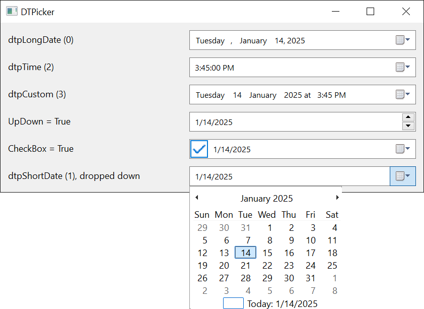

# DTPickerFormatConstants
{: .no_toc }

Selects the display format used by a [**DTPicker**](../DTPicker) control. Used by the [**DTPicker.Format**](../DTPicker#format) property.

When set to **dtpCustom**, the picker also reads [**DTPicker.CustomFormat**](../DTPicker#customformat) to control the actual display.

| Member            | Value | Description                                                            |
|-------------------|-------|------------------------------------------------------------------------|
| **dtpLongDate**{: #dtpLongDate }   | 0 | Long date format, e.g. *"Tuesday, January 14, 2025"*.   |
| **dtpShortDate**{: #dtpShortDate } | 1 | Short date format, e.g. *"1/14/2025"*.                  |
| **dtpTime**{: #dtpTime }           | 2 | Time format, e.g. *"3:45:00 PM"*.                       |
| **dtpCustom**{: #dtpCustom }       | 3 | Custom picture string from [**CustomFormat**](../DTPicker#customformat). |

{:width="561" height="409"}

## See Also

- [DTPicker](../DTPicker) -- the consuming control
