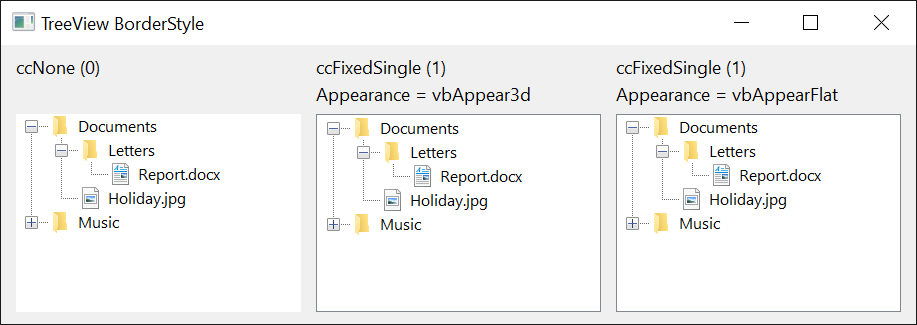

# TreeBorderStyleConstants
{: .no_toc }

The border style enumeration used by both [**TreeView.BorderStyle**](../TreeView/#borderstyle) and [**ListView.BorderStyle**](../ListView/#borderstyle). The `cc…` (common-controls) prefix reflects that the enum is shared across multiple controls in this package.

The effective rendering interacts with [**Appearance**](../../VBRUN/Constants/AppearanceConstants): when **Appearance** is **vbAppear3d** and **BorderStyle** is **ccFixedSingle**, the control gets an OS-themed 3D edge (`WS_EX_CLIENTEDGE`); when **Appearance** is **vbAppearFlat** and **BorderStyle** is **ccFixedSingle**, the control gets a single-pixel flat border (`WS_BORDER`).

| Member                | Value | Description                  |
|-----------------------|-------|------------------------------|
| **ccNone**{: #ccNone }              | 0 | No border around the control. |
| **ccFixedSingle**{: #ccFixedSingle } | 1 | Single-pixel border.          |

{:width="611" height="217"}

## See Also

- [TreeView](../TreeView/) -- consumer
- [ListView](../ListView/) -- consumer
