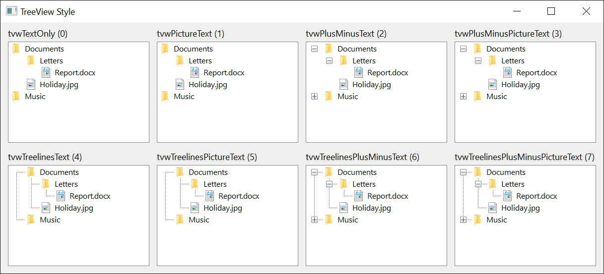

# TreeStyleConstants
{: .no_toc }

Composite visual style of a [**TreeView**](../TreeView/), encoding a 3-bit combination of which elements appear: **plus-minus** buttons, **treelines**, and **picture** icons. The labels are always shown.

Used by [**TreeView.Style**](../TreeView/#style). Default: **tvwTreelinesPlusMinusPictureText**.

The composite decoding:

| [**Style**](../TreeView/#style)                  | Buttons | Lines | Icons | Labels |
|--------------------------------------------------|---------|-------|-------|--------|
| **tvwTextOnly**                                  | ---       | ---     | ---     | yes    |
| **tvwPictureText**                               | ---       | ---     | yes   | yes    |
| **tvwPlusMinusText**                             | yes     | ---     | ---     | yes    |
| **tvwPlusMinusPictureText**                      | yes     | ---     | yes   | yes    |
| **tvwTreelinesText**                             | ---       | yes   | ---     | yes    |
| **tvwTreelinesPictureText**                      | ---       | yes   | yes   | yes    |
| **tvwTreelinesPlusMinusText**                    | yes     | yes   | ---     | yes    |
| **tvwTreelinesPlusMinusPictureText**             | yes     | yes   | yes   | yes    |

{:width="811" height="369"}

<!-- test: bug treeview-text-styles-show-pictures -->
> [!NOTE] BETA 1042
> A TreeView with an [**ImageList**](../TreeView/#imagelist) draws its nodes' pictures in every **Style**: the four styles without *Picture* in their name show them too, as the picture shows, and the nodes' text starts after them.

The enum's underlying values are 0--7, matching the order in the table.

| Member                                       | Value |
|----------------------------------------------|-------|
| **tvwTextOnly**{: #tvwTextOnly }                                       | 0 |
| **tvwPictureText**{: #tvwPictureText }                                 | 1 |
| **tvwPlusMinusText**{: #tvwPlusMinusText }                             | 2 |
| **tvwPlusMinusPictureText**{: #tvwPlusMinusPictureText }               | 3 |
| **tvwTreelinesText**{: #tvwTreelinesText }                             | 4 |
| **tvwTreelinesPictureText**{: #tvwTreelinesPictureText }               | 5 |
| **tvwTreelinesPlusMinusText**{: #tvwTreelinesPlusMinusText }           | 6 |
| **tvwTreelinesPlusMinusPictureText**{: #tvwTreelinesPlusMinusPictureText } | 7 |

## See Also

- [TreeView](../TreeView/) -- consumer
- [TreeLineStyleConstants](TreeLineStyleConstants) -- selects whether root-level lines are drawn when the **tvwTreelines…** variants are in effect
