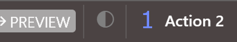

# Button class
{: .no_toc }

An addin-created toolbar button. Returned by [**Toolbar.AddButton**](Toolbar#addbutton); held via `WithEvents` to receive [**OnClick**](#onclick) notifications. The button's [**Caption**](#caption) and [**IconData**](#icondata) are mutable at run time --- the caption can reflect a state, or the icon can reflect a toggle.

```tb check_build
Private WithEvents RefreshButton As Button

Private Sub Host_OnProjectLoaded()
    Set RefreshButton = Host.Toolbars(0).AddButton("MyAddIn.Refresh", "Refresh project", _
                                                            LoadResDataInternal("refresh.png", "ICONS"))
End Sub

Private Sub RefreshButton_OnClick()
    Host.CurrentProject.Save
End Sub
```

A button with [**IconData**](#icondata) is drawn as its icon, and one without is drawn as its [**Caption**](#caption). The two buttons of the [**Toolbar**](Toolbar) page's sample, Action 1 with an icon and Action 2 without:

{:width="196" height="35"}

* TOC
{:toc}

## Properties

### Caption
{: .no_toc }

The button's caption. **String**. When [**IconData**](#icondata) is set, the caption is shown as a tooltip on hover. When [**IconData**](#icondata) is empty, the caption is shown inline as the button's text. Read / write.

Syntax: *button*.**Caption** [ = *value* ]

### IconData
{: .no_toc }

The icon graphic as a **Byte()** array --- typically the bytes of an embedded PNG / ICO resource. Pass **Empty** to remove the icon and fall back to showing the [**Caption**](#caption) inline. Read / write.

Syntax: *button*.**IconData** [ = *bytes* ]

*bytes*
: A **Byte()** array (or **Empty**). **Variant**.

### ID
{: .no_toc }

The unique ID assigned to the button when it was created via [**Toolbar.AddButton**](Toolbar#addbutton). **String**, read-only.

## Events

### OnClick
{: .no_toc }

Fires when the user clicks the button.

Syntax: *button*_**OnClick**()
