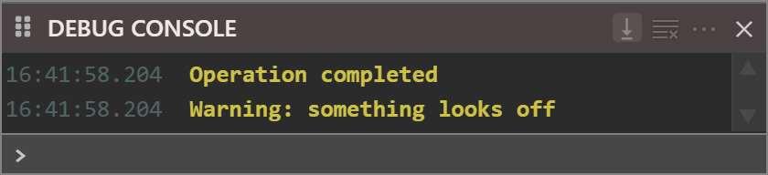

# DebugConsole class
{: .no_toc }

The IDE's DEBUG CONSOLE pane --- reached through [**Host.DebugConsole**](Host#debugconsole). The canonical place for an addin to write diagnostic and log output.

```tb check_build
With Host.DebugConsole
    .PrintText "[MyAddIn] Project: " & Host.CurrentProject.Name
    .PrintText "[MyAddIn] Compiler: " & Host.CompilerVersion
    .PrintText "[MyAddIn] PID: "      & Host.IDEProcessID
End With
```

The pane is shared across the IDE's own output and every addin's output --- prefix log lines with an addin tag (e.g. `"[MyAddIn] "`) so users can distinguish the sources.

* TOC
{:toc}

## Methods

### Clear
{: .no_toc }

Clears the entire content of the DEBUG CONSOLE pane.

Syntax: *debugConsole*.**Clear**

### PrintText
{: .no_toc }

Prints one line of text to the pane.

Syntax: *debugConsole*.**PrintText** *Prompt* [, *ColorRGB* ]

*Prompt*
: *required* The text to print. **String**.

*ColorRGB*
: *optional* The text colour as an RGB **Long** (use the `RGB(r, g, b)` function to construct one). Default 0.

```tb check_build
Host.DebugConsole.PrintText "Operation completed"                           ' default colour
Host.DebugConsole.PrintText "Warning: something looks off", RGB(255, 128, 0) ' orange
```

{:width="420" height="96"}

<!-- test: bug printtext-colorrgb-ignored -->
> [!NOTE] BETA 1042
> *ColorRGB* has no effect: every line an addin prints is drawn in the yellow of the IDE's own message lines, whatever the value, as the picture shows for the sample's orange line.

<!-- test: bug console-cleared-at-open -->
> [!WARNING] BETA 1042
> Text that an addin prints while the first project of the IDE's session loads can be erased a moment later: the IDE empties the pane a second time as the project's console options are applied. Text printed once the project has loaded stays. See the [Debug Console](../../../tB/IDE/Debugging/Debug-Console) page.

### SetFocus
{: .no_toc }

Gives keyboard focus to the DEBUG CONSOLE's text-entry point --- equivalent to the user clicking into the console.

Syntax: *debugConsole*.**SetFocus**
