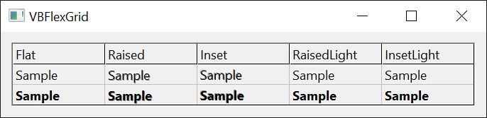

# Cells, Text and Appearance
{: .no_toc }

The 25 enumerations that the topic pages [Rows and Columns](../VBFlexGrid/Structure), [Sizes and Positions](../VBFlexGrid/Sizing), [Cell Text](../VBFlexGrid/Text), [Cell Formatting](../VBFlexGrid/CellFormatting), [Merging Cells](../VBFlexGrid/Merging) and [Appearance](../VBFlexGrid/Appearance) of the [**VBFlexGrid**](../VBFlexGrid/) control use are listed here in alphabetical order. Every enumeration is declared inside the control, and its members are written without a qualifier or with the name of the enumeration, as in `FlexAlignmentLeftTop` or `FlexAlignmentConstants.FlexAlignmentLeftTop`.

* TOC
{:toc}

## FlexAlignmentConstants

The alignment of text in a cell: a horizontal position (left, center, right or general) combined with a vertical one (top, center or bottom). It is used by the [**CellAlignment**](../VBFlexGrid/CellFormatting#cellalignment), [**ColAlignment**](../VBFlexGrid/CellFormatting#colalignment) and [**FixedAlignment**](../VBFlexGrid/CellFormatting#fixedalignment) properties.

The members whose names start with **FlexAlignmentGeneral** choose the horizontal position of each cell from its text. Text that **IsNumeric** or **IsDate** accepts is aligned to the right, any other text to the left. The [**MirrorAlignGeneral**](../VBFlexGrid/Appearance#mirroraligngeneral) property reverses that choice, which suits right-to-left reading order.

[**FixedAlignment**](../VBFlexGrid/CellFormatting#fixedalignment) also accepts -1, which is not a member: the fixed cells of the column then use [**ColAlignment**](../VBFlexGrid/CellFormatting#colalignment). [**CellAlignment**](../VBFlexGrid/CellFormatting#cellalignment) accepts -1 as well: the cell then uses the alignment of its column. **FlexAlignmentGeneral** is the alignment of a column that no code has set.

| Member | Value | Description |
|:-------|:------|:------------|
| **FlexAlignmentLeftTop**{: #FlexAlignmentLeftTop } | `0` | Left, at the top of the cell. |
| **FlexAlignmentLeftCenter**{: #FlexAlignmentLeftCenter } | `1` | Left, centered vertically. |
| **FlexAlignmentLeftBottom**{: #FlexAlignmentLeftBottom } | `2` | Left, at the bottom of the cell. |
| **FlexAlignmentCenterTop**{: #FlexAlignmentCenterTop } | `3` | Centered horizontally, at the top. |
| **FlexAlignmentCenterCenter**{: #FlexAlignmentCenterCenter } | `4` | Centered horizontally and vertically. |
| **FlexAlignmentCenterBottom**{: #FlexAlignmentCenterBottom } | `5` | Centered horizontally, at the bottom. |
| **FlexAlignmentRightTop**{: #FlexAlignmentRightTop } | `6` | Right, at the top of the cell. |
| **FlexAlignmentRightCenter**{: #FlexAlignmentRightCenter } | `7` | Right, centered vertically. |
| **FlexAlignmentRightBottom**{: #FlexAlignmentRightBottom } | `8` | Right, at the bottom of the cell. |
| **FlexAlignmentGeneral**{: #FlexAlignmentGeneral } | `9` | General: numbers and dates to the right, other text to the left, centered vertically. |
| **FlexAlignmentGeneralTop**{: #FlexAlignmentGeneralTop } | `10` | General horizontally, at the top of the cell. |
| **FlexAlignmentGeneralCenter**{: #FlexAlignmentGeneralCenter } | `11` | General horizontally, centered vertically. It does the same as **FlexAlignmentGeneral**. |
| **FlexAlignmentGeneralBottom**{: #FlexAlignmentGeneralBottom } | `12` | General horizontally, at the bottom of the cell. |

## FlexAllowUserFreezingConstants

Which kinds of rows and columns the user can freeze with the mouse. It is used by the [**AllowUserFreezing**](../VBFlexGrid/Structure#allowuserfreezing) property.

The values are bits: 1 stands for columns and 2 for rows, and **FlexAllowUserFreezingBoth** is their sum.

| Member | Value | Description |
|:-------|:------|:------------|
| **FlexAllowUserFreezingNone**{: #FlexAllowUserFreezingNone } | `0` | The user cannot freeze rows or columns. |
| **FlexAllowUserFreezingColumns**{: #FlexAllowUserFreezingColumns } | `1` | The user can freeze columns. |
| **FlexAllowUserFreezingRows**{: #FlexAllowUserFreezingRows } | `2` | The user can freeze rows. |
| **FlexAllowUserFreezingBoth**{: #FlexAllowUserFreezingBoth } | `3` | The user can freeze rows and columns. |

## FlexAllowUserResizingConstants

Which kinds of dividers the user can drag to resize columns and rows. It is used by the [**AllowUserResizing**](../VBFlexGrid/Sizing#allowuserresizing) property.

The values are bits: 1 stands for columns and 2 for rows, and **FlexAllowUserResizingBoth** is their sum.

| Member | Value | Description |
|:-------|:------|:------------|
| **FlexAllowUserResizingNone**{: #FlexAllowUserResizingNone } | `0` | The user cannot resize rows or columns. |
| **FlexAllowUserResizingColumns**{: #FlexAllowUserResizingColumns } | `1` | The user can resize columns. |
| **FlexAllowUserResizingRows**{: #FlexAllowUserResizingRows } | `2` | The user can resize rows. |
| **FlexAllowUserResizingBoth**{: #FlexAllowUserResizingBoth } | `3` | The user can resize rows and columns. |

## FlexAutoSizeModeConstants

What the [**AutoSize**](../VBFlexGrid/Sizing#autosize) method resizes: column widths or row heights.

| Member | Value | Description |
|:-------|:------|:------------|
| **FlexAutoSizeModeColWidth**{: #FlexAutoSizeModeColWidth } | `0` | Sets the widths of the columns the method names. The scope chooses which rows it measures. |
| **FlexAutoSizeModeRowHeight**{: #FlexAutoSizeModeRowHeight } | `1` | Sets the heights of the rows the method names. The scope chooses which columns it measures. |

## FlexAutoSizeScopeConstants

Which cells the [**AutoSize**](../VBFlexGrid/Sizing#autosize) method measures when it sets a column width or a row height.

In column mode ([**FlexAutoSizeModeConstants**](#flexautosizemodeconstants)) the scope selects rows, and in row mode it selects columns. The description of each member names the rows; the columns follow the same rule.

| Member | Value | Description |
|:-------|:------|:------------|
| **FlexAutoSizeScopeAll**{: #FlexAutoSizeScopeAll } | `0` | All rows. |
| **FlexAutoSizeScopeFixed**{: #FlexAutoSizeScopeFixed } | `1` | The fixed rows only. |
| **FlexAutoSizeScopeScrollable**{: #FlexAutoSizeScopeScrollable } | `2` | The rows after the fixed rows and the frozen rows, which scroll. |
| **FlexAutoSizeScopeMovable**{: #FlexAutoSizeScopeMovable } | `3` | The frozen rows and the scrollable rows, which together are every row after the fixed rows. |
| **FlexAutoSizeScopeFrozen**{: #FlexAutoSizeScopeFrozen } | `4` | The frozen rows only. |

## FlexBestFitModeConstants

What [**AutoSize**](../VBFlexGrid/Sizing#autosize) and the format string count besides the text when they compute the best size of a cell. It is used by the [**BestFitMode**](../VBFlexGrid/Sizing#bestfitmode) property.

The cell contents that the modes add are the combo cue, a picture aligned with one of the no-overlap alignments, a check box aligned at the left or the right of the cell, and the sort arrow in the fixed row that [**RowSortArrows**](../VBFlexGrid/SortingAndSearching#rowsortarrows) names.

| Member | Value | Description |
|:-------|:------|:------------|
| **FlexBestFitModeTextOnly**{: #FlexBestFitModeTextOnly } | `0` | Only the text counts. This is the default. |
| **FlexBestFitModeFull**{: #FlexBestFitModeFull } | `1` | The text, the combo cue, the picture, the check box and the sort arrow. |
| **FlexBestFitModeSortArrowText**{: #FlexBestFitModeSortArrowText } | `2` | The text and the sort arrow. |
| **FlexBestFitModeOtherText**{: #FlexBestFitModeOtherText } | `3` | The text, the combo cue, the picture and the check box, but not the sort arrow. |

## FlexBorderStyleConstants

The border around the control. It is used by the [**BorderStyle**](../VBFlexGrid/Appearance#borderstyle) property.

The members select Windows window border styles.

| Member | Value | Description |
|:-------|:------|:------------|
| **FlexBorderStyleNone**{: #FlexBorderStyleNone } | `0` | No border. |
| **FlexBorderStyleSingle**{: #FlexBorderStyleSingle } | `1` | A thin single-line border. |
| **FlexBorderStyleThin**{: #FlexBorderStyleThin } | `2` | A thin three-dimensional border (the static edge style). |
| **FlexBorderStyleSunken**{: #FlexBorderStyleSunken } | `3` | A sunken border (the client edge style). This is the default. |
| **FlexBorderStyleRaised**{: #FlexBorderStyleRaised } | `4` | A raised border (the window edge style with a dialog frame). |

## FlexCellSettings

The cell settings that the [**Cell**](../VBFlexGrid/Text#cell) property reads and writes for any cell or range of cells, without selecting it.

Each member names the cell property whose value the [**Cell**](../VBFlexGrid/Text#cell) property reads or writes. For most members, a range of cells (the **RowSel** and **ColSel** arguments) gets the same value in every cell, as when [**FillStyle**](../VBFlexGrid/CellFormatting#fillstyle) is **FlexFillStyleRepeat**.

A member that cannot be read or cannot be written raises an error: **FlexCellSort** raises 394 when read, and **FlexCellLeft**, **FlexCellTop**, **FlexCellWidth**, **FlexCellHeight**, **FlexCellTextDisplay** and **FlexCellTextHidden** raise 383 when written. A value that is not a member raises 380. **FlexCellPicture** and **FlexCellTag** are the two members that accept an object, which is assigned with **Set**.

| Member | Value | Description |
|:-------|:------|:------------|
| **FlexCellText**{: #FlexCellText } | `0` | The text of the cell: [**Text**](../VBFlexGrid/Text#text). |
| **FlexCellClip**{: #FlexCellClip } | `1` | The contents of the cells as a clip string: [**Clip**](../VBFlexGrid/ClipboardAndArrays#clip). |
| **FlexCellTextStyle**{: #FlexCellTextStyle } | `2` | The 3D effect of the text: [**CellTextStyle**](../VBFlexGrid/CellFormatting#celltextstyle). |
| **FlexCellAlignment**{: #FlexCellAlignment } | `3` | The alignment of the text: [**CellAlignment**](../VBFlexGrid/CellFormatting#cellalignment). |
| **FlexCellPicture**{: #FlexCellPicture } | `4` | The picture of the cell: [**CellPicture**](../VBFlexGrid/CellFormatting#cellpicture). |
| **FlexCellPictureAlignment**{: #FlexCellPictureAlignment } | `5` | The alignment of the picture: [**CellPictureAlignment**](../VBFlexGrid/CellFormatting#cellpicturealignment). |
| **FlexCellBackColor**{: #FlexCellBackColor } | `6` | The background color: [**CellBackColor**](../VBFlexGrid/CellFormatting#cellbackcolor). |
| **FlexCellForeColor**{: #FlexCellForeColor } | `7` | The text color: [**CellForeColor**](../VBFlexGrid/CellFormatting#cellforecolor). |
| **FlexCellToolTipText**{: #FlexCellToolTipText } | `8` | The tool tip of the cell: [**CellToolTipText**](../VBFlexGrid/Text#celltooltiptext). |
| **FlexCellComboCue**{: #FlexCellComboCue } | `9` | The combo cue of the cell: [**CellComboCue**](../VBFlexGrid/ComboEditing#cellcombocue). |
| **FlexCellChecked**{: #FlexCellChecked } | `10` | The check box state: [**CellChecked**](../VBFlexGrid/CheckBoxes#cellchecked). |
| **FlexCellFloodPercent**{: #FlexCellFloodPercent } | `11` | The percentage of the cell that the flood bar fills, from -100 to 100; a negative value fills the cell from the right: [**CellFloodPercent**](../VBFlexGrid/CellFormatting#cellfloodpercent). |
| **FlexCellFloodColor**{: #FlexCellFloodColor } | `12` | The color of the flood bar: [**CellFloodColor**](../VBFlexGrid/CellFormatting#cellfloodcolor). |
| **FlexCellFontName**{: #FlexCellFontName } | `13` | The font name: [**CellFontName**](../VBFlexGrid/CellFormatting#cellfontname). |
| **FlexCellFontSize**{: #FlexCellFontSize } | `14` | The font size: [**CellFontSize**](../VBFlexGrid/CellFormatting#cellfontsize). |
| **FlexCellFontBold**{: #FlexCellFontBold } | `15` | The bold attribute: [**CellFontBold**](../VBFlexGrid/CellFormatting#cellfontbold). |
| **FlexCellFontItalic**{: #FlexCellFontItalic } | `16` | The italic attribute: [**CellFontItalic**](../VBFlexGrid/CellFormatting#cellfontitalic). |
| **FlexCellFontStrikeThrough**{: #FlexCellFontStrikeThrough } | `17` | The strikethrough attribute: [**CellFontStrikeThrough**](../VBFlexGrid/CellFormatting#cellfontstrikethrough). |
| **FlexCellFontUnderline**{: #FlexCellFontUnderline } | `18` | The underline attribute: [**CellFontUnderline**](../VBFlexGrid/CellFormatting#cellfontunderline). |
| **FlexCellFontCharset**{: #FlexCellFontCharset } | `19` | The font character set: [**CellFontCharset**](../VBFlexGrid/CellFormatting#cellfontcharset). |
| **FlexCellLeft**{: #FlexCellLeft } | `20` | The left edge of the cell: [**CellLeft**](../VBFlexGrid/Sizing#cellleft). Read-only. |
| **FlexCellTop**{: #FlexCellTop } | `21` | The top edge of the cell: [**CellTop**](../VBFlexGrid/Sizing#celltop). Read-only. |
| **FlexCellWidth**{: #FlexCellWidth } | `22` | The width of the cell: [**CellWidth**](../VBFlexGrid/Sizing#cellwidth). Read-only. |
| **FlexCellHeight**{: #FlexCellHeight } | `23` | The height of the cell: [**CellHeight**](../VBFlexGrid/Sizing#cellheight). Read-only. |
| **FlexCellSort**{: #FlexCellSort } | `24` | Sorts the rows by the column of the cell or range, with the sort order that is written: [**Sort**](../VBFlexGrid/SortingAndSearching#sort). Write-only. |
| **FlexCellTextDisplay**{: #FlexCellTextDisplay } | `25` | The text as the cell displays it, after the column's lookup and format string are applied. Read-only. |
| **FlexCellTextHidden**{: #FlexCellTextHidden } | `26` | **True** when the cell does not draw its text, because an image of the column's image list is drawn instead or because the text stands for a check box (**FlexTextAsCheckBox**). Read-only. |
| **FlexCellHasCustomFormatting**{: #FlexCellHasCustomFormatting } | `27` | Whether the cell has memory allocated for custom formatting: [**CellHasCustomFormatting**](../VBFlexGrid/CellFormatting#cellhascustomformatting). Writing **False** frees it. |
| **FlexCellHasTag**{: #FlexCellHasTag } | `28` | Whether the cell has memory allocated for a tag: [**CellHasTag**](../VBFlexGrid/Text#cellhastag). Writing **False** frees it. |
| **FlexCellTag**{: #FlexCellTag } | `29` | The tag of the cell: [**CellTag**](../VBFlexGrid/Text#celltag). |

Writing and reading settings of cells that are not the current cell, and the errors that read-only and write-only members raise:

```tb check_build check_run arch=win32,win64
With VBFlexGrid1
    .Rows = 3
    .Cols = 3
    .Cell(FlexCellText, 1, 1) = "x"
    Debug.Print .TextMatrix(1, 1) ' x
    .Cell(FlexCellText, 1, 1, 2, 2) = "z"
    Debug.Print .TextMatrix(1, 2); .TextMatrix(2, 1); .TextMatrix(2, 2) ' zzz
    On Error Resume Next
    .Cell(FlexCellWidth, 1, 1) = 100
    Debug.Print Err.Number ' 383
    Err.Clear
    Debug.Print .Cell(FlexCellSort, 1, 1)
    Debug.Print Err.Number ' 394
End With
```

## FlexClearWhatConstants

What the [**Clear**](../VBFlexGrid/Structure#clear) method clears in the cells that the area names.

| Member | Value | Description |
|:-------|:------|:------------|
| **FlexClearEverything**{: #FlexClearEverything } | `0` | The text, the formatting and the tag. A grid with a custom data source (**FlexDataSource**) raises error 5 for this member. |
| **FlexClearText**{: #FlexClearText } | `1` | The text only. |
| **FlexClearFormatting**{: #FlexClearFormatting } | `2` | The cell formatting only (colors, fonts, alignment, picture, flood bar, tool tip, combo cue and check box state). It frees the memory that formatting uses. |
| **FlexClearTag**{: #FlexClearTag } | `3` | The tag only. It frees the memory that tags use. |

## FlexClearWhereConstants

The area of the grid that the [**Clear**](../VBFlexGrid/Structure#clear) method clears.

| Member | Value | Description |
|:-------|:------|:------------|
| **FlexClearEverywhere**{: #FlexClearEverywhere } | `0` | All cells. |
| **FlexClearFixed**{: #FlexClearFixed } | `1` | The fixed rows and the fixed columns. |
| **FlexClearScrollable**{: #FlexClearScrollable } | `2` | The cells after the fixed and the frozen rows and columns, which scroll. |
| **FlexClearMovable**{: #FlexClearMovable } | `3` | The frozen and the scrollable cells, which together are every cell after the fixed rows and columns. |
| **FlexClearFrozen**{: #FlexClearFrozen } | `4` | The frozen rows and columns. |
| **FlexClearSelection**{: #FlexClearSelection } | `5` | The selected cells. |
| **FlexClearClip**{: #FlexClearClip } | `6` | The cells of the selection. When [**ClipPasteMode**](../VBFlexGrid/ClipboardAndArrays#clippastemode) is **FlexClipPasteModeExtended** or higher, the selection is extended to whole rows in **FlexSelectionModeFreeByRow** and to whole columns in **FlexSelectionModeFreeByColumn**, and with [**AllowMultiSelection**](../VBFlexGrid/Selection#allowmultiselection) every selected row is cleared. The [**Delete**](../VBFlexGrid/ClipboardAndArrays#delete) method uses it. |

## FlexEllipsisFormatConstants

How text that does not fit in its cell is shortened with an ellipsis. It is used by the [**EllipsisFormat**](../VBFlexGrid/Text#ellipsisformat) and [**EllipsisFormatFixed**](../VBFlexGrid/Text#ellipsisformatfixed) properties.

For a column that has not set its own [**ColWordWrapOption**](../VBFlexGrid/Text#colwordwrapoption), the setting is one of the three, with [**WordWrap**](../VBFlexGrid/Text#wordwrap) and [**SingleLine**](../VBFlexGrid/Text#singleline), from which the column's member of [**FlexWordWrapOptions**](#flexwordwrapoptions) is made. The members are the Windows text formats of the same names.

| Member | Value | Description |
|:-------|:------|:------------|
| **FlexEllipsisFormatNone**{: #FlexEllipsisFormatNone } | `0` | No ellipsis. This is the default. |
| **FlexEllipsisFormatEnd**{: #FlexEllipsisFormatEnd } | `1` | The text is cut at the end and finished with an ellipsis. |
| **FlexEllipsisFormatPath**{: #FlexEllipsisFormatPath } | `2` | The ellipsis replaces characters in the middle, so that the end of a path stays visible. |
| **FlexEllipsisFormatWord**{: #FlexEllipsisFormatWord } | `3` | A word that does not fit is cut and finished with an ellipsis. |

## FlexFillStyleConstants

Whether setting a cell property applies to the current cell or to every selected cell. It is used by the [**FillStyle**](../VBFlexGrid/CellFormatting#fillstyle) property.

The [**Cell**](../VBFlexGrid/Text#cell) property sets this value itself while it works, to **FlexFillStyleRepeat** for a range and to **FlexFillStyleSingle** for one cell, and restores it afterwards.

| Member | Value | Description |
|:-------|:------|:------------|
| **FlexFillStyleSingle**{: #FlexFillStyleSingle } | `0` | Only the current cell changes. This is the default. |
| **FlexFillStyleRepeat**{: #FlexFillStyleRepeat } | `1` | Every selected cell changes. |

## FlexFontQualityConstants

How the fonts of the grid are rendered. The members have the values of the Windows font qualities. It is used by the [**FontQuality**](../VBFlexGrid/Appearance#fontquality) property.


| Member | Value | Description |
|:-------|:------|:------------|
| **FlexFontQualityDefault**{: #FlexFontQualityDefault } | `0` | Windows chooses. This is the default. |
| **FlexFontQualityDraft**{: #FlexFontQualityDraft } | `1` | Draft quality: appearance matters less than with proof quality. |
| **FlexFontQualityProof**{: #FlexFontQualityProof } | `2` | Proof quality: the exactness of the character shapes matters more than the exactness of the size. |
| **FlexFontQualityNonAntiAliased**{: #FlexFontQualityNonAntiAliased } | `3` | Text is never smoothed. |
| **FlexFontQualityAntiAliased**{: #FlexFontQualityAntiAliased } | `4` | Text is smoothed when the font and size support it. |
| **FlexFontQualityClearType**{: #FlexFontQualityClearType } | `5` | Text is smoothed with ClearType. |
| **FlexFontQualityClearTypeNatural**{: #FlexFontQualityClearTypeNatural } | `6` | Text is smoothed with natural ClearType, which keeps the character shapes closer to the font. |

## FlexGridLineConstants

The type of the lines between cells, and whether they run in both directions or in one only. It is used by the [**GridLines**](../VBFlexGrid/Appearance#gridlines), [**GridLinesFixed**](../VBFlexGrid/Appearance#gridlinesfixed) and [**GridLinesFrozen**](../VBFlexGrid/Appearance#gridlinesfrozen) properties.

The members without a suffix draw horizontal and vertical lines, the members ending in **Horz** only horizontal ones, and those ending in **Vert** only vertical ones. Flat, dashed and dotted lines have the color of the matching grid color property. The inset and raised lines are drawn in two colors, black and white, to look sunken or raised, and ignore the color property. The default is **FlexGridLineFlat** for the scrollable and the frozen cells and **FlexGridLineInset** for the fixed cells.

| Member | Value | Description |
|:-------|:------|:------------|
| **FlexGridLineNone**{: #FlexGridLineNone } | `0` | No lines. |
| **FlexGridLineFlat**{: #FlexGridLineFlat } | `1` | Solid lines. |
| **FlexGridLineInset**{: #FlexGridLineInset } | `2` | Sunken lines. |
| **FlexGridLineRaised**{: #FlexGridLineRaised } | `3` | Raised lines. |
| **FlexGridLineDashes**{: #FlexGridLineDashes } | `4` | Dashed lines. |
| **FlexGridLineDots**{: #FlexGridLineDots } | `5` | Dotted lines. |
| **FlexGridLineFlatHorz**{: #FlexGridLineFlatHorz } | `6` | Solid horizontal lines. |
| **FlexGridLineInsetHorz**{: #FlexGridLineInsetHorz } | `7` | Sunken horizontal lines. |
| **FlexGridLineRaisedHorz**{: #FlexGridLineRaisedHorz } | `8` | Raised horizontal lines. |
| **FlexGridLineDashesHorz**{: #FlexGridLineDashesHorz } | `9` | Dashed horizontal lines. |
| **FlexGridLineDotsHorz**{: #FlexGridLineDotsHorz } | `10` | Dotted horizontal lines. |
| **FlexGridLineFlatVert**{: #FlexGridLineFlatVert } | `11` | Solid vertical lines. |
| **FlexGridLineInsetVert**{: #FlexGridLineInsetVert } | `12` | Sunken vertical lines. |
| **FlexGridLineRaisedVert**{: #FlexGridLineRaisedVert } | `13` | Raised vertical lines. |
| **FlexGridLineDashesVert**{: #FlexGridLineDashesVert } | `14` | Dashed vertical lines. |
| **FlexGridLineDotsVert**{: #FlexGridLineDotsVert } | `15` | Dotted vertical lines. |

{:width="709" height="259"}

## FlexLookupConvConstants

The direction of a lookup conversion that [**LookupConv**](../VBFlexGrid/Text#lookupconv) makes.

A lookup maps keys, which a database stores, to values, which the user reads; [**ColLookup**](../VBFlexGrid/Text#collookup) defines it for a column.

| Member | Value | Description |
|:-------|:------|:------------|
| **FlexLookupConvValue**{: #FlexLookupConvValue } | `0` | Converts a key to its value. The key matches without regard to case. |
| **FlexLookupConvKey**{: #FlexLookupConvKey } | `1` | Converts a value to its key. The value matches exactly, with regard to case. |

Converting in both directions with a lookup of two entries:

```tb check_build check_run arch=win32,win64
With VBFlexGrid1
    .ColLookup(1) = "1;One|2;Two"
    Debug.Print .LookupConv("2", FlexLookupConvValue, 1) ' Two
    Debug.Print .LookupConv("One", FlexLookupConvKey, 1) ' 1
End With
```

## FlexMergeCellsConstants

Which neighbouring cells with the same content the grid merges into one. It is used by the [**MergeCells**](../VBFlexGrid/Merging#mergecells) property.

Merging applies only to the rows and columns that [**MergeRow**](../VBFlexGrid/Merging#mergerow) and [**MergeCol**](../VBFlexGrid/Merging#mergecol) switch on. Cells in a row merge when each has the same content as its left neighbour, and cells in a column merge when each has the same content as its upper neighbour. In the restricted modes, two cells merge in one direction only if the cells beside them are equal as well, so that merged blocks look like a hierarchy: **FlexMergeCellsRestrictRows** restricts the merging within columns, and **FlexMergeCellsRestrictColumns** the merging within rows.

| Member | Value | Description |
|:-------|:------|:------------|
| **FlexMergeCellsNever**{: #FlexMergeCellsNever } | `0` | No merging. This is the default. |
| **FlexMergeCellsFree**{: #FlexMergeCellsFree } | `1` | Merge within the rows and within the columns that are switched on. |
| **FlexMergeCellsRestrictRows**{: #FlexMergeCellsRestrictRows } | `2` | Rows merge freely. Two cells of a column merge only if the cells to the left of them are equal too. |
| **FlexMergeCellsRestrictColumns**{: #FlexMergeCellsRestrictColumns } | `3` | Columns merge freely. Two cells of a row merge only if the cells above them are equal too. |
| **FlexMergeCellsRestrictAll**{: #FlexMergeCellsRestrictAll } | `4` | Both restrictions: those of **FlexMergeCellsRestrictRows** and of **FlexMergeCellsRestrictColumns**. |
| **FlexMergeCellsFixedOnly**{: #FlexMergeCellsFixedOnly } | `5` | Merge freely, but only the fixed rows and fixed columns. |

{:width="336" height="189"}

## FlexMetricConstants

The size metric that [**GetMetrics**](../VBFlexGrid/Sizing#getmetrics) returns.

[**GetMetrics**](../VBFlexGrid/Sizing#getmetrics) returns the horizontal size in its **CX** argument and the vertical size in its **CY** argument, in twips. The control defines every metric except the size of a scroll bar, which comes from Windows, in device-independent pixels (the sizes in the descriptions) and converts them for the DPI of the display.

| Member | Value | Description |
|:-------|:------|:------------|
| **FlexMetricDividerSpacing**{: #FlexMetricDividerSpacing } | `0` | The distance from the edge of a cell within which a hit counts as on the divider (2 device-independent pixels in both directions). |
| **FlexMetricTextPadding**{: #FlexMetricTextPadding } | `1` | The space between the edge of a cell and its text (3 device-independent pixels horizontally, 1 vertically). |
| **FlexMetricCellSpacing**{: #FlexMetricCellSpacing } | `2` | The space that [**AutoSize**](../VBFlexGrid/Sizing#autosize) adds to the text size of the best fit (6 device-independent pixels horizontally, 3 vertically). |
| **FlexMetricScrollBarSize**{: #FlexMetricScrollBarSize } | `3` | The size of a scroll bar, which is also the width of a drop-down arrow. |
| **FlexMetricCheckBoxSize**{: #FlexMetricCheckBoxSize } | `4` | The size of a check box (13 device-independent pixels in both directions). |

## FlexMimicTextBoxConstants

Whether a column draws its text the way a multi-line text box does. It is used by the [**ColMimicTextBox**](../VBFlexGrid/Text#colmimictextbox) and [**ColMimicTextBoxFixed**](../VBFlexGrid/Text#colmimictextboxfixed) properties.

Mimicking a text box draws the text with the Windows `DT_EDITCONTROL` format, as a multi-line text box draws it: the average character width is calculated as a text box calculates it, and a last line that would show only in part is left out. [**MimicTextBox**](../VBFlexGrid/Text#mimictextbox) is the setting for the whole grid, and the column properties accept -1 in addition, which is not a member and means the grid's setting.

| Member | Value | Description |
|:-------|:------|:------------|
| **FlexMimicTextBoxOn**{: #FlexMimicTextBoxOn } | `0` | The column draws its text like a text box. |
| **FlexMimicTextBoxOff**{: #FlexMimicTextBoxOff } | `1` | The column draws its text in the normal way. [**MimicTextBox**](../VBFlexGrid/Text#mimictextbox) is **False** by default. |

## FlexPictureAlignmentConstants

Where the picture of a cell is drawn relative to the cell and to its text. It is used by the [**CellPictureAlignment**](../VBFlexGrid/CellFormatting#cellpicturealignment) property.

The nine positions place the picture over the cell, and the text is drawn over the picture. The **NoOverlap** members place the picture at the left or right edge and take the width it needs from the text area, so that the text and the picture do not cover each other; there is no centered no-overlap member, so the numbers 23 to 25 are not used. Best fit ([**BestFitMode**](../VBFlexGrid/Sizing#bestfitmode)) counts the width of a no-overlap picture.

| Member | Value | Description |
|:-------|:------|:------------|
| **FlexPictureAlignmentLeftTop**{: #FlexPictureAlignmentLeftTop } | `0` | At the left, at the top of the cell. |
| **FlexPictureAlignmentLeftCenter**{: #FlexPictureAlignmentLeftCenter } | `1` | At the left, centered vertically. |
| **FlexPictureAlignmentLeftBottom**{: #FlexPictureAlignmentLeftBottom } | `2` | At the left, at the bottom of the cell. |
| **FlexPictureAlignmentCenterTop**{: #FlexPictureAlignmentCenterTop } | `3` | Centered horizontally, at the top. |
| **FlexPictureAlignmentCenterCenter**{: #FlexPictureAlignmentCenterCenter } | `4` | Centered horizontally and vertically. |
| **FlexPictureAlignmentCenterBottom**{: #FlexPictureAlignmentCenterBottom } | `5` | Centered horizontally, at the bottom. |
| **FlexPictureAlignmentRightTop**{: #FlexPictureAlignmentRightTop } | `6` | At the right, at the top of the cell. |
| **FlexPictureAlignmentRightCenter**{: #FlexPictureAlignmentRightCenter } | `7` | At the right, centered vertically. |
| **FlexPictureAlignmentRightBottom**{: #FlexPictureAlignmentRightBottom } | `8` | At the right, at the bottom of the cell. |
| **FlexPictureAlignmentStretch**{: #FlexPictureAlignmentStretch } | `9` | Stretched to fill the cell. |
| **FlexPictureAlignmentTile**{: #FlexPictureAlignmentTile } | `10` | Repeated to fill the cell. |
| **FlexPictureAlignmentLeftTopNoOverlap**{: #FlexPictureAlignmentLeftTopNoOverlap } | `20` | At the left, at the top, beside the text. |
| **FlexPictureAlignmentLeftCenterNoOverlap**{: #FlexPictureAlignmentLeftCenterNoOverlap } | `21` | At the left, centered vertically, beside the text. |
| **FlexPictureAlignmentLeftBottomNoOverlap**{: #FlexPictureAlignmentLeftBottomNoOverlap } | `22` | At the left, at the bottom, beside the text. |
| **FlexPictureAlignmentRightTopNoOverlap**{: #FlexPictureAlignmentRightTopNoOverlap } | `26` | At the right, at the top, beside the text. |
| **FlexPictureAlignmentRightCenterNoOverlap**{: #FlexPictureAlignmentRightCenterNoOverlap } | `27` | At the right, centered vertically, beside the text. |
| **FlexPictureAlignmentRightBottomNoOverlap**{: #FlexPictureAlignmentRightBottomNoOverlap } | `28` | At the right, at the bottom, beside the text. |

## FlexPictureTypeConstants

The kind of picture that the [**Picture**](../VBFlexGrid/Appearance#picture) property creates from the grid. It is used by the [**PictureType**](../VBFlexGrid/Appearance#picturetype) property.

The setting also decides how the grid renders itself for a page print (the **VP_FORMATRANGE** message).

| Member | Value | Description |
|:-------|:------|:------------|
| **FlexPictureTypeColor**{: #FlexPictureTypeColor } | `0` | A color bitmap. This is the default. |
| **FlexPictureTypeMonochrome**{: #FlexPictureTypeMonochrome } | `1` | A black and white bitmap. |
| **FlexPictureTypeEnhMetafile**{: #FlexPictureTypeEnhMetafile } | `2` | An enhanced metafile, which scales better when it is painted on a printer. |

## FlexRightToLeftModeConstants

How the [**RightToLeft**](../VBFlexGrid/Appearance#righttoleft) property decides whether the control reads and lays out from right to left. It is used by the [**RightToLeftMode**](../VBFlexGrid/Appearance#righttoleftmode) property.

The setting matters only while [**RightToLeft**](../VBFlexGrid/Appearance#righttoleft) is **True**. The three locale members then keep it **True** only when the chosen locale's language reads from right to left; otherwise it turns **False**.

| Member | Value | Description |
|:-------|:------|:------------|
| **FlexRightToLeftModeNoControl**{: #FlexRightToLeftModeNoControl } | `0` | [**RightToLeft**](../VBFlexGrid/Appearance#righttoleft) is used as set. |
| **FlexRightToLeftModeVBAME**{: #FlexRightToLeftModeVBAME } | `1` | [**RightToLeft**](../VBFlexGrid/Appearance#righttoleft) takes the value that the user control keeps after it is set, which is the behavior of the Middle East edition of VB and VBA. This is the default. |
| **FlexRightToLeftModeSystemLocale**{: #FlexRightToLeftModeSystemLocale } | `2` | The system default locale decides. |
| **FlexRightToLeftModeUserLocale**{: #FlexRightToLeftModeUserLocale } | `3` | The default locale of the user decides. |
| **FlexRightToLeftModeOSLanguage**{: #FlexRightToLeftModeOSLanguage } | `4` | The user interface language of Windows decides. |

## FlexRowSizingModeConstants

What happens to the other rows when the user resizes one row with the mouse. It is used by the [**RowSizingMode**](../VBFlexGrid/Sizing#rowsizingmode) property.

| Member | Value | Description |
|:-------|:------|:------------|
| **FlexRowSizingModeIndividual**{: #FlexRowSizingModeIndividual } | `0` | Only the row that the user resizes changes. This is the default. |
| **FlexRowSizingModeAll**{: #FlexRowSizingModeAll } | `1` | Every row gets the new height. |
| **FlexRowSizingModeUniform**{: #FlexRowSizingModeUniform } | `2` | The new height becomes [**RowHeightUniform**](../VBFlexGrid/Sizing#rowheightuniform), which applies to every row that has no height of its own. |

## FlexTextStyleConstants

The 3D effect of the text in a cell. It is used by the [**CellTextStyle**](../VBFlexGrid/CellFormatting#celltextstyle), [**TextStyle**](../VBFlexGrid/Appearance#textstyle) and [**TextStyleFixed**](../VBFlexGrid/Appearance#textstylefixed) properties.

The effects are made by drawing the text again, offset by one pixel, in gray or white. The raised and inset styles add a gray or white shadow, and the light styles add a white one only.

| Member | Value | Description |
|:-------|:------|:------------|
| **FlexTextStyleFlat**{: #FlexTextStyleFlat } | `0` | Plain text. This is the default. |
| **FlexTextStyleRaised**{: #FlexTextStyleRaised } | `1` | Raised: a white highlight at the upper left and a gray shadow at the lower right. |
| **FlexTextStyleInset**{: #FlexTextStyleInset } | `2` | Sunken: a gray shadow at the upper left and a white highlight at the lower right. |
| **FlexTextStyleRaisedLight**{: #FlexTextStyleRaisedLight } | `3` | Raised, with the white highlight at the upper left only. |
| **FlexTextStyleInsetLight**{: #FlexTextStyleInsetLight } | `4` | Sunken, with the white highlight at the lower right only. |

{:width="457" height="111"}

## FlexWallPaperAlignmentConstants

Where the wallpaper picture is drawn in the area of the grid that is not fixed. It is used by the [**WallPaperAlignment**](../VBFlexGrid/Appearance#wallpaperalignment) property.

| Member | Value | Description |
|:-------|:------|:------------|
| **FlexWallPaperAlignmentLeftTop**{: #FlexWallPaperAlignmentLeftTop } | `0` | At the upper left. |
| **FlexWallPaperAlignmentLeftCenter**{: #FlexWallPaperAlignmentLeftCenter } | `1` | At the left, centered vertically. |
| **FlexWallPaperAlignmentLeftBottom**{: #FlexWallPaperAlignmentLeftBottom } | `2` | At the lower left. |
| **FlexWallPaperAlignmentCenterTop**{: #FlexWallPaperAlignmentCenterTop } | `3` | Centered horizontally, at the top. |
| **FlexWallPaperAlignmentCenterCenter**{: #FlexWallPaperAlignmentCenterCenter } | `4` | In the center. |
| **FlexWallPaperAlignmentCenterBottom**{: #FlexWallPaperAlignmentCenterBottom } | `5` | Centered horizontally, at the bottom. |
| **FlexWallPaperAlignmentRightTop**{: #FlexWallPaperAlignmentRightTop } | `6` | At the upper right. |
| **FlexWallPaperAlignmentRightCenter**{: #FlexWallPaperAlignmentRightCenter } | `7` | At the right, centered vertically. |
| **FlexWallPaperAlignmentRightBottom**{: #FlexWallPaperAlignmentRightBottom } | `8` | At the lower right. |
| **FlexWallPaperAlignmentStretch**{: #FlexWallPaperAlignmentStretch } | `9` | Stretched to fill the area. This is the default. |
| **FlexWallPaperAlignmentTile**{: #FlexWallPaperAlignmentTile } | `10` | Repeated to fill the area. |

## FlexWordWrapOptions

How a column breaks its text into lines and shortens text that does not fit. It is used by the [**ColWordWrapOption**](../VBFlexGrid/Text#colwordwrapoption) and [**ColWordWrapOptionFixed**](../VBFlexGrid/Text#colwordwrapoptionfixed) properties.

Each member combines up to two choices: word break or single line (not both), and an ellipsis format. **FlexWordWrapNone** means a plain draw that neither breaks words nor limits the text to one line, so the text breaks only at the line breaks it contains.

A column that has not set its own option reports the one that [**WordWrap**](../VBFlexGrid/Text#wordwrap), [**SingleLine**](../VBFlexGrid/Text#singleline) and [**EllipsisFormat**](../VBFlexGrid/Text#ellipsisformat) give together, so that reading [**ColWordWrapOption**](../VBFlexGrid/Text#colwordwrapoption) always returns a member. Writing -1, which is not a member, goes back to that. The fixed cells of the column have [**ColWordWrapOptionFixed**](../VBFlexGrid/Text#colwordwrapoptionfixed) in the same way.

| Member | Value | Description |
|:-------|:------|:------------|
| **FlexWordWrapNone**{: #FlexWordWrapNone } | `0` | No word break, no single line, no ellipsis. |
| **FlexWordBreak**{: #FlexWordBreak } | `1` | Breaks the text into lines at words. |
| **FlexSingleLine**{: #FlexSingleLine } | `2` | Shows the text on one line and ignores line breaks. |
| **FlexEndEllipsis**{: #FlexEndEllipsis } | `3` | No word break; text that does not fit is cut at the end with an ellipsis. |
| **FlexPathEllipsis**{: #FlexPathEllipsis } | `4` | No word break; the ellipsis replaces characters in the middle, as for a path. |
| **FlexWordEllipsis**{: #FlexWordEllipsis } | `5` | No word break; a word that does not fit is cut with an ellipsis. |
| **FlexWordBreakEndEllipsis**{: #FlexWordBreakEndEllipsis } | `6` | Word break, with an end ellipsis. |
| **FlexWordBreakPathEllipsis**{: #FlexWordBreakPathEllipsis } | `7` | Word break, with a path ellipsis. |
| **FlexWordBreakWordEllipsis**{: #FlexWordBreakWordEllipsis } | `8` | Word break, with a word ellipsis. |
| **FlexSingleLineEndEllipsis**{: #FlexSingleLineEndEllipsis } | `9` | Single line, with an end ellipsis. |
| **FlexSingleLinePathEllipsis**{: #FlexSingleLinePathEllipsis } | `10` | Single line, with a path ellipsis. |
| **FlexSingleLineWordEllipsis**{: #FlexSingleLineWordEllipsis } | `11` | Single line, with a word ellipsis. |

{:width="364" height="145"}

A column that sets no option reports the combination of the grid's properties:

```tb check_build check_run arch=win32,win64
With VBFlexGrid1
    .WordWrap = True
    .EllipsisFormat = FlexEllipsisFormatEnd
    Debug.Print .ColWordWrapOption(0) = FlexWordBreakEndEllipsis ' True
    .ColWordWrapOption(0) = FlexSingleLine
    Debug.Print .ColWordWrapOption(0) ' 2
    .ColWordWrapOption(0) = -1
    Debug.Print .ColWordWrapOption(0) ' 6
End With
```
