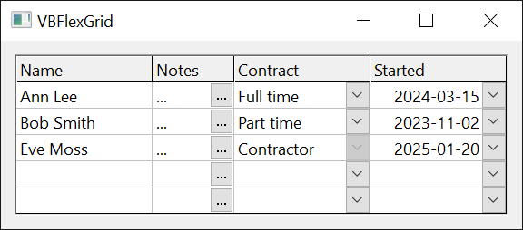
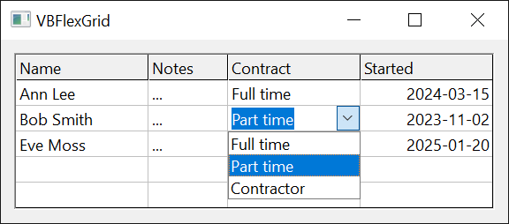
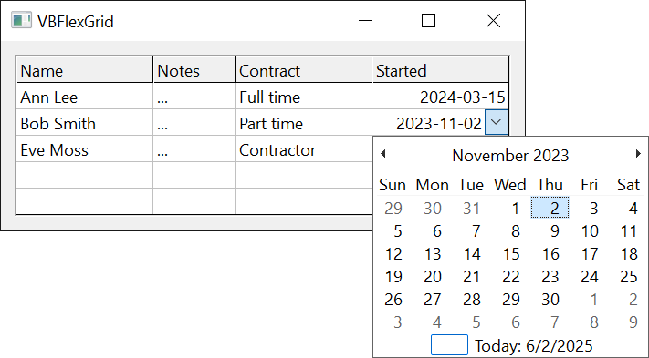

# Editing, Combo Boxes and Check Boxes
{: .no_toc }

The 13 enumerations that the topic pages [Editing Cells](../VBFlexGrid/Editing), [Drop-Down Lists, Buttons and Calendars](../VBFlexGrid/ComboEditing), [Check Boxes](../VBFlexGrid/CheckBoxes) and [Data Binding](../VBFlexGrid/DataBinding) of the [**VBFlexGrid**](../VBFlexGrid/) control use are listed here in alphabetical order. Every enumeration is declared inside the control, and its members are written without a qualifier or with the name of the enumeration, as in `FlexChecked` or `FlexCheckBoxConstants.FlexChecked`.

* TOC
{:toc}

## FlexCellCheckReasonConstants

How the user changed the check box of a cell, as the **Reason** argument of the [**CellBeforeCheck**](../VBFlexGrid/CheckBoxes#cellbeforecheck) event reports it.

Setting [**CellChecked**](../VBFlexGrid/CheckBoxes#cellchecked) from code raises no [**CellBeforeCheck**](../VBFlexGrid/CheckBoxes#cellbeforecheck) event, so no member stands for code.

| Member | Value | Description |
|:-------|:------|:------------|
| **FlexCellCheckReasonMouse**{: #FlexCellCheckReasonMouse } | `0` | The user clicked the check box or double-clicked it. |
| **FlexCellCheckReasonKeyboard**{: #FlexCellCheckReasonKeyboard } | `1` | The user pressed the space key. |

## FlexCheckBoxAlignmentConstants

Where a check box is drawn in a cell. It is used by the [**ColCheckBoxAlignment**](../VBFlexGrid/CheckBoxes#colcheckboxalignment) and [**FixedCheckBoxAlignment**](../VBFlexGrid/CheckBoxes#fixedcheckboxalignment) properties.

[**FixedCheckBoxAlignment**](../VBFlexGrid/CheckBoxes#fixedcheckboxalignment) also accepts -1, which is not a member: the fixed cells then use the alignment of [**ColCheckBoxAlignment**](../VBFlexGrid/CheckBoxes#colcheckboxalignment).

| Member | Value | Description |
|:-------|:------|:------------|
| **FlexCheckBoxAlignmentLeftTop**{: #FlexCheckBoxAlignmentLeftTop } | `0` | At the left, at the top of the cell. |
| **FlexCheckBoxAlignmentLeftCenter**{: #FlexCheckBoxAlignmentLeftCenter } | `1` | At the left, centered vertically. |
| **FlexCheckBoxAlignmentLeftBottom**{: #FlexCheckBoxAlignmentLeftBottom } | `2` | At the left, at the bottom of the cell. |
| **FlexCheckBoxAlignmentCenterTop**{: #FlexCheckBoxAlignmentCenterTop } | `3` | Centered horizontally, at the top. |
| **FlexCheckBoxAlignmentCenterCenter**{: #FlexCheckBoxAlignmentCenterCenter } | `4` | Centered horizontally and vertically. |
| **FlexCheckBoxAlignmentCenterBottom**{: #FlexCheckBoxAlignmentCenterBottom } | `5` | Centered horizontally, at the bottom. |
| **FlexCheckBoxAlignmentRightTop**{: #FlexCheckBoxAlignmentRightTop } | `6` | At the right, at the top of the cell. |
| **FlexCheckBoxAlignmentRightCenter**{: #FlexCheckBoxAlignmentRightCenter } | `7` | At the right, centered vertically. |
| **FlexCheckBoxAlignmentRightBottom**{: #FlexCheckBoxAlignmentRightBottom } | `8` | At the right, at the bottom of the cell. |
| **FlexCheckBoxAlignmentUsePictureAlignment**{: #FlexCheckBoxAlignmentUsePictureAlignment } | `9` | The check box takes its horizontal position from the alignment of the cell's picture: left for the left alignments, centered for the centered, stretched and tiled ones, right for the right alignments, and always centered vertically. This is the default of [**ColCheckBoxAlignment**](../VBFlexGrid/CheckBoxes#colcheckboxalignment). |

## FlexCheckBoxConstants

The state of the check box of a cell, which [**CellChecked**](../VBFlexGrid/CheckBoxes#cellchecked) reads and writes.

A cell without a check box has the state -1. In a column whose [**ColCheckBoxes**](../VBFlexGrid/CheckBoxes#colcheckboxes) is **True**, a cell below the fixed rows whose own state is **FlexNoCheckBox** reads as **FlexUnchecked** and shows an unchecked box. Nothing is stored in the cell, so it reads -1 again once **ColCheckBoxes** is set back to **False**. **FlexNoCheckBoxEver** keeps a check box away from one cell of such a column, such as a cell of a frozen row.

The four **Disabled** members draw the same four states grayed and ignore the user. **FlexTextAsCheckBox** takes its state from the text of the cell: empty text (such as a database null) shows the grayed state, and any other text is converted to **True** for the checked state or **False** for the unchecked one. The cell does not draw its text, and the program must change the text itself when the [**CellCheck**](../VBFlexGrid/CheckBoxes#cellcheck) event reports a click.

| Member | Value | Description |
|:-------|:------|:------------|
| **FlexNoCheckBoxEver**{: #FlexNoCheckBoxEver } | `-2` | The cell never has a check box, even in a column whose [**ColCheckBoxes**](../VBFlexGrid/CheckBoxes#colcheckboxes) is **True**. |
| **FlexNoCheckBox**{: #FlexNoCheckBox } | `-1` | The cell has no check box of its own. In a column with [**ColCheckBoxes**](../VBFlexGrid/CheckBoxes#colcheckboxes) it reads and shows as **FlexUnchecked**. |
| **FlexUnchecked**{: #FlexUnchecked } | `0` | An unchecked check box. |
| **FlexChecked**{: #FlexChecked } | `1` | A checked check box. |
| **FlexGrayed**{: #FlexGrayed } | `2` | A grayed (indeterminate) check box. |
| **FlexTextAsCheckBox**{: #FlexTextAsCheckBox } | `3` | A check box whose state follows the text of the cell. |
| **FlexDisabledUnchecked**{: #FlexDisabledUnchecked } | `4` | A disabled, unchecked check box. |
| **FlexDisabledChecked**{: #FlexDisabledChecked } | `5` | A disabled, checked check box. |
| **FlexDisabledGrayed**{: #FlexDisabledGrayed } | `6` | A disabled, grayed check box. |
| **FlexDisabledTextAsCheckBox**{: #FlexDisabledTextAsCheckBox } | `7` | A disabled check box whose state follows the text of the cell. |

{:width="257" height="208"}

Setting and reading the state, and the text of a cell that stands for a check box:

```tb check_build check_run arch=win32,win64
With VBFlexGrid1
    .Rows = 3
    .Cols = 2
    .FixedRows = 1
    .FixedCols = 0
    .Row = 1
    .Col = 0
    Debug.Print .CellChecked ' -1
    .CellChecked = FlexChecked
    Debug.Print .CellChecked ' 1
    .TextMatrix(1, 0) = "True"
    .CellChecked = FlexTextAsCheckBox
    Debug.Print .CellChecked ' 3
    Debug.Print .Cell(FlexCellTextHidden) ' True
End With
```

## FlexCheckBoxDrawModeConstants

Who draws the check boxes of the grid. It is used by the [**CheckBoxDrawMode**](../VBFlexGrid/CheckBoxes#checkboxdrawmode) property.

| Member | Value | Description |
|:-------|:------|:------------|
| **FlexCheckBoxDrawModeNormal**{: #FlexCheckBoxDrawModeNormal } | `0` | The control draws the check boxes. |
| **FlexCheckBoxDrawModeOwnerDraw**{: #FlexCheckBoxDrawModeOwnerDraw } | `1` | The program draws them in the [**CheckBoxOwnerDraw**](../VBFlexGrid/CheckBoxes#checkboxownerdraw) event. |

## FlexComboButtonDrawModeConstants

Who draws the combo buttons of the grid. It is used by the [**ComboButtonDrawMode**](../VBFlexGrid/ComboEditing#combobuttondrawmode) property.

| Member | Value | Description |
|:-------|:------|:------------|
| **FlexComboButtonDrawModeNormal**{: #FlexComboButtonDrawModeNormal } | `0` | The control draws the button. With [**ComboMode**](../VBFlexGrid/ComboEditing#combomode) **FlexComboModeButton** a picture from [**ComboButtonPicture**](../VBFlexGrid/ComboEditing#combobuttonpicture) replaces the ellipsis. |
| **FlexComboButtonDrawModeOwnerDraw**{: #FlexComboButtonDrawModeOwnerDraw } | `1` | The program draws the button in the [**ComboButtonOwnerDraw**](../VBFlexGrid/ComboEditing#combobuttonownerdraw) event. |

## FlexComboButtonValueConstants

The state of the combo button of the cell being edited, which [**ComboButtonValue**](../VBFlexGrid/ComboEditing#combobuttonvalue) reads and writes.

| Member | Value | Description |
|:-------|:------|:------------|
| **FlexComboButtonValueUnpressed**{: #FlexComboButtonValueUnpressed } | `0` | The normal state. A drop-down list or calendar closes. |
| **FlexComboButtonValuePressed**{: #FlexComboButtonValuePressed } | `1` | Drops the list or calendar down, or, with [**ComboMode**](../VBFlexGrid/ComboEditing#combomode) **FlexComboModeButton**, raises the [**ComboButtonClick**](../VBFlexGrid/ComboEditing#combobuttonclick) event. |
| **FlexComboButtonValueDisabled**{: #FlexComboButtonValueDisabled } | `2` | The button is grayed and cannot be clicked. A drop-down list or calendar closes. |

## FlexComboCueConstants

The combo cue of a cell: the drop-down arrow or the button that shows a cell can be edited with a list or a custom editor. It is used by the [**CellComboCue**](../VBFlexGrid/ComboEditing#cellcombocue), [**ColComboCue**](../VBFlexGrid/ComboEditing#colcombocue) and [**ComboCue**](../VBFlexGrid/ComboEditing#combocue) properties.

A cue is drawn where editing is possible ([**AllowUserEditing**](../VBFlexGrid/Editing#allowuserediting) is **True**, or [**AlwaysAllowComboCues**](../VBFlexGrid/ComboEditing#alwaysallowcombocues) is **True**). The cue of a cell comes from the first of [**CellComboCue**](../VBFlexGrid/ComboEditing#cellcombocue), [**ColComboCue**](../VBFlexGrid/ComboEditing#colcombocue) and [**ComboCue**](../VBFlexGrid/ComboEditing#combocue) that is not **FlexComboCueNone**. [**ColComboCue**](../VBFlexGrid/ComboEditing#colcombocue) does not apply to the fixed rows, and [**ComboCue**](../VBFlexGrid/ComboEditing#combocue) applies only to the cell given by [**ComboCueRow**](../VBFlexGrid/ComboEditing#combocuerow) and [**ComboCueCol**](../VBFlexGrid/ComboEditing#combocuecol), the current cell when they are -1. Clicking a cue starts editing and drops the list down or presses the button.

| Member | Value | Description |
|:-------|:------|:------------|
| **FlexComboCueHidden**{: #FlexComboCueHidden } | `-1` | No cue, although a column cue or the grid's cue would apply. It takes one cell, such as a cell of a frozen row, out of the cue of its column. |
| **FlexComboCueNone**{: #FlexComboCueNone } | `0` | No cue of this level: the next level decides. |
| **FlexComboCueDropDown**{: #FlexComboCueDropDown } | `1` | A drop-down arrow. |
| **FlexComboCueButton**{: #FlexComboCueButton } | `2` | A button. |
| **FlexComboCueDisabledDropDown**{: #FlexComboCueDisabledDropDown } | `3` | A grayed drop-down arrow, which the user cannot click. |
| **FlexComboCueDisabledButton**{: #FlexComboCueDisabledButton } | `4` | A grayed button, which the user cannot click. |

{:width="384" height="169"}

## FlexComboDropDownReasonConstants

Why a drop-down list or calendar is about to drop down, as the **Reason** argument of the [**ComboBeforeDropDown**](../VBFlexGrid/ComboEditing#combobeforedropdown) event reports it.

| Member | Value | Description |
|:-------|:------|:------------|
| **FlexComboDropDownReasonCode**{: #FlexComboDropDownReasonCode } | `0` | Program code: [**ComboButtonValue**](../VBFlexGrid/ComboEditing#combobuttonvalue) set to **FlexComboButtonValuePressed**. |
| **FlexComboDropDownReasonInitialize**{: #FlexComboDropDownReasonInitialize } | `1` | Editing has just started and the list or calendar drops down at once. |
| **FlexComboDropDownReasonMouse**{: #FlexComboDropDownReasonMouse } | `2` | The user clicked the combo button. |
| **FlexComboDropDownReasonKeyboard**{: #FlexComboDropDownReasonKeyboard } | `3` | The user pressed F4, Alt+Up or Alt+Down. |

## FlexComboModeConstants

How a cell is edited with a combo: by a list, by a button or by a calendar. It is used by the [**ColComboMode**](../VBFlexGrid/ComboEditing#colcombomode) and [**ComboMode**](../VBFlexGrid/ComboEditing#combomode) properties.

A column's [**ColComboMode**](../VBFlexGrid/ComboEditing#colcombomode) takes precedence over the grid's [**ComboMode**](../VBFlexGrid/ComboEditing#combomode), unless it is **FlexComboModeNone**: the column then uses the grid's setting.

| Member | Value | Description |
|:-------|:------|:------------|
| **FlexComboModeNone**{: #FlexComboModeNone } | `0` | Normal editing with the text box only. |
| **FlexComboModeDropDown**{: #FlexComboModeDropDown } | `1` | The user changes the text only by choosing an item of the drop-down list, which drops down as editing starts. |
| **FlexComboModeEditable**{: #FlexComboModeEditable } | `2` | The user types the text or chooses an item of the drop-down list. |
| **FlexComboModeButton**{: #FlexComboModeButton } | `3` | The text box is followed by a button, which raises [**ComboButtonClick**](../VBFlexGrid/ComboEditing#combobuttonclick) so that the program can open a custom editor. [**ComboItems**](../VBFlexGrid/ComboEditing#comboitems) is ignored. |
| **FlexComboModeCalendar**{: #FlexComboModeCalendar } | `4` | The drop-down is a calendar. The program checks the date in the [**ValidateEdit**](../VBFlexGrid/Editing#validateedit) event. When the text box is read-only the calendar drops down at once and a click on a date commits it. |

{:width="384" height="169"}

{:width="474" height="262"}

## FlexDataSourceFlags

Options that a custom data source returns from the [**GetFlags**](../IVBFlexDataSource2#getflags) method of the **IVBFlexDataSource2** interface.

The values are bits, combined with **Or**. A custom data source that does not implement **IVBFlexDataSource2** has no flags.

| Member | Value | Description |
|:-------|:------|:------------|
| **FlexDataSourceUnboundFixedColumns**{: #FlexDataSourceUnboundFixedColumns } | `1` | The fixed columns are not fed by the data source: the field with number 0 appears in the first column after them, and the fixed cells keep the text that the grid holds. |
| **FlexDataSourceNoData**{: #FlexDataSourceNoData } | `2` | The data source provides the fields and records, but the grid keeps its own cell texts. The functions that a data source normally disables (such as [**Sort**](../VBFlexGrid/SortingAndSearching#sort)) then work. |
| **FlexDataSourceNoFieldNames**{: #FlexDataSourceNoFieldNames } | `4` | The grid does not ask for field names, and leaves the fixed row alone. |
| **FlexDataSourceToolTipText**{: #FlexDataSourceToolTipText } | `8` | The grid asks the data source for the tool tip of each cell. |
| **FlexDataSourceChecked**{: #FlexDataSourceChecked } | `16` | The grid asks the data source for the check box state of each cell in a column whose [**ColCheckBoxes**](../VBFlexGrid/CheckBoxes#colcheckboxes) is **True**. |

Combining the flags and testing one:

```tb check_build check_run
Dim Flags As Long
Flags = FlexDataSourceNoData Or FlexDataSourceChecked
Debug.Print Flags ' 18
Debug.Print (Flags And FlexDataSourceChecked) <> 0 ' True
Debug.Print (Flags And FlexDataSourceToolTipText) <> 0 ' False
```

## FlexEditCloseModeConstants

How the last edit of a cell ended, as [**EditCloseMode**](../VBFlexGrid/Editing#editclosemode) and the **CloseMode** argument of the [**EditQueryClose**](../VBFlexGrid/Editing#editqueryclose) event report it. **EditQueryClose** is not raised when the edit loses the focus, so its *CloseMode* is never **FlexEditCloseModeLostFocus**. **EditCloseMode** is -1, which is not a member, before the first edit and while an edit is open.

| Member | Value | Description |
|:-------|:------|:------------|
| **FlexEditCloseModeCode**{: #FlexEditCloseModeCode } | `0` | A call of [**CommitEdit**](../VBFlexGrid/Editing#commitedit) or [**CancelEdit**](../VBFlexGrid/Editing#canceledit). |
| **FlexEditCloseModeLostFocus**{: #FlexEditCloseModeLostFocus } | `1` | The text box lost the focus. |
| **FlexEditCloseModeEscape**{: #FlexEditCloseModeEscape } | `2` | The user pressed Esc, which cancels the edit. |
| **FlexEditCloseModeReturn**{: #FlexEditCloseModeReturn } | `3` | The user pressed Enter, chose an item of a **FlexComboModeDropDown** list with the mouse, or clicked a date in a calendar whose box is locked. |
| **FlexEditCloseModeTab**{: #FlexEditCloseModeTab } | `4` | The user pressed Tab while [**TabBehavior**](../VBFlexGrid/Selection#tabbehavior) is not **FlexTabControls**. With **FlexTabControls**, the default, Tab moves the focus away and the edit ends with **FlexEditCloseModeLostFocus**. |
| **FlexEditCloseModeShiftTab**{: #FlexEditCloseModeShiftTab } | `5` | The user pressed Shift+Tab while [**TabBehavior**](../VBFlexGrid/Selection#tabbehavior) is not **FlexTabControls**. |
| **FlexEditCloseModeNavigationKey**{: #FlexEditCloseModeNavigationKey } | `6` | The user pressed a navigation key while no text was selected and the caret was already at the edge that the key points to: Left at the start of the text, Right at the end, Up in the first line, Down in the last line, Home or End at the start or end of the line, or Page Up or Page Down. |

## FlexEditReasonConstants

What started the edit of a cell. It is used by the [**EditReason**](../VBFlexGrid/Editing#editreason) property and the **Reason** argument of the [**BeforeEdit**](../VBFlexGrid/Editing#beforeedit) and [**ComboCueClick**](../VBFlexGrid/ComboEditing#combocueclick) events.

The reason also decides what the text box shows first. With **FlexEditReasonSpace** and **FlexEditReasonReturn** the caret goes to the end of the text, with **FlexEditReasonBackSpace** the text is cleared unless the box is locked, and with any other reason the whole text is selected. The four combo reasons start editing of a cell that has a combo cue and drop the list down or press the button at once.

| Member | Value | Description |
|:-------|:------|:------------|
| **FlexEditReasonCode**{: #FlexEditReasonCode } | `0` | A call of [**StartEdit**](../VBFlexGrid/Editing#startedit). |
| **FlexEditReasonF2**{: #FlexEditReasonF2 } | `1` | The user pressed F2. |
| **FlexEditReasonSpace**{: #FlexEditReasonSpace } | `2` | The user pressed the space key without Shift, on a cell that has no check box (the space key changes the check box of a cell that has one). |
| **FlexEditReasonKeyPress**{: #FlexEditReasonKeyPress } | `3` | The user typed a character. |
| **FlexEditReasonDblClick**{: #FlexEditReasonDblClick } | `4` | The user double-clicked the cell. |
| **FlexEditReasonBackSpace**{: #FlexEditReasonBackSpace } | `5` | The user pressed Backspace without Shift. |
| **FlexEditReasonReturn**{: #FlexEditReasonReturn } | `6` | The user pressed Enter without Shift, while [**DirectionAfterReturn**](../VBFlexGrid/Selection#directionafterreturn) is **FlexDirectionAfterReturnEdit**. |
| **FlexEditReasonComboCueClick**{: #FlexEditReasonComboCueClick } | `10` | The user clicked the combo cue. |
| **FlexEditReasonComboCueDblClick**{: #FlexEditReasonComboCueDblClick } | `11` | The user double-clicked the combo cue. |
| **FlexEditReasonComboCueF4**{: #FlexEditReasonComboCueF4 } | `12` | The user pressed F4 on a cell with a combo cue. |
| **FlexEditReasonComboCueAltUpDown**{: #FlexEditReasonComboCueAltUpDown } | `13` | The user pressed Alt+Up or Alt+Down on a cell with a combo cue. |

## FlexLeftRightAlignmentConstants

On which side of a cell the combo button or the sort arrow sits. It is used by the [**ColComboButtonAlignment**](../VBFlexGrid/ComboEditing#colcombobuttonalignment), [**ColSortArrowAlignment**](../VBFlexGrid/SortingAndSearching#colsortarrowalignment) and [**ComboButtonAlignment**](../VBFlexGrid/ComboEditing#combobuttonalignment) properties.

A column's [**ColComboButtonAlignment**](../VBFlexGrid/ComboEditing#colcombobuttonalignment) takes precedence over the grid's [**ComboButtonAlignment**](../VBFlexGrid/ComboEditing#combobuttonalignment) when it is not -1, which is not a member.

| Member | Value | Description |
|:-------|:------|:------------|
| **FlexLeftRightAlignmentLeft**{: #FlexLeftRightAlignmentLeft } | `0` | At the left edge of the cell. |
| **FlexLeftRightAlignmentRight**{: #FlexLeftRightAlignmentRight } | `1` | At the right edge of the cell. This is the default of [**ComboButtonAlignment**](../VBFlexGrid/ComboEditing#combobuttonalignment) and of [**ColSortArrowAlignment**](../VBFlexGrid/SortingAndSearching#colsortarrowalignment). |
