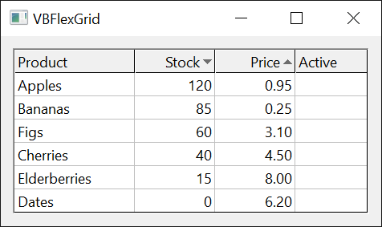

# Selection, Mouse, Sorting and Clipboard
{: .no_toc }

The 23 enumerations that the topic pages [Current Cell and Selection](../VBFlexGrid/Selection), [Scrolling](../VBFlexGrid/Scrolling), [Mouse, Keyboard and Drag and Drop](../VBFlexGrid/MouseAndKeyboard), [Sorting and Searching](../VBFlexGrid/SortingAndSearching) and [Clipboard, Undo and Arrays](../VBFlexGrid/ClipboardAndArrays) of the [**VBFlexGrid**](../VBFlexGrid/) control use are listed here in alphabetical order. Every enumeration is declared inside the control, and its members are written without a qualifier or with the name of the enumeration, as in `FlexSortStringAscending` or `FlexSortConstants.FlexSortStringAscending`.

* TOC
{:toc}

## FlexArrayOrderConstants

The order in which [**SaveArray**](../VBFlexGrid/ClipboardAndArrays#savearray) writes the cells of the grid into an array.

With the **OneDim** argument of [**SaveArray**](../VBFlexGrid/ClipboardAndArrays#savearray) set, the order is the order of the items in the one-dimensional array. Otherwise it decides which dimension of the two-dimensional array holds the rows and which the columns.

| Member | Value | Description |
|:-------|:------|:------------|
| **FlexRowMajor**{: #FlexRowMajor } | `0` | The array holds the rows in its first dimension and the columns in its second. |
| **FlexColumnMajor**{: #FlexColumnMajor } | `1` | The array holds the columns in its first dimension and the rows in its second. This is the default of [**SaveArray**](../VBFlexGrid/ClipboardAndArrays#savearray), which makes its result match what [**LoadArray**](../VBFlexGrid/ClipboardAndArrays#loadarray) reads. |

Reading a grid of two rows and three columns in both orders:

```tb check_build check_run arch=win32,win64
Dim A As Variant
With VBFlexGrid1
    .FixedRows = 0
    .FixedCols = 0
    .Rows = 2
    .Cols = 3
    A = .SaveArray(FlexRowMajor)
    Debug.Print UBound(A, 1); UBound(A, 2) ' 1  2
    A = .SaveArray(FlexColumnMajor)
    Debug.Print UBound(A, 1); UBound(A, 2) ' 2  1
End With
```

## FlexClipboardActionConstants

The clipboard action that the [**BeforeClipboardAction**](../VBFlexGrid/ClipboardAndArrays#beforeclipboardaction) and [**AfterClipboardAction**](../VBFlexGrid/ClipboardAndArrays#afterclipboardaction) events report.

| Member | Value | Description |
|:-------|:------|:------------|
| **FlexClipboardActionCopy**{: #FlexClipboardActionCopy } | `0` | The [**Copy**](../VBFlexGrid/ClipboardAndArrays#copy) method or the user's copy shortcut. |
| **FlexClipboardActionCut**{: #FlexClipboardActionCut } | `1` | The [**Cut**](../VBFlexGrid/ClipboardAndArrays#cut) method or the user's cut shortcut. |
| **FlexClipboardActionPaste**{: #FlexClipboardActionPaste } | `2` | The [**Paste**](../VBFlexGrid/ClipboardAndArrays#paste) method or the user's paste shortcut. |
| **FlexClipboardActionDelete**{: #FlexClipboardActionDelete } | `3` | The [**Delete**](../VBFlexGrid/ClipboardAndArrays#delete) method or the user's Delete key. |

## FlexClipCopyModeConstants

What the [**Copy**](../VBFlexGrid/ClipboardAndArrays#copy) method puts on the clipboard and what the [**Clip**](../VBFlexGrid/ClipboardAndArrays#clip) property returns. It is used by the [**ClipCopyMode**](../VBFlexGrid/ClipboardAndArrays#clipcopymode) property.

The mode affects the [**Copy**](../VBFlexGrid/ClipboardAndArrays#copy) method and reading [**Clip**](../VBFlexGrid/ClipboardAndArrays#clip). Writing [**Clip**](../VBFlexGrid/ClipboardAndArrays#clip) ignores it, so keep **FlexClipCopyModeNormal** when reading and writing must match.

The values are bits: 1 adds the fixed rows, 2 adds the fixed columns, and 4 selects the extended clip. **FlexClipCopyModeIncludeFixedAll** (3) is 1 plus 2, and the four members from 4 to 7 are 4 plus the first four. The extended clip holds all the cells that are drawn selected, not only the rectangle between **Row**, **Col** and **RowSel**, **ColSel**: with the selection modes **FlexSelectionModeFreeByRow** and **FlexSelectionModeFreeByColumn** it spans whole rows or columns, and with [**AllowMultiSelection**](../VBFlexGrid/Selection#allowmultiselection) it holds every selected row, in the columns of the range.

| Member | Value | Description |
|:-------|:------|:------------|
| **FlexClipCopyModeNormal**{: #FlexClipCopyModeNormal } | `0` | The selected cells only. |
| **FlexClipCopyModeIncludeFixedRows**{: #FlexClipCopyModeIncludeFixedRows } | `1` | The fixed rows, then the selected cells. |
| **FlexClipCopyModeIncludeFixedColumns**{: #FlexClipCopyModeIncludeFixedColumns } | `2` | The selected cells with the fixed columns. |
| **FlexClipCopyModeIncludeFixedAll**{: #FlexClipCopyModeIncludeFixedAll } | `3` | The selected cells with the fixed rows and the fixed columns. |
| **FlexClipCopyModeExtended**{: #FlexClipCopyModeExtended } | `4` | The extended clip. |
| **FlexClipCopyModeExtendedFixedRows**{: #FlexClipCopyModeExtendedFixedRows } | `5` | The extended clip with the fixed rows. |
| **FlexClipCopyModeExtendedFixedColumns**{: #FlexClipCopyModeExtendedFixedColumns } | `6` | The extended clip with the fixed columns. |
| **FlexClipCopyModeExtendedFixedAll**{: #FlexClipCopyModeExtendedFixedAll } | `7` | The extended clip with the fixed rows and the fixed columns. |

The clip of a selection of two cells, without and with the fixed row, written with a comma between columns and a semicolon between rows:

```tb check_build check_run arch=win32,win64
With VBFlexGrid1
    .Rows = 3
    .Cols = 3
    .FixedRows = 1
    .FixedCols = 1
    .TextMatrix(0, 1) = "A"
    .TextMatrix(0, 2) = "B"
    .TextMatrix(1, 1) = "a1"
    .TextMatrix(1, 2) = "b1"
    .TextMatrix(2, 1) = "a2"
    .TextMatrix(2, 2) = "b2"
    .ClipSeparatorCol = ","
    .ClipSeparatorRow = ";"
    .Row = 1
    .Col = 1
    .RowSel = 2
    .ColSel = 2
    Debug.Print .Clip ' a1,b1;a2,b2
    .ClipCopyMode = FlexClipCopyModeIncludeFixedRows
    Debug.Print .Clip ' A,B;a1,b1;a2,b2
    Debug.Print (FlexClipCopyModeExtendedFixedRows And FlexClipCopyModeIncludeFixedRows) <> 0 ' True
End With
```

## FlexClipModeConstants

Whether clip operations include hidden cells and whether they translate lookup values. It is used by the [**ClipMode**](../VBFlexGrid/ClipboardAndArrays#clipmode) property.

The mode applies to the [**Clip**](../VBFlexGrid/ClipboardAndArrays#clip) property, to the clipboard methods and to [**AddItem**](../VBFlexGrid/Structure#additem). The translation of the lookup members works only in columns that have a lookup defined with [**ColLookup**](../VBFlexGrid/Text#collookup).

| Member | Value | Description |
|:-------|:------|:------------|
| **FlexClipModeNormal**{: #FlexClipModeNormal } | `0` | Hidden rows and columns are included. The text of the cells is used as it is. This is the default. |
| **FlexClipModeExcludeHidden**{: #FlexClipModeExcludeHidden } | `1` | Hidden rows and columns are left out. |
| **FlexClipModeLookupConv**{: #FlexClipModeLookupConv } | `2` | Reading a clip returns the value of each lookup key, and writing a clip translates each value back to its key. Hidden cells are included. |
| **FlexClipModeLookupConvExcludeHidden**{: #FlexClipModeLookupConvExcludeHidden } | `3` | The lookup translation of **FlexClipModeLookupConv**, with hidden rows and columns left out. |

## FlexClipPasteModeConstants

Where pasted text goes and what is selected afterwards, for the [**Paste**](../VBFlexGrid/ClipboardAndArrays#paste) method and for writing the [**Clip**](../VBFlexGrid/ClipboardAndArrays#clip) property. It is used by the [**ClipPasteMode**](../VBFlexGrid/ClipboardAndArrays#clippastemode) property.

With the two normal modes the pasted text fills the current selection only, and text that does not fit is ignored. **FlexClipPasteModeAutoSelection** pastes at the first cell of the selection and then selects exactly the cells that the text covers, as far as the grid reaches; the new selection can be smaller than the old one. The two extended modes work with the extended selection of the selection modes **FlexSelectionModeFreeByRow** and **FlexSelectionModeFreeByColumn**, the way **FlexClipCopyModeExtended** does when copying. Only **FlexClipPasteModeExtended** writes into every selected row of a multiple selection ([**AllowMultiSelection**](../VBFlexGrid/Selection#allowmultiselection)). Both extended modes make [**Delete**](../VBFlexGrid/ClipboardAndArrays#delete) and [**Cut**](../VBFlexGrid/ClipboardAndArrays#cut) clear the extended selection, a multiple selection included.

| Member | Value | Description |
|:-------|:------|:------------|
| **FlexClipPasteModeNormal**{: #FlexClipPasteModeNormal } | `0` | Paste into the selection. |
| **FlexClipPasteModeAutoSelection**{: #FlexClipPasteModeAutoSelection } | `1` | Paste, then select the pasted cells. |
| **FlexClipPasteModeExtended**{: #FlexClipPasteModeExtended } | `2` | Paste into the extended selection. |
| **FlexClipPasteModeExtendedAutoSelection**{: #FlexClipPasteModeExtendedAutoSelection } | `3` | Paste into the extended selection, then select the pasted cells. |

## FlexDirectionAfterReturnConstants

What the Enter key does in the grid: nothing, a move of the current cell in one direction, or the start of editing. It is used by the [**DirectionAfterReturn**](../VBFlexGrid/Selection#directionafterreturn) property.

A move at the edge of the grid follows [**WrapCellBehavior**](../VBFlexGrid/Selection#wrapcellbehavior): with **FlexWrapRow** a move left or right continues in the previous or next row, and with **FlexWrapGrid** every move also wraps from one end of the grid to the other. Without wrapping the current cell stays where it is.

**FlexDirectionAfterReturnEdit** starts the editor with the reason **FlexEditReasonReturn** and only when no Shift key is held. A move and an edit exclude each other, which is why the choice is in this one property.

| Member | Value | Description |
|:-------|:------|:------------|
| **FlexDirectionAfterReturnNone**{: #FlexDirectionAfterReturnNone } | `0` | The grid does not use the Enter key. This is the default. |
| **FlexDirectionAfterReturnUp**{: #FlexDirectionAfterReturnUp } | `1` | Moves the current cell up. |
| **FlexDirectionAfterReturnDown**{: #FlexDirectionAfterReturnDown } | `2` | Moves the current cell down. |
| **FlexDirectionAfterReturnLeft**{: #FlexDirectionAfterReturnLeft } | `3` | Moves the current cell to the left. |
| **FlexDirectionAfterReturnRight**{: #FlexDirectionAfterReturnRight } | `4` | Moves the current cell to the right. |
| **FlexDirectionAfterReturnEdit**{: #FlexDirectionAfterReturnEdit } | `5` | Starts editing the current cell. |

## FlexDropTargetModeConstants

Whether a drop highlight or an insert mark applies to whole rows or to whole columns. It is used by the [**DropHighlightMode**](../VBFlexGrid/MouseAndKeyboard#drophighlightmode) and [**InsertMarkMode**](../VBFlexGrid/MouseAndKeyboard#insertmarkmode) properties.

| Member | Value | Description |
|:-------|:------|:------------|
| **FlexDropTargetModeByRow**{: #FlexDropTargetModeByRow } | `0` | Rows. This is the default. |
| **FlexDropTargetModeByColumn**{: #FlexDropTargetModeByColumn } | `1` | Columns. |

{:width="609" height="189"}

## FlexFindDirectionConstants

The direction in which [**FindItem**](../VBFlexGrid/SortingAndSearching#finditem) and [**FindTag**](../VBFlexGrid/SortingAndSearching#findtag) search, and the direction of an incremental search. It is used by the [**FindItem**](../VBFlexGrid/SortingAndSearching#finditem) and [**FindTag**](../VBFlexGrid/SortingAndSearching#findtag) methods and the [**BeginIncrementalSearch**](../VBFlexGrid/SortingAndSearching#beginincrementalsearch) and [**IncrementalSearch**](../VBFlexGrid/SortingAndSearching#incrementalsearch) events.

A search down or up goes through the rows of one column, and a search to the right or left goes through the columns of one row. [**FindItem**](../VBFlexGrid/SortingAndSearching#finditem) and [**FindTag**](../VBFlexGrid/SortingAndSearching#findtag) raise error 30003 when the search starts in a fixed row (down, up) or a fixed column (right, left).

| Member | Value | Description |
|:-------|:------|:------------|
| **FlexFindDirectionDown**{: #FlexFindDirectionDown } | `0` | Down the column, toward the last row. |
| **FlexFindDirectionUp**{: #FlexFindDirectionUp } | `1` | Up the column, toward the first row. |
| **FlexFindDirectionRight**{: #FlexFindDirectionRight } | `2` | Along the row, toward the last column. |
| **FlexFindDirectionLeft**{: #FlexFindDirectionLeft } | `3` | Along the row, toward the first column. |

## FlexFindMatchConstants

How the text that [**FindItem**](../VBFlexGrid/SortingAndSearching#finditem) and [**FindTag**](../VBFlexGrid/SortingAndSearching#findtag) look for must match a cell.

A **True** passed in place of a member (the old **Partial** argument) counts as **FlexFindMatchPartial**.

| Member | Value | Description |
|:-------|:------|:------------|
| **FlexFindMatchExact**{: #FlexFindMatchExact } | `0` | The cell holds the whole text. |
| **FlexFindMatchPartial**{: #FlexFindMatchPartial } | `1` | The cell holds the text somewhere. |
| **FlexFindMatchStartsWith**{: #FlexFindMatchStartsWith } | `2` | The cell starts with the text. |
| **FlexFindMatchEndsWith**{: #FlexFindMatchEndsWith } | `3` | The cell ends with the text. |

Each match kind finds a different row of the same column:

```tb check_build check_run arch=win32,win64
With VBFlexGrid1
    .Cols = 1
    .FixedCols = 0
    .Rows = 4
    .FixedRows = 1
    .TextMatrix(1, 0) = "alpha"
    .TextMatrix(2, 0) = "beta"
    .TextMatrix(3, 0) = "alphabet"
    Debug.Print .FindItem("alpha", , , FlexFindMatchExact) ' 1
    Debug.Print .FindItem("bet", , , FlexFindMatchExact) ' -1
    Debug.Print .FindItem("bet", , , FlexFindMatchPartial) ' 2
    Debug.Print .FindItem("alp", , , FlexFindMatchStartsWith) ' 1
    Debug.Print .FindItem("bet", , , FlexFindMatchEndsWith) ' 3
End With
```

## FlexFocusRectConstants

How the focus rectangle of the current cell is drawn. It is used by the [**FocusRect**](../VBFlexGrid/Selection#focusrect) property.

| Member | Value | Description |
|:-------|:------|:------------|
| **FlexFocusRectNone**{: #FlexFocusRectNone } | `0` | No focus rectangle. |
| **FlexFocusRectLight**{: #FlexFocusRectLight } | `1` | A thin dotted rectangle, as the Windows focus rectangle looks. This is the default. |
| **FlexFocusRectHeavy**{: #FlexFocusRectHeavy } | `2` | Two dotted rectangles, one inside the other. |
| **FlexFocusRectFlat**{: #FlexFocusRectFlat } | `3` | A solid rectangle in the color of [**BackColorSel**](../VBFlexGrid/Appearance#backcolorsel), with the width of [**FocusRectWidth**](../VBFlexGrid/Selection#focusrectwidth). |

## FlexHighLightConstants

When the selected cells are drawn highlighted. It is used by the [**HighLight**](../VBFlexGrid/Selection#highlight) property.

While [**FocusRect**](../VBFlexGrid/Selection#focusrect) is not **FlexFocusRectNone**, the current cell is not drawn highlighted when the control has the focus: it keeps its own colors and has the focus rectangle. Without the focus the members differ in what the current cell does. With **FlexHighLightAlways** it keeps its own colors inside the highlighted selection. With **FlexHighLightAlwaysFocusRect** it is highlighted like the other selected cells.

| Member | Value | Description |
|:-------|:------|:------------|
| **FlexHighLightNever**{: #FlexHighLightNever } | `0` | The selection is not highlighted. |
| **FlexHighLightAlways**{: #FlexHighLightAlways } | `1` | The selection is highlighted whether or not the control has the focus. This is the default. |
| **FlexHighLightWithFocus**{: #FlexHighLightWithFocus } | `2` | The selection is highlighted only while the control has the focus. |
| **FlexHighLightAlwaysFocusRect**{: #FlexHighLightAlwaysFocusRect } | `3` | The selection is highlighted at all times, and the current cell is highlighted with it when the control has no focus. |

## FlexHitResultConstants

What lies at a point of the control, as [**HitResult**](../VBFlexGrid/MouseAndKeyboard#hitresult) returns it after a call of [**HitTest**](../VBFlexGrid/MouseAndKeyboard#hittest).

The divider members mean the edge of a row or a column that the user can drag. [**HitRowDivider**](../VBFlexGrid/MouseAndKeyboard#hitrowdivider) and [**HitColDivider**](../VBFlexGrid/MouseAndKeyboard#hitcoldivider) give the row or column whose size the divider changes. The frozen divider members are the edges the user drags to freeze or unfreeze rows and columns, and are reported only while [**AllowUserFreezing**](../VBFlexGrid/Structure#allowuserfreezing) permits it. The members for the combo cue and the check box are reported only for the cue or check box that is drawn, and the disabled variants stand for the grayed ones.

| Member | Value | Description |
|:-------|:------|:------------|
| **FlexHitResultNoWhere**{: #FlexHitResultNoWhere } | `0` | No part of the grid: outside the cells. |
| **FlexHitResultCell**{: #FlexHitResultCell } | `1` | The contents of a cell. |
| **FlexHitResultDividerRowTop**{: #FlexHitResultDividerRowTop } | `2` | The divider at the top of a row. |
| **FlexHitResultDividerRowBottom**{: #FlexHitResultDividerRowBottom } | `3` | The divider at the bottom of a row. |
| **FlexHitResultDividerColumnLeft**{: #FlexHitResultDividerColumnLeft } | `4` | The divider at the left edge of a column. |
| **FlexHitResultDividerColumnRight**{: #FlexHitResultDividerColumnRight } | `5` | The divider at the right edge of a column. |
| **FlexHitResultDividerFrozenRowTop**{: #FlexHitResultDividerFrozenRowTop } | `6` | The freeze divider at the top edge of a row. |
| **FlexHitResultDividerFrozenRowBottom**{: #FlexHitResultDividerFrozenRowBottom } | `7` | The freeze divider at the bottom edge of a row. |
| **FlexHitResultDividerFrozenColumnLeft**{: #FlexHitResultDividerFrozenColumnLeft } | `8` | The freeze divider at the left edge of a column. |
| **FlexHitResultDividerFrozenColumnRight**{: #FlexHitResultDividerFrozenColumnRight } | `9` | The freeze divider at the right edge of a column. |
| **FlexHitResultComboCue**{: #FlexHitResultComboCue } | `10` | An enabled combo cue. |
| **FlexHitResultComboCueDisabled**{: #FlexHitResultComboCueDisabled } | `11` | A disabled combo cue. |
| **FlexHitResultCheckBox**{: #FlexHitResultCheckBox } | `12` | An enabled check box. |
| **FlexHitResultCheckBoxDisabled**{: #FlexHitResultCheckBoxDisabled } | `13` | A disabled check box. |

## FlexIMEModeConstants

The state of the input method editor (IME) while the grid or its text box has the focus. It is used by the [**IMEMode**](../VBFlexGrid/MouseAndKeyboard#imemode) property.

The IME modes apply only on a system with an input method editor. The members for Japanese and Korean input set the conversion state of the editor.

| Member | Value | Description |
|:-------|:------|:------------|
| **FlexIMEModeNoControl**{: #FlexIMEModeNoControl } | `0` | The control does not change the IME. This is the default. |
| **FlexIMEModeOn**{: #FlexIMEModeOn } | `1` | The IME is on. |
| **FlexIMEModeOff**{: #FlexIMEModeOff } | `2` | The IME is off. |
| **FlexIMEModeDisable**{: #FlexIMEModeDisable } | `3` | The IME is disabled and the user cannot turn it on. |
| **FlexIMEModeHiragana**{: #FlexIMEModeHiragana } | `4` | The IME is on, with full-width hiragana. |
| **FlexIMEModeKatakana**{: #FlexIMEModeKatakana } | `5` | The IME is on, with full-width katakana. |
| **FlexIMEModeKatakanaHalf**{: #FlexIMEModeKatakanaHalf } | `6` | The IME is on, with half-width katakana. |
| **FlexIMEModeAlphaFull**{: #FlexIMEModeAlphaFull } | `7` | The IME is on, with full-width alphanumeric characters. |
| **FlexIMEModeAlpha**{: #FlexIMEModeAlpha } | `8` | The IME is on, with half-width alphanumeric characters. |
| **FlexIMEModeHangulFull**{: #FlexIMEModeHangulFull } | `9` | The IME is on, with full-width hangul. |
| **FlexIMEModeHangul**{: #FlexIMEModeHangul } | `10` | The IME is on, with half-width hangul. |

## FlexMousePointerConstants

The shape of the mouse pointer over the control. It is used by the [**MousePointer**](../VBFlexGrid/MouseAndKeyboard#mousepointer) property.

The members map to Windows cursors. A value of 99 shows the picture of [**MouseIcon**](../VBFlexGrid/MouseAndKeyboard#mouseicon).

| Member | Value | Description |
|:-------|:------|:------------|
| **FlexMousePointerDefault**{: #FlexMousePointerDefault } | `0` | The default pointer. |
| **FlexMousePointerArrow**{: #FlexMousePointerArrow } | `1` | An arrow. |
| **FlexMousePointerCrosshair**{: #FlexMousePointerCrosshair } | `2` | A cross. |
| **FlexMousePointerIbeam**{: #FlexMousePointerIbeam } | `3` | An I-beam. |
| **FlexMousePointerHand**{: #FlexMousePointerHand } | `4` | A hand. It replaces the icon pointer of the standard constants. |
| **FlexMousePointerSizePointer**{: #FlexMousePointerSizePointer } | `5` | Four arrows, the same as **FlexMousePointerSizeAll**. |
| **FlexMousePointerSizeNESW**{: #FlexMousePointerSizeNESW } | `6` | A double arrow pointing northeast and southwest. |
| **FlexMousePointerSizeNS**{: #FlexMousePointerSizeNS } | `7` | A double arrow pointing north and south. |
| **FlexMousePointerSizeNWSE**{: #FlexMousePointerSizeNWSE } | `8` | A double arrow pointing northwest and southeast. |
| **FlexMousePointerSizeWE**{: #FlexMousePointerSizeWE } | `9` | A double arrow pointing west and east. |
| **FlexMousePointerUpArrow**{: #FlexMousePointerUpArrow } | `10` | An up arrow. |
| **FlexMousePointerHourglass**{: #FlexMousePointerHourglass } | `11` | An hourglass or circle: the program is busy. |
| **FlexMousePointerNoDrop**{: #FlexMousePointerNoDrop } | `12` | A not-allowed symbol. |
| **FlexMousePointerArrowHourglass**{: #FlexMousePointerArrowHourglass } | `13` | An arrow with an hourglass: the program is starting. |
| **FlexMousePointerArrowQuestion**{: #FlexMousePointerArrowQuestion } | `14` | An arrow with a question mark. |
| **FlexMousePointerSizeAll**{: #FlexMousePointerSizeAll } | `15` | Four arrows. |
| **FlexMousePointerArrowCD**{: #FlexMousePointerArrowCD } | `16` | An arrow with a compact disc. |
| **FlexMousePointerPin**{: #FlexMousePointerPin } | `17` | A pin. |
| **FlexMousePointerPerson**{: #FlexMousePointerPerson } | `18` | A person. |
| **FlexMousePointerPen**{: #FlexMousePointerPen } | `19` | A pen. |
| **FlexMousePointerScrollN**{: #FlexMousePointerScrollN } | `20` | A scroll pointer pointing north. |
| **FlexMousePointerScrollS**{: #FlexMousePointerScrollS } | `21` | A scroll pointer pointing south. |
| **FlexMousePointerScrollE**{: #FlexMousePointerScrollE } | `22` | A scroll pointer pointing east. |
| **FlexMousePointerScrollW**{: #FlexMousePointerScrollW } | `23` | A scroll pointer pointing west. |
| **FlexMousePointerScrollNS**{: #FlexMousePointerScrollNS } | `24` | A scroll pointer pointing north and south. |
| **FlexMousePointerScrollWE**{: #FlexMousePointerScrollWE } | `25` | A scroll pointer pointing west and east. |
| **FlexMousePointerScrollNW**{: #FlexMousePointerScrollNW } | `26` | A scroll pointer pointing northwest. |
| **FlexMousePointerScrollNE**{: #FlexMousePointerScrollNE } | `27` | A scroll pointer pointing northeast. |
| **FlexMousePointerScrollSW**{: #FlexMousePointerScrollSW } | `28` | A scroll pointer pointing southwest. |
| **FlexMousePointerScrollSE**{: #FlexMousePointerScrollSE } | `29` | A scroll pointer pointing southeast. |
| **FlexMousePointerScrollAll**{: #FlexMousePointerScrollAll } | `30` | A scroll pointer pointing in all directions. |
| **FlexMousePointerCustom**{: #FlexMousePointerCustom } | `99` | The picture of [**MouseIcon**](../VBFlexGrid/MouseAndKeyboard#mouseicon). |

## FlexOLEDropModeConstants

Whether the control accepts OLE drops. It is used by the [**OLEDropMode**](../VBFlexGrid/MouseAndKeyboard#oledropmode) property.

The members have the values of the standard **vbOLEDropNone** and **vbOLEDropManual** constants.

| Member | Value | Description |
|:-------|:------|:------------|
| **FlexOLEDropModeNone**{: #FlexOLEDropModeNone } | `vbOLEDropNone` (0) | The control accepts no OLE drop. |
| **FlexOLEDropModeManual**{: #FlexOLEDropModeManual } | `vbOLEDropManual` (1) | The program handles the OLE drop events itself. |

## FlexScrollOrientationConstants

The directions in which the grid scrolls by itself while an OLE drag moves near its edge. It is used by the [**OLEDragDropScrollOrientation**](../VBFlexGrid/MouseAndKeyboard#oledragdropscrollorientation) property.

| Member | Value | Description |
|:-------|:------|:------------|
| **FlexScrollOrientationHorizontal**{: #FlexScrollOrientationHorizontal } | `0` | Horizontally only. |
| **FlexScrollOrientationVertical**{: #FlexScrollOrientationVertical } | `1` | Vertically only. |
| **FlexScrollOrientationBoth**{: #FlexScrollOrientationBoth } | `2` | Both ways. This is the default. |

## FlexSelectionModeConstants

How the user selects cells. It is used by the [**SelectionMode**](../VBFlexGrid/Selection#selectionmode) property.

**FlexSelectionModeFreeByRow** and **FlexSelectionModeFreeByColumn** also select freely, but the fixed cells select in one direction only, and every row (or column) that the range touches is drawn selected as a whole. With **FlexSelectionModeFreeByRow** a click on a fixed cell at the start of a row selects the whole row, while a click on a column header does not select the column. **FlexSelectionModeFreeByColumn** works the other way round.

| Member | Value | Description |
|:-------|:------|:------------|
| **FlexSelectionModeFree**{: #FlexSelectionModeFree } | `0` | The user selects any range of cells. A click on a fixed cell selects the whole row or the whole column when [**AllowBigSelection**](../VBFlexGrid/Selection#allowbigselection) is **True**. This is the default. |
| **FlexSelectionModeByRow**{: #FlexSelectionModeByRow } | `1` | The selection always covers whole rows. |
| **FlexSelectionModeByColumn**{: #FlexSelectionModeByColumn } | `2` | The selection always covers whole columns. |
| **FlexSelectionModeFreeByRow**{: #FlexSelectionModeFreeByRow } | `3` | A free selection, where only the fixed cells that start a row (the row headers) select the whole row. |
| **FlexSelectionModeFreeByColumn**{: #FlexSelectionModeFreeByColumn } | `4` | A free selection, where only the fixed cells that start a column (the column headers) select the whole column. |

{:width="609" height="189"}

## FlexSortArrowConstants

The sort arrow that a column header shows. It is used by the [**ColSortArrow**](../VBFlexGrid/SortingAndSearching#colsortarrow) property.

| Member | Value | Description |
|:-------|:------|:------------|
| **FlexSortArrowNone**{: #FlexSortArrowNone } | `0` | No arrow. |
| **FlexSortArrowAscending**{: #FlexSortArrowAscending } | `1` | An arrow for an ascending sort. |
| **FlexSortArrowDescending**{: #FlexSortArrowDescending } | `2` | An arrow for a descending sort. |

{:width="317" height="189"}

## FlexSortConstants

The comparison and the direction of a sort of rows, for [**Sort**](../VBFlexGrid/SortingAndSearching#sort) and [**ColSort**](../VBFlexGrid/SortingAndSearching#colsort).

The sort is stable: rows that compare as equal keep their order. The keys are the columns from [**Col**](../VBFlexGrid/Selection#col) to [**ColSel**](../VBFlexGrid/Selection#colsel), and the rows are those from [**Row**](../VBFlexGrid/Selection#row) to [**RowSel**](../VBFlexGrid/Selection#rowsel), or every row after the fixed rows when [**Row**](../VBFlexGrid/Selection#row) equals [**RowSel**](../VBFlexGrid/Selection#rowsel). A sort of text in a column whose [**ColSortMode**](../VBFlexGrid/SortingAndSearching#colsortmode) is **FlexSortModeTextDisplay** compares the displayed text. Setting [**Sort**](../VBFlexGrid/SortingAndSearching#sort) to **FlexSortNone** does nothing, and reading it raises 394.

**FlexSortUseColSort** can be written to [**Sort**](../VBFlexGrid/SortingAndSearching#sort) only: the sort then uses the order of [**ColSort**](../VBFlexGrid/SortingAndSearching#colsort) for each key column. [**ColSort**](../VBFlexGrid/SortingAndSearching#colsort) itself rejects it with error 380, and [**Sort**](../VBFlexGrid/SortingAndSearching#sort) is unavailable while a custom data source is in use unless it returns **FlexDataSourceNoData**.

| Member | Value | Description |
|:-------|:------|:------------|
| **FlexSortNone**{: #FlexSortNone } | `0` | No sort. |
| **FlexSortGenericAscending**{: #FlexSortGenericAscending } | `1` | Ascending. Two numbers compare as numbers; otherwise the two texts compare as strings, so dates compare as strings. |
| **FlexSortGenericDescending**{: #FlexSortGenericDescending } | `2` | Descending, with the comparison of **FlexSortGenericAscending**. |
| **FlexSortNumericAscending**{: #FlexSortNumericAscending } | `3` | Ascending by numeric value. Text that is not a number counts as 0. |
| **FlexSortNumericDescending**{: #FlexSortNumericDescending } | `4` | Descending by numeric value. |
| **FlexSortStringNoCaseAscending**{: #FlexSortStringNoCaseAscending } | `5` | Ascending as strings, without regard to case. |
| **FlexSortStringNoCaseDescending**{: #FlexSortStringNoCaseDescending } | `6` | Descending as strings, without regard to case. |
| **FlexSortStringAscending**{: #FlexSortStringAscending } | `7` | Ascending as strings, with regard to case. |
| **FlexSortStringDescending**{: #FlexSortStringDescending } | `8` | Descending as strings, with regard to case. |
| **FlexSortCustom**{: #FlexSortCustom } | `9` | The program compares two whole rows in the [**Compare**](../VBFlexGrid/SortingAndSearching#compare) event. |
| **FlexSortUseColSort**{: #FlexSortUseColSort } | `10` | Each key column uses its own [**ColSort**](../VBFlexGrid/SortingAndSearching#colsort) order. |
| **FlexSortCurrencyAscending**{: #FlexSortCurrencyAscending } | `11` | Ascending as **Currency** values. Text that is not a number counts as 0. |
| **FlexSortCurrencyDescending**{: #FlexSortCurrencyDescending } | `12` | Descending as **Currency** values. |
| **FlexSortDateAscending**{: #FlexSortDateAscending } | `13` | Ascending as dates. Text that is not a date counts as the date of the value 0. |
| **FlexSortDateDescending**{: #FlexSortDateDescending } | `14` | Descending as dates. |
| **FlexSortCustomText**{: #FlexSortCustomText } | `15` | The program compares the texts of two cells in the [**CompareText**](../VBFlexGrid/SortingAndSearching#comparetext) event. |

The same three numbers in text, sorted as numbers and as strings:

```tb check_build check_run arch=win32,win64
With VBFlexGrid1
    .FixedCols = 0
    .Cols = 1
    .Rows = 4
    .FixedRows = 1
    .TextMatrix(1, 0) = "10"
    .TextMatrix(2, 0) = "9"
    .TextMatrix(3, 0) = "2"
    .Row = 1
    .RowSel = 3
    .Col = 0
    .ColSel = 0
    .Sort = FlexSortStringAscending
    Debug.Print .TextMatrix(1, 0); ","; .TextMatrix(2, 0); ","; .TextMatrix(3, 0) ' 10,2,9
    .Sort = FlexSortGenericAscending
    Debug.Print .TextMatrix(1, 0); ","; .TextMatrix(2, 0); ","; .TextMatrix(3, 0) ' 2,9,10
    .Sort = FlexSortNumericDescending
    Debug.Print .TextMatrix(1, 0); ","; .TextMatrix(2, 0); ","; .TextMatrix(3, 0) ' 10,9,2
End With
```

## FlexSortModeConstants

Which text a column compares when it is sorted. It is used by the [**ColSortMode**](../VBFlexGrid/SortingAndSearching#colsortmode) property.

| Member | Value | Description |
|:-------|:------|:------------|
| **FlexSortModeNormal**{: #FlexSortModeNormal } | `0` | The text of the cells. This is the default. |
| **FlexSortModeTextDisplay**{: #FlexSortModeTextDisplay } | `1` | The text as the cells display it, after the lookup and the format of the column. |

## FlexTabBehaviorConstants

What the Tab key does in the grid. It is used by the [**TabBehavior**](../VBFlexGrid/Selection#tabbehavior) property.

With **FlexTabNext** the Tab key moves through the cells for as long as there is a cell to move to, and then moves the focus to the next control. With **FlexWrapNone** and the selection mode **FlexSelectionModeByRow** or **FlexSelectionModeByColumn**, Tab always moves to the next control. [**WrapCellBehavior**](../VBFlexGrid/Selection#wrapcellbehavior) sets what counts as a next cell: with **FlexWrapRow** the move continues in the next row, and with **FlexWrapGrid** the Tab key never leaves the grid.

| Member | Value | Description |
|:-------|:------|:------------|
| **FlexTabControls**{: #FlexTabControls } | `0` | The Tab key moves the focus to the next control. This is the default. |
| **FlexTabCells**{: #FlexTabCells } | `1` | The Tab key moves to the next cell and never leaves the grid. |
| **FlexTabNext**{: #FlexTabNext } | `2` | The Tab key moves to the next cell, and past the last one to the next control. |

## FlexVisibilityConstants

Whether a row or column counts as visible when only a part of it shows. It is used by the [**BottomRow**](../VBFlexGrid/Scrolling#bottomrow), [**ColIsVisible**](../VBFlexGrid/Scrolling#colisvisible), [**ColsVisible**](../VBFlexGrid/Scrolling#colsvisible), [**FixedColsVisible**](../VBFlexGrid/Structure#fixedcolsvisible), [**FixedRowsVisible**](../VBFlexGrid/Structure#fixedrowsvisible), [**FrozenColsVisible**](../VBFlexGrid/Structure#frozencolsvisible), [**FrozenRowsVisible**](../VBFlexGrid/Structure#frozenrowsvisible), [**RightCol**](../VBFlexGrid/Scrolling#rightcol), [**RowIsVisible**](../VBFlexGrid/Scrolling#rowisvisible) and [**RowsVisible**](../VBFlexGrid/Scrolling#rowsvisible) properties and the [**CellEnsureVisible**](../VBFlexGrid/Scrolling#cellensurevisible) method.

The members are an optional argument of the properties and methods that count or find visible rows and columns. The default is not the same everywhere: [**BottomRow**](../VBFlexGrid/Scrolling#bottomrow), [**RightCol**](../VBFlexGrid/Scrolling#rightcol), [**ColIsVisible**](../VBFlexGrid/Scrolling#colisvisible) and [**RowIsVisible**](../VBFlexGrid/Scrolling#rowisvisible) default to **FlexVisibilityPartialOK**, while the counting properties such as [**ColsVisible**](../VBFlexGrid/Scrolling#colsvisible) and [**FixedRowsVisible**](../VBFlexGrid/Structure#fixedrowsvisible) and the method [**CellEnsureVisible**](../VBFlexGrid/Scrolling#cellensurevisible) default to **FlexVisibilityCompleteOnly**.

| Member | Value | Description |
|:-------|:------|:------------|
| **FlexVisibilityPartialOK**{: #FlexVisibilityPartialOK } | `0` | A row or column that shows in part counts. |
| **FlexVisibilityCompleteOnly**{: #FlexVisibilityCompleteOnly } | `1` | Only a row or column that shows completely counts. |

## FlexWrapCellBehaviorConstants

What happens when the cursor keys, the Tab key or the Enter key move the current cell past the end of a row or of the grid. It is used by the [**WrapCellBehavior**](../VBFlexGrid/Selection#wrapcellbehavior) property.

| Member | Value | Description |
|:-------|:------|:------------|
| **FlexWrapNone**{: #FlexWrapNone } | `0` | The current cell stays at the edge of the row. This is the default. |
| **FlexWrapRow**{: #FlexWrapRow } | `1` | The move continues in the next row, or in the previous one for a move to the left. |
| **FlexWrapGrid**{: #FlexWrapGrid } | `2` | As **FlexWrapRow**, and a move past the last cell continues at the first cell and the other way round. |
