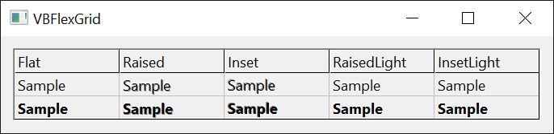
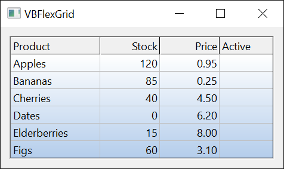

# Appearance
{: .no_toc }

The members that set the colors, grid lines, borders, fonts and text style of a **VBFlexGrid**, give it a background picture, return a picture of it, and turn on visual styles and right-to-left layout.

A cell is drawn from these settings of the whole grid, which [Cell Formatting](CellFormatting) can override for a single cell, a range of cells or a column:

| Part of the grid | Background | Text color | Font | Text style | Grid lines |
|------------------|------------|------------|------|------------|------------|
| Normal cells | [**BackColor**](#backcolor), and [**BackColorAlt**](#backcoloralt) in every second row | [**ForeColor**](#forecolor) | [**Font**](#font) | [**TextStyle**](#textstyle) | [**GridLines**](#gridlines), [**GridColor**](#gridcolor), [**GridLineWidth**](#gridlinewidth) |
| Fixed cells | [**BackColorFixed**](#backcolorfixed) | [**ForeColorFixed**](#forecolorfixed) | [**FontFixed**](#fontfixed) | [**TextStyleFixed**](#textstylefixed) | [**GridLinesFixed**](#gridlinesfixed), [**GridColorFixed**](#gridcolorfixed), [**GridLineWidthFixed**](#gridlinewidthfixed) |
| Frozen cells | as the normal cells | as the normal cells | as the normal cells | as the normal cells | [**GridLinesFrozen**](#gridlinesfrozen), [**GridColorFrozen**](#gridcolorfrozen), [**GridLineWidthFrozen**](#gridlinewidthfrozen) |
| Selected cells | [**BackColorSel**](#backcolorsel) | [**ForeColorSel**](#forecolorsel), when [**UseForeColorSel**](#useforecolorsel) is **True** | as the cell | as the cell | as the cell |
| The space outside the cells | [**BackColorBkg**](#backcolorbkg) | | | | |

The colors are **OLE_COLOR** values: an RGB color, or a system color such as **vbWindowBackground** or **vbHighlight**. The defaults are system colors, so the grid follows the color scheme of Windows.

The grid line settings of the fixed and the frozen cells inherit: the fixed cells use [**GridLineWidth**](#gridlinewidth) until [**GridLineWidthFixed**](#gridlinewidthfixed) is set, and the frozen cells use the width of the fixed cells until [**GridLineWidthFrozen**](#gridlinewidthfrozen) is set. Setting the width to -1 goes back to inheriting.

```tb check_build check_run slot=sub
With VBFlexGrid1
    .BackColor = vbYellow
    Debug.Print Hex(.BackColorAlt)           ' BackColor also sets BackColorAlt
    .BackColorAlt = vbCyan
    Debug.Print Hex(.BackColor)              ' but BackColorAlt does not set BackColor
    .GridLineWidth = 3
    Debug.Print .GridLineWidthFixed & " " & .GridLineWidthFrozen
    .GridLineWidthFixed = 2
    Debug.Print .GridLineWidthFixed & " " & .GridLineWidthFrozen
    .GridLineWidthFrozen = 4
    Debug.Print .GridLineWidthFrozen
End With
' Output:
' FFFF
' FFFF
' 3 3
' 2 2
' 4
```

The grid can show a picture behind its cells ([**WallPaper**](#wallpaper)) and can produce a picture of itself ([**Picture**](#picture)). The members of [Sizes and Positions](Sizing) measure the cells, and those of [Cell Formatting](CellFormatting) change one cell.

* TOC
{:toc}

## Properties

### BackColor
{: .no_toc }

Returns or sets the background color of the normal cells. An **OLE_COLOR**. Default: **vbWindowBackground**.

Syntax: *object*.**BackColor** [ = *value* ]

Setting it sets [**BackColorAlt**](#backcoloralt) to the same color, so that every row has this color. A cell whose [**CellBackColor**](CellFormatting#cellbackcolor) is set keeps its own color.

### BackColorAlt
{: .no_toc }

Returns or sets the background color of every second row of the normal cells. An **OLE_COLOR**. Default: **vbWindowBackground**, the same as **BackColor**, which gives no alternating rows.

Syntax: *object*.**BackColorAlt** [ = *value* ]

When it differs from [**BackColor**](#backcolor), the rows alternate: counted from the first row that is not fixed, the first, third and so on have **BackColor**, and the second, fourth and so on have this color. Assign **BackColorAlt** after **BackColor**, since assigning **BackColor** changes both. The edit box of a cell that is being edited takes the color of its row.

### BackColorBkg
{: .no_toc }

Returns or sets the color of the space of the control that no cell covers, which is the area to the right of the last column and under the last row. An **OLE_COLOR**. Default: &H808080&, a gray.

Syntax: *object*.**BackColorBkg** [ = *value* ]

### BackColorFixed
{: .no_toc }

Returns or sets the background color of the fixed cells. An **OLE_COLOR**. Default: **vbButtonFace**.

Syntax: *object*.**BackColorFixed** [ = *value* ]

### BackColorSel
{: .no_toc }

Returns or sets the background color of the selected cells. An **OLE_COLOR**. Default: **vbHighlight**.

Syntax: *object*.**BackColorSel** [ = *value* ]

With [**FocusRect**](Selection#focusrect) set to **FlexFocusRectFlat**, the focus rectangle is drawn in this color.

### BorderStyle
{: .no_toc }

Returns or sets the border of the control. A [**FlexBorderStyleConstants**](../Enumerations/CellsAndAppearance#flexborderstyleconstants) member. Default: **FlexBorderStyleSunken**.

Syntax: *object*.**BorderStyle** [ = *value* ]

The border is part of the control and not of its client area: the cells and the scroll bars are inside it, and [**ClientLeft**](Sizing#clientleft) and [**ClientTop**](Sizing#clienttop) are its width. **FlexBorderStyleNone** has no border, so they are 0. A value that is not a member of the enumeration raises run-time error 380.

### Font
{: .no_toc }

Returns or sets the font of the normal cells. A **StdFont**. Default: the font of the form.

Syntax: *object*.**Font** [ = *value* ]

Assign with **Set**. Assigning **Nothing** gives the grid the font of the form again. A change to the font object, such as `VBFlexGrid1.Font.Size = 12`, is applied at once: the default row heights and column widths follow the new font and the grid is repainted. A cell can have a font of its own through [**CellFontName**](CellFormatting#cellfontname) and the other **CellFont** properties.

### FontFixed
{: .no_toc }

Returns or sets the font of the fixed cells. A **StdFont**. Default: none, which means that the fixed cells use [**Font**](#font).

Syntax: *object*.**FontFixed** [ = *value* ]

Assign with **Set**. Reading it returns the **Font** object as long as no font is set for the fixed cells. Assigning **Nothing** removes the font of the fixed cells again. The default height of the fixed rows and the default width of the fixed columns follow this font.

### FontQuality
{: .no_toc }

Returns or sets how Windows renders the font. A [**FlexFontQualityConstants**](../Enumerations/CellsAndAppearance#flexfontqualityconstants) member. Default: **FlexFontQualityDefault**.

Syntax: *object*.**FontQuality** [ = *value* ]

The quality applies to every font of the grid, those of the cells included, and the grid creates its fonts again when it changes. A value that is not a member of the enumeration raises run-time error 380.

### ForeColor
{: .no_toc }

Returns or sets the text color of the normal cells. An **OLE_COLOR**. Default: **vbWindowText**.

Syntax: *object*.**ForeColor** [ = *value* ]

A cell whose [**CellForeColor**](CellFormatting#cellforecolor) is set keeps its own color.

### ForeColorFixed
{: .no_toc }

Returns or sets the text color of the fixed cells. An **OLE_COLOR**. Default: **vbButtonText**.

Syntax: *object*.**ForeColorFixed** [ = *value* ]

### ForeColorSel
{: .no_toc }

Returns or sets the text color of the selected cells. An **OLE_COLOR**. Default: **vbHighlightText**.

Syntax: *object*.**ForeColorSel** [ = *value* ]

It is used only when [**UseForeColorSel**](#useforecolorsel) is **True**.

### GridColor
{: .no_toc }

Returns or sets the color of the grid lines between the normal cells. An **OLE_COLOR**. Default: &HC0C0C0&, a light gray.

Syntax: *object*.**GridColor** [ = *value* ]

The color applies to the styles **FlexGridLineFlat**, **FlexGridLineDashes** and **FlexGridLineDots** and their horizontal and vertical variants. The styles **FlexGridLineInset** and **FlexGridLineRaised** draw black and white lines and ignore it.

### GridColorFixed
{: .no_toc }

Returns or sets the color of the grid lines between the fixed cells. An **OLE_COLOR**. Default: **vbBlack**.

Syntax: *object*.**GridColorFixed** [ = *value* ]

The same applies as for [**GridColor**](#gridcolor): the default style of the fixed cells, **FlexGridLineInset**, ignores the color. It colors the line that [**SheetBorder**](#sheetborder) draws.

### GridColorFrozen
{: .no_toc }

Returns or sets the color of the grid lines of the frozen cells. An **OLE_COLOR**. Default: **vbBlack**.

Syntax: *object*.**GridColorFrozen** [ = *value* ]

The same applies as for [**GridColor**](#gridcolor).

### GridLines
{: .no_toc }

Returns or sets the style of the grid lines between the normal cells. A [**FlexGridLineConstants**](../Enumerations/CellsAndAppearance#flexgridlineconstants) member. Default: **FlexGridLineFlat**.

Syntax: *object*.**GridLines** [ = *value* ]

The styles are a plain line (**FlexGridLineFlat**), a dashed line (**FlexGridLineDashes**), a dotted line (**FlexGridLineDots**), and a pair of black and white lines that gives the cells a sunken (**FlexGridLineInset**) or a raised look (**FlexGridLineRaised**). Each of them has a variant with **Horz** and one with **Vert** in its name that draws the horizontal or the vertical lines only. **FlexGridLineNone** draws no lines. The color and the width of the plain, dashed and dotted lines are [**GridColor**](#gridcolor) and [**GridLineWidth**](#gridlinewidth). A value that is not a member of the enumeration raises run-time error 380.

{:width="709" height="259"}

The offsets of the grid lines, which [**GetGridLineOffsets**](Sizing#getgridlineoffsets) returns, follow the style only when [**FixGridLineOffsets**](Sizing#fixgridlineoffsets) is **True**.

### GridLinesFixed
{: .no_toc }

Returns or sets the style of the grid lines between the fixed cells. A [**FlexGridLineConstants**](../Enumerations/CellsAndAppearance#flexgridlineconstants) member. Default: **FlexGridLineInset**.

Syntax: *object*.**GridLinesFixed** [ = *value* ]

The styles are those of [**GridLines**](#gridlines); the color and the width are [**GridColorFixed**](#gridcolorfixed) and [**GridLineWidthFixed**](#gridlinewidthfixed). A value that is not a member of the enumeration raises run-time error 380.

### GridLinesFrozen
{: .no_toc }

Returns or sets the style of the grid lines of the frozen cells. A [**FlexGridLineConstants**](../Enumerations/CellsAndAppearance#flexgridlineconstants) member. Default: **FlexGridLineFlat**.

Syntax: *object*.**GridLinesFrozen** [ = *value* ]

The styles are those of [**GridLines**](#gridlines); the color and the width are [**GridColorFrozen**](#gridcolorfrozen) and [**GridLineWidthFrozen**](#gridlinewidthfrozen). They are the lines at the edge of the frozen rows and columns. A value that is not a member of the enumeration raises run-time error 380.

### GridLineWidth
{: .no_toc }

Returns or sets the width of the grid lines between the normal cells, in pixels. An **Integer**. Default: 1.

Syntax: *object*.**GridLineWidth** [ = *value* ]

A value below 1 raises run-time error 380. The width is also the width of the grid lines of the fixed and the frozen cells, until [**GridLineWidthFixed**](#gridlinewidthfixed) and [**GridLineWidthFrozen**](#gridlinewidthfrozen) are set.

### GridLineWidthFixed
{: .no_toc }

Returns or sets the width of the grid lines between the fixed cells, in pixels. An **Integer**. Default: -1, which means the width of [**GridLineWidth**](#gridlinewidth).

Syntax: *object*.**GridLineWidthFixed** [ = *value* ]

Reading returns the width that is in use, never -1. A value that is below 1 and is not -1 raises run-time error 380.

### GridLineWidthFrozen
{: .no_toc }

Returns or sets the width of the grid lines of the frozen cells, in pixels. An **Integer**. Default: -1, which means the width of [**GridLineWidthFixed**](#gridlinewidthfixed), and when that is -1 as well, the width of [**GridLineWidth**](#gridlinewidth).

Syntax: *object*.**GridLineWidthFrozen** [ = *value* ]

Reading returns the width that is in use, never -1. A value that is below 1 and is not -1 raises run-time error 380.

### MirrorAlignGeneral
{: .no_toc }

Returns or sets whether the general alignment is mirrored. **Boolean**. Default: **False**.

Syntax: *object*.**MirrorAlignGeneral** [ = *value* ]

A cell with the general alignment (**FlexAlignmentGeneral**, see [**CellAlignment**](CellFormatting#cellalignment)) puts text on the side where reading starts, which is the left in a left-to-right grid, and numbers and dates on the other side. With **True** it is the other way round: a text goes to the right and a number to the left. The property is meant for grids that are read from right to left (see [**RightToLeft**](#righttoleft)) in which the numbers are expected on the side where the reading starts.

### Picture
{: .no_toc }

Returns a picture of the grid. An **IPictureDisp**. Read-only.

Syntax: *object*.**Picture**

The picture shows the fixed and frozen rows and columns, followed by the rows and columns from the first visible one to the last one of the grid. It is the whole width and height of those cells, not only the part that fits into the control. What is scrolled out of view above or to the left is not in it. The picture can be copied to the clipboard, saved or printed, or assigned to a picture box. [**PictureType**](#picturetype) selects its kind.

```tb check_build check_run slot=sub
With VBFlexGrid1
    .Rows = 6
    .Cols = 4
    Debug.Print .Picture.Type & " " & .PictureType      ' a bitmap, the default type
    .PictureType = FlexPictureTypeEnhMetafile
    Debug.Print .Picture.Type                           ' an enhanced metafile
End With
' Output:
' 1 0
' 4
```

### PictureType
{: .no_toc }

Returns or sets the kind of picture that [**Picture**](#picture) returns. A [**FlexPictureTypeConstants**](../Enumerations/CellsAndAppearance#flexpicturetypeconstants) member. Default: **FlexPictureTypeColor**.

Syntax: *object*.**PictureType** [ = *value* ]

**FlexPictureTypeColor** gives a color bitmap and **FlexPictureTypeMonochrome** a black-and-white bitmap, both of the type 1 (**vbPicTypeBitmap**). **FlexPictureTypeEnhMetafile** gives an enhanced metafile, of the type 4 (**vbPicTypeEMetafile**), which can be scaled without loss. A value that is not a member of the enumeration raises run-time error 380.

### RightToLeft
{: .no_toc }

Returns or sets whether the text is read from right to left. **Boolean**. Default: the setting of the form.

Syntax: *object*.**RightToLeft** [ = *value* ]

With **True** the text of the cells and of the edit box is drawn in right-to-left reading order. With [**RightToLeftLayout**](#righttoleftlayout) also **True** the control is mirrored as a whole: the scroll bar is on the left, and the columns run from the right. Assigning **True** does not always set it: [**RightToLeftMode**](#righttoleftmode) decides when the grid follows the setting. After the assignment the property reads back the value that applies.

### RightToLeftLayout
{: .no_toc }

Returns or sets whether the control is mirrored when **RightToLeft** is **True**. **Boolean**. Default: **False**.

Syntax: *object*.**RightToLeftLayout** [ = *value* ]

With **False**, **RightToLeft** changes only the reading order of the text. With **True**, the whole grid is mirrored, so that the first column is on the right and the scroll bar on the left. It has no effect while **RightToLeft** is **False**.

### RightToLeftMode
{: .no_toc }

Returns or sets when an assignment of **True** to **RightToLeft** takes effect. A [**FlexRightToLeftModeConstants**](../Enumerations/CellsAndAppearance#flexrighttoleftmodeconstants) member. Default: **FlexRightToLeftModeVBAME**.

Syntax: *object*.**RightToLeftMode** [ = *value* ]

| Value | **RightToLeft** is set to **True** |
|-------|------------------------------------|
| **FlexRightToLeftModeNoControl** | always, as assigned |
| **FlexRightToLeftModeVBAME** | as the **UserControl** that holds the grid accepts it |
| **FlexRightToLeftModeSystemLocale** | only when the default language of the system is written from right to left |
| **FlexRightToLeftModeUserLocale** | only when the language of the user's settings is written from right to left |
| **FlexRightToLeftModeOSLanguage** | only when the language of the user interface of Windows is written from right to left |

In the other cases the property stays **False**. A value that is not a member of the enumeration raises run-time error 380.

### SheetBorder
{: .no_toc }

Returns or sets whether a line is drawn at the end of the sheet. **Boolean**. Default: **True**.

Syntax: *object*.**SheetBorder** [ = *value* ]

The line closes the sheet on its bottom edge, under the last row, and on its right edge, after the last column, in the color of [**GridColorFixed**](#gridcolorfixed). The lines of the cells are drawn on the right and at the bottom of each cell, so without the line the last row and column would have none on the outer side.

### TextStyle
{: .no_toc }

Returns or sets the 3D effect of the text in the normal cells. A [**FlexTextStyleConstants**](../Enumerations/CellsAndAppearance#flextextstyleconstants) member. Default: **FlexTextStyleFlat**.

Syntax: *object*.**TextStyle** [ = *value* ]

The effects draw the text a second time in a shifted position, in gray or white. **FlexTextStyleRaised** gives the text a gray shadow and a white highlight on the other side, so that it seems to stand out of the cell, **FlexTextStyleInset** the reverse, so that it seems pressed in. The *Light* variants draw only the white copy. A value that is not a member of the enumeration raises run-time error 380. A cell's own effect is [**CellTextStyle**](CellFormatting#celltextstyle).

{:width="457" height="111"}

### TextStyleFixed
{: .no_toc }

Returns or sets the 3D effect of the text in the fixed cells. A [**FlexTextStyleConstants**](../Enumerations/CellsAndAppearance#flextextstyleconstants) member. Default: **FlexTextStyleFlat**.

Syntax: *object*.**TextStyleFixed** [ = *value* ]

The effects are those of [**TextStyle**](#textstyle).

### UseForeColorSel
{: .no_toc }

Returns or sets whether the selected cells use [**ForeColorSel**](#forecolorsel). **Boolean**. Default: **True**.

Syntax: *object*.**UseForeColorSel** [ = *value* ]

With **False** the selected cells keep the text color that they have when they are not selected, and only their background changes to [**BackColorSel**](#backcolorsel). That keeps cells with their own text colors readable.

### VisualStyles
{: .no_toc }

Returns or sets whether the parts of the grid that Windows themes use the visual styles. **Boolean**. Default: **True**.

Syntax: *object*.**VisualStyles** [ = *value* ]

The scroll bars, the check boxes, the combo buttons, the drop-down lists, the calendar, the edit box and the tool tips are drawn in the theme of Windows when the program has visual styles on. With **False** they have the classic look. The setting changes nothing when the program has no visual styles.

### WallPaper
{: .no_toc }

Returns or sets a picture that is shown behind the cells that are not fixed. An **IPictureDisp**. Default: none.

Syntax: *object*.**WallPaper** [ = *value* ]

Assign with **Set**; assigning **Nothing** removes the picture. Without a wallpaper the property reads **Nothing**; after a wallpaper was removed it returns a picture object that has no image, whose **Handle** is 0, as the **Picture** property of a form does. The picture shows through the cells that have the default background, which means that [**BackColor**](#backcolor) is not painted over it, and it is covered by the cells whose [**CellBackColor**](CellFormatting#cellbackcolor) is set and by the selection. Its place and size in the area are given by [**WallPaperAlignment**](#wallpaperalignment). The grid keeps a copy, so changing the source picture does not change the wallpaper.

{:width="317" height="189"}

### WallPaperAlignment
{: .no_toc }

Returns or sets where the wallpaper is placed. A [**FlexWallPaperAlignmentConstants**](../Enumerations/CellsAndAppearance#flexwallpaperalignmentconstants) member. Default: **FlexWallPaperAlignmentStretch**.

Syntax: *object*.**WallPaperAlignment** [ = *value* ]

The picture is placed at one of the nine positions (left, center and right at the top, in the middle and at the bottom), stretched over the whole area (**FlexWallPaperAlignmentStretch**) or repeated (**FlexWallPaperAlignmentTile**). A value that is not a member of the enumeration raises run-time error 380.

```tb check_build check_run slot=sub
With VBFlexGrid1
    Debug.Print .WallPaper Is Nothing
    Set .WallPaper = .Picture
    Debug.Print .WallPaper.Handle <> 0
    Set .WallPaper = Nothing
    Debug.Print .WallPaper.Handle
    On Error Resume Next
    .WallPaperAlignment = 99
    Debug.Print Err.Number
End With
' Output:
' True
' True
' 0
' 380
```

## See Also

- [Cell Formatting](CellFormatting) -- colors, fonts and text style of single cells and columns
- [Sizes and Positions](Sizing) -- grid line offsets, and the sizes that follow the font
- [Current Cell and Selection](Selection) -- the highlight and the focus rectangle
- [Scrolling](Scrolling) -- scroll bars
- [FlexBorderStyleConstants](../Enumerations/CellsAndAppearance#flexborderstyleconstants) -- borders
- [FlexFontQualityConstants](../Enumerations/CellsAndAppearance#flexfontqualityconstants) -- font rendering quality
- [FlexGridLineConstants](../Enumerations/CellsAndAppearance#flexgridlineconstants) -- grid line styles
- [FlexPictureTypeConstants](../Enumerations/CellsAndAppearance#flexpicturetypeconstants) -- kinds of picture
- [FlexRightToLeftModeConstants](../Enumerations/CellsAndAppearance#flexrighttoleftmodeconstants) -- right-to-left modes
- [FlexTextStyleConstants](../Enumerations/CellsAndAppearance#flextextstyleconstants) -- 3D effects of text
- [FlexWallPaperAlignmentConstants](../Enumerations/CellsAndAppearance#flexwallpaperalignmentconstants) -- places of the wallpaper
