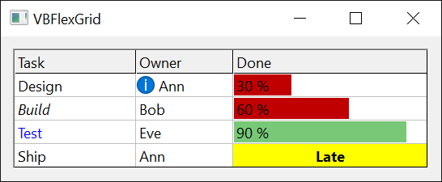

# Cell Formatting
{: .no_toc }

Alignment, colours, fonts, text style, pictures and flood bars of single cells and whole columns, and the **FillStyle** property that applies a cell setting to a whole selection.

A cell has the look of the grid until a **Cell...** property gives it a look of its own. The properties of the grid ([**BackColor**](Appearance#backcolor), [**ForeColor**](Appearance#forecolor), [**Font**](Appearance#font) and the others on the [Appearance](Appearance) page) are the defaults, and a cell, or a column for the alignment, overrides them. A property that has not been set for a cell returns the value the cell inherits, not a special "unset" value. Setting a colour, an alignment or a text style to -1 returns the cell to the grid's setting.

The **Cell...** properties of this page act on the current cell, the one at [**Row**](Selection#row) and [**Col**](Selection#col). Set those first, or use [**Cell**](Text#cell), which names the cell in each call and leaves the current cell alone.

{:width="364" height="150"}

```tb check_build check_run arch=win32,win64
VBFlexGrid1.Rows = 4
VBFlexGrid1.Cols = 3
VBFlexGrid1.Row = 2
VBFlexGrid1.Col = 1
VBFlexGrid1.CellBackColor = vbYellow
VBFlexGrid1.CellFontBold = True
VBFlexGrid1.CellAlignment = FlexAlignmentCenterCenter
Debug.Print VBFlexGrid1.CellBackColor = vbYellow                   ' True
Debug.Print VBFlexGrid1.Cell(FlexCellFontBold, 2, 1)               ' True
Debug.Print VBFlexGrid1.Cell(FlexCellBackColor, 3, 1) = VBFlexGrid1.BackColor ' True
VBFlexGrid1.CellBackColor = -1                                     ' back to the grid's colour
Debug.Print VBFlexGrid1.CellBackColor = VBFlexGrid1.BackColor      ' True
```

* TOC
{:toc}

## A block of cells with FillStyle

[**FillStyle**](#fillstyle) chooses whether a **Cell...** property changes one cell or every cell of the selection. With **FlexFillStyleSingle**, the default, it changes the current cell. With **FlexFillStyleRepeat** it changes the whole block from [**Row**](Selection#row) and [**Col**](Selection#col) to [**RowSel**](Selection#rowsel) and [**ColSel**](Selection#colsel). The same holds for [**Text**](Text#text), [**CellTag**](Text#celltag), [**CellChecked**](CheckBoxes#cellchecked) and the other properties that write a cell. Switch it back when the block is done: it stays in force for every later write.

```tb check_build check_run
VBFlexGrid1.Rows = 4
VBFlexGrid1.Cols = 4
VBFlexGrid1.Row = 1
VBFlexGrid1.Col = 1
VBFlexGrid1.RowSel = 2
VBFlexGrid1.ColSel = 2
VBFlexGrid1.FillStyle = FlexFillStyleRepeat
VBFlexGrid1.CellFontBold = True
VBFlexGrid1.CellForeColor = vbRed
VBFlexGrid1.FillStyle = FlexFillStyleSingle
Debug.Print VBFlexGrid1.Cell(FlexCellFontBold, 2, 2)  ' True
Debug.Print VBFlexGrid1.Cell(FlexCellFontBold, 3, 3)  ' False
Debug.Print VBFlexGrid1.Cell(FlexCellForeColor, 1, 2) = vbRed ' True
```

## Own formatting, and discarding it

A cell that has had any of its looks changed has *custom formatting*, which takes a little memory. [**CellHasCustomFormatting**](#cellhascustomformatting) tells whether a cell has it, and setting it to **False** discards the formatting of the cell, picture and font included, so that the cell looks like the grid again. [**Clear**](Structure#clear) with **FlexClearFormatting** does the same for a whole area.

The font of a cell is set as a whole. The first time a program writes **CellFontBold**, **CellFontItalic**, **CellFontName**, **CellFontSize**, **CellFontStrikeThrough**, **CellFontUnderline** or **CellFontCharset** for a cell, the cell takes a copy of the grid's [**Font**](Appearance#font) (or [**FontFixed**](Appearance#fontfixed) for a fixed cell) with that one attribute changed. A later change to the grid's font then no longer reaches that cell. Setting **CellFontName** to an empty string gives the cell the grid's font again, with every attribute.

```tb check_build check_run
VBFlexGrid1.Row = 1
VBFlexGrid1.Col = 1
Debug.Print VBFlexGrid1.CellHasCustomFormatting ' False
VBFlexGrid1.CellFontItalic = True
Debug.Print VBFlexGrid1.CellHasCustomFormatting ' True
Debug.Print VBFlexGrid1.CellFontName = VBFlexGrid1.Font.Name ' True
VBFlexGrid1.CellFontName = ""
Debug.Print VBFlexGrid1.CellFontItalic = VBFlexGrid1.Font.Italic ' True
VBFlexGrid1.CellHasCustomFormatting = False
Debug.Print VBFlexGrid1.CellHasCustomFormatting ' False
```

## Flood bars

A cell can show a coloured bar behind its text, as a progress bar does. [**CellFloodPercent**](#cellfloodpercent) sets how much of the cell's width the bar covers, and [**CellFloodColor**](#cellfloodcolor) its colour; the colour of a cell with none of its own is the grid's [**FloodColor**](#floodcolor). A positive percentage fills from the left edge, a negative one from the right edge. 0, the default, draws no bar. The bar is drawn behind the text, inside the grid line.

```tb check_build check_run
VBFlexGrid1.Rows = 4
VBFlexGrid1.Cols = 2
Dim r As Long
For r = 1 To 3
    VBFlexGrid1.TextMatrix(r, 1) = CStr(r * 30) & " %"
    VBFlexGrid1.Cell(FlexCellFloodPercent, r, 1) = r * 30
Next r
VBFlexGrid1.Cell(FlexCellFloodColor, 3, 1) = vbGreen
Debug.Print VBFlexGrid1.Cell(FlexCellFloodPercent, 2, 1)             ' 60
Debug.Print VBFlexGrid1.Cell(FlexCellFloodColor, 1, 1) = VBFlexGrid1.FloodColor ' True
Debug.Print VBFlexGrid1.Cell(FlexCellFloodColor, 3, 1) = vbGreen     ' True
```

## Pictures

[**CellPicture**](#cellpicture) puts a picture in a cell, drawn at the position [**CellPictureAlignment**](#cellpicturealignment) names. The picture keeps its own size, except with **FlexPictureAlignmentStretch**, and is cut off at the cell's edge. The text is drawn over the picture, unless the alignment is one of the *NoOverlap* values, which move the text clear of it. When many cells show the images of one list, [**ColImageList**](#colimagelist) is cheaper than a picture in each cell: the cell's text, or the result of [**CellImageCallback**](#cellimagecallback), is an index into the list.

## Properties

### CellAlignment
{: .no_toc }

The alignment of the text in the current cell.

Syntax: *object*.**CellAlignment** [ = *value* ]

A [**FlexAlignmentConstants**](../Enumerations/CellsAndAppearance#flexalignmentconstants) member, or -1. A cell that has not had one set returns the alignment of its column: [**ColAlignment**](#colalignment) for the cells of the scrollable area, [**FixedAlignment**](#fixedalignment) for the fixed cells. Writing -1 returns the cell to that. With [**FillStyle**](#fillstyle) at **FlexFillStyleRepeat** it sets every cell of the selection. Raises 30005 for another value, and 30009 or 30010 when there is no current row or column.

### CellBackColor
{: .no_toc }

The background colour of the current cell.

Syntax: *object*.**CellBackColor** [ = *value* ]

An **OLE_COLOR** held in a **Long**, a colour or a system colour value, or -1. A cell that has not had one set returns the grid's [**BackColor**](Appearance#backcolor), or [**BackColorFixed**](Appearance#backcolorfixed) for a fixed cell. Writing -1 returns the cell to that. With [**FillStyle**](#fillstyle) at **FlexFillStyleRepeat** it sets every cell of the selection. Raises 30009 or 30010 when there is no current row or column.

### CellFloodColor
{: .no_toc }

The colour of the flood bar of the current cell.

Syntax: *object*.**CellFloodColor** [ = *value* ]

An **OLE_COLOR** held in a **Long**, or -1. A cell that has not had one set returns the grid's [**FloodColor**](#floodcolor). Writing -1 returns the cell to that. The bar is drawn only when [**CellFloodPercent**](#cellfloodpercent) is not 0. With [**FillStyle**](#fillstyle) at **FlexFillStyleRepeat** it sets every cell of the selection.

### CellFloodPercent
{: .no_toc }

How much of the current cell its flood bar covers.

Syntax: *object*.**CellFloodPercent** [ = *value* ]

An **Integer** from -100 to 100. Default: 0, no bar. A positive value fills that percentage of the cell's width from the left edge and a negative value from the right edge. Raises 380 for a value outside the range, and 30009 or 30010 when there is no current row or column. With [**FillStyle**](#fillstyle) at **FlexFillStyleRepeat** it sets every cell of the selection.

### CellFontBold
{: .no_toc }

Whether the text of the current cell is bold.

Syntax: *object*.**CellFontBold** [ = *value* ]

A **Boolean**. A cell with no font of its own returns the bold setting of the grid's font. Writing it gives the cell its own font: see *Own formatting, and discarding it* above.

### CellFontCharset
{: .no_toc }

The character set of the font of the current cell.

Syntax: *object*.**CellFontCharset** [ = *value* ]

An **Integer**, a Windows character set number (0 is ANSI, 1 default, 204 Cyrillic). A cell with no font of its own returns the character set of the grid's font. Setting **CellFontName** also sets the character set from the font named.

### CellFontItalic
{: .no_toc }

Whether the text of the current cell is italic.

Syntax: *object*.**CellFontItalic** [ = *value* ]

A **Boolean**. A cell with no font of its own returns the italic setting of the grid's font.

### CellFontName
{: .no_toc }

The name of the font of the current cell.

Syntax: *object*.**CellFontName** [ = *value* ]

A **String**. A cell with no font of its own returns the name of the grid's font. Writing a name gives the cell its own font, a copy of the grid's with that name, and sets the character set to the one that font has. Writing an empty string gives the cell the grid's font again.

### CellFontSize
{: .no_toc }

The size in points of the font of the current cell.

Syntax: *object*.**CellFontSize** [ = *value* ]

A **Single**. A cell with no font of its own returns the size of the grid's font. A row grows to hold a larger font only when [**RowHeight**](Sizing#rowheight) or [**AutoSize**](Sizing#autosize) is used to size it.

### CellFontStrikeThrough
{: .no_toc }

Whether the text of the current cell is struck through.

Syntax: *object*.**CellFontStrikeThrough** [ = *value* ]

A **Boolean**. A cell with no font of its own returns the strikethrough setting of the grid's font.

### CellFontUnderline
{: .no_toc }

Whether the text of the current cell is underlined.

Syntax: *object*.**CellFontUnderline** [ = *value* ]

A **Boolean**. A cell with no font of its own returns the underline setting of the grid's font.

### CellForeColor
{: .no_toc }

The colour of the text of the current cell.

Syntax: *object*.**CellForeColor** [ = *value* ]

An **OLE_COLOR** held in a **Long**, or -1. A cell that has not had one set returns the grid's [**ForeColor**](Appearance#forecolor), or [**ForeColorFixed**](Appearance#forecolorfixed) for a fixed cell. Writing -1 returns the cell to that. The colour is not used while the cell is selected and the grid's [**UseForeColorSel**](Appearance#useforecolorsel) is **True**; the grid's [**ForeColorSel**](Appearance#forecolorsel) is used then.

### CellHasCustomFormatting
{: .no_toc }

Whether the current cell has formatting of its own.

Syntax: *object*.**CellHasCustomFormatting** [ = *value* ]

A **Boolean**. It is **True** once any look of the cell has been written. Setting it to **True** reserves the memory for formatting without changing any look; setting it to **False** discards all the formatting of the cell and returns it to the grid's look. With [**FillStyle**](#fillstyle) at **FlexFillStyleRepeat** it applies to every cell of the selection. Raises 30009 or 30010 when there is no current row or column.

### CellPicture
{: .no_toc }

The picture of the current cell.

Syntax: *object*.**CellPicture** [ = *value* ]

Syntax: **Set** *object*.**CellPicture** = *value*

An **IPictureDisp**. A cell with no picture returns **Nothing**. Write **Nothing** to remove it. With [**FillStyle**](#fillstyle) at **FlexFillStyleRepeat** it sets every cell of the selection.

```tb check_build
VBFlexGrid1.Row = 1
VBFlexGrid1.Col = 1
Set VBFlexGrid1.CellPicture = Picture1.Picture
VBFlexGrid1.CellPictureAlignment = FlexPictureAlignmentLeftCenterNoOverlap
```

### CellPictureAlignment
{: .no_toc }

Where the picture of the current cell is drawn.

Syntax: *object*.**CellPictureAlignment** [ = *value* ]

A [**FlexPictureAlignmentConstants**](../Enumerations/CellsAndAppearance#flexpicturealignmentconstants) member. Default: **FlexPictureAlignmentLeftTop**. **FlexPictureAlignmentStretch** scales the picture to the cell and **FlexPictureAlignmentTile** repeats it. Raises 30005 for another value, and 30009 or 30010 when there is no current row or column.

### CellTextStyle
{: .no_toc }

The 3D effect of the text of the current cell.

Syntax: *object*.**CellTextStyle** [ = *value* ]

A [**FlexTextStyleConstants**](../Enumerations/CellsAndAppearance#flextextstyleconstants) member, or -1. A cell that has not had one set returns the grid's [**TextStyle**](Appearance#textstyle), or [**TextStyleFixed**](Appearance#textstylefixed) for a fixed cell. Writing -1 returns the cell to that. Raises 380 for another value.

### ColAlignment
{: .no_toc }

The alignment of the text in the scrollable cells of a column.

Syntax: *object*.**ColAlignment**(*Index*) [ = *value* ]

*Index*
: *required* The column, as a **Long**. -1 in a write means every column. It is not valid in a read.

A [**FlexAlignmentConstants**](../Enumerations/CellsAndAppearance#flexalignmentconstants) member. Default: **FlexAlignmentGeneral**: numbers and dates are aligned right, other text left. The fixed cells of the column use it too unless [**FixedAlignment**](#fixedalignment) is set. A [**CellAlignment**](#cellalignment) of a single cell overrides it. The [**FormatString**](Structure#formatstring) property sets it for all columns. Raises 30004 when *Index* is not a column (and not -1 in a write), and 30005 for another value.

```tb check_build check_run
VBFlexGrid1.Cols = 3
Debug.Print VBFlexGrid1.ColAlignment(1) = FlexAlignmentGeneral ' True
VBFlexGrid1.ColAlignment(1) = FlexAlignmentRightCenter
VBFlexGrid1.FixedAlignment(1) = FlexAlignmentCenterCenter
Debug.Print VBFlexGrid1.Cell(FlexCellAlignment, 1, 1) = FlexAlignmentRightCenter   ' True
Debug.Print VBFlexGrid1.Cell(FlexCellAlignment, 0, 1) = FlexAlignmentCenterCenter  ' True
Debug.Print VBFlexGrid1.Cell(FlexCellAlignment, 1, 2) = FlexAlignmentGeneral       ' True
```

### ColImageList
{: .no_toc }

The image list whose images a column shows instead of its text.

Syntax: *object*.**ColImageList**(*Index*) [ = *value* ]

Syntax: **Set** *object*.**ColImageList**(*Index*) = *value*

*Index*
: *required* The column, as a **Long**.

A **Variant** holding an **ImageList** object that has a handle (its **hImageList** property), or the handle of an image list, as a **Long** or **LongLong**. Writing **Empty** or **Nothing** removes the list. Reading returns the object that was set, the handle that was set, or **Empty**.

For each cell of the column the grid finds an image index, and draws that image instead of the text when there is one. The index is the value of [**CellImageCallback**](#cellimagecallback) when the event sets *Handled*; otherwise it is the cell's text read as a number, or, with an **ImageList** object, as a key of its **ListImages**. An index that is 0 or beyond the list draws no image, and the text is drawn as usual. The image is aligned by the cell's alignment: [**CellAlignment**](#cellalignment), [**ColAlignment**](#colalignment) or [**FixedAlignment**](#fixedalignment). Raises 30010 when *Index* is not a column, 13 for a value that is not an object, a **Long**, a **LongLong** or **Empty**, and 35610 for an object that is not an **ImageList**.

```tb check_build
Dim hList As LongPtr                      ' the handle of an image list the program created
VBFlexGrid1.ColImageList(1) = hList
VBFlexGrid1.TextMatrix(1, 1) = "2"        ' shows the second image
```

### FillStyle
{: .no_toc }

Whether a **Cell...** property or **Text** changes one cell or the whole selection.

Syntax: *object*.**FillStyle** [ = *value* ]

A [**FlexFillStyleConstants**](../Enumerations/CellsAndAppearance#flexfillstyleconstants) member. Default: **FlexFillStyleSingle**. Raises 380 for another value.

### FixedAlignment
{: .no_toc }

The alignment of the text in the fixed cells of a column.

Syntax: *object*.**FixedAlignment**(*Index*) [ = *value* ]

*Index*
: *required* The column, as a **Long**. -1 in a write means every column. It is not valid in a read.

A [**FlexAlignmentConstants**](../Enumerations/CellsAndAppearance#flexalignmentconstants) member, or -1. A column that has not had one set uses [**ColAlignment**](#colalignment) for its fixed cells, and reading it returns that. Writing -1 returns the column to that. Raises 30004 when *Index* is not a column (and not -1 in a write), and 30005 for another value.

### FloodColor
{: .no_toc }

The colour of the flood bars of the cells that have no colour of their own.

Syntax: *object*.**FloodColor** [ = *value* ]

An **OLE_COLOR**. Default: &HC0& (a dark red, `RGB(192, 0, 0)`). It is the colour of every bar whose cell has no [**CellFloodColor**](#cellfloodcolor).

## Events

### CellImageCallback
{: .no_toc }

Occurs when a cell of a column with a [**ColImageList**](#colimagelist) needs the index of its image.

Syntax: *object*\_**CellImageCallback**(*Row* As **Long**, *Col* As **Long**, *Image* As **Variant**, *Handled* As **Boolean**)

*Row*, *Col*
: The cell.

*Image*
: **ByRef**, **Empty** on entry. The program sets it to the index of the image, as a number, or to the key of the image in the **ImageList** object (a string). A **Long**, **Integer** and **Byte** are taken as an index, a **Double** or **Single** is rounded to one.

*Handled*
: **ByRef**, **False** on entry. Set it to **True** to use *Image*. Left **False**, the grid reads the cell's text as an index or a key, as it does when the event does not exist. Setting it **True** with an *Image* that selects no image is the way to make a cell, for example a fixed cell, show no image.

```tb check_build
Private Sub VBFlexGrid1_CellImageCallback(ByVal Row As Long, ByVal Col As Long, ByRef Image As Variant, ByRef Handled As Boolean)
    If Row < VBFlexGrid1.FixedRows Then
        Handled = True          ' no image in the fixed rows
    ElseIf VBFlexGrid1.TextMatrix(Row, Col) = "Yes" Then
        Image = 1
        Handled = True
    End If
End Sub
```

## See Also

- [Cell Text](Text) -- the text of the cells, [**Cell**](Text#cell), formats and lookups
- [Appearance](Appearance) -- the grid-wide colours, fonts and lines that cells inherit
- [Check Boxes](CheckBoxes) -- [**CellChecked**](CheckBoxes#cellchecked)
- [Drop-Down Lists, Buttons and Calendars](ComboEditing) -- the combo cue of a cell
- [**FlexAlignmentConstants**](../Enumerations/CellsAndAppearance#flexalignmentconstants), [**FlexPictureAlignmentConstants**](../Enumerations/CellsAndAppearance#flexpicturealignmentconstants), [**FlexTextStyleConstants**](../Enumerations/CellsAndAppearance#flextextstyleconstants), [**FlexFillStyleConstants**](../Enumerations/CellsAndAppearance#flexfillstyleconstants)
