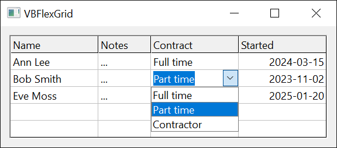
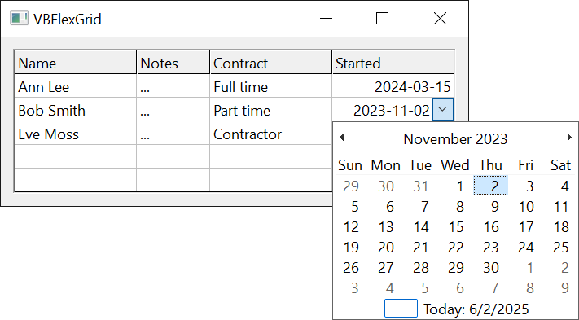
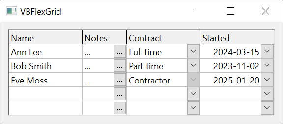

# Drop-Down Lists, Buttons and Calendars
{: .no_toc }

Gives the edit box of a cell a drop-down list, a button or a drop-down calendar, and draws a cue in the cell that tells the user about it.

When a cell is edited (see [Editing Cells](Editing)), the box can carry a combo part at its left or right edge. The part is set by a mode, a [**FlexComboModeConstants**](../Enumerations/EditingAndComboBoxes#flexcombomodeconstants) value, which is **FlexComboModeNone** (a plain edit box) by default:

| Mode | The edit box | The combo part |
|:-----|:-------------|:---------------|
| **FlexComboModeDropDown** | The text is locked. | A button and a list. The list drops down when the edit starts. Choosing an item ends the edit and stores the item. |
| **FlexComboModeEditable** | The user can type. | A button and a list. The list drops down at the user's request: a click on the button, **F4**, **Alt+Up** or **Alt+Down**. Choosing an item puts it in the box. A text typed in the box that equals an item (case ignored) selects it. |
| **FlexComboModeButton** | The user can type. | A button, by default with an ellipsis, that raises [**ComboButtonClick**](#combobuttonclick) when pressed. The program shows its own dialog and sets [**EditText**](Editing#edittext). |
| **FlexComboModeCalendar** | The user can type a date. | A button and a month calendar. Choosing a date puts it in the box, in the short date format of the system. A date typed in the box moves the calendar to it. When the box is locked, the calendar drops down when the edit starts, and choosing a date ends the edit. |

The mode is set for one column with [**ColComboMode**](#colcombomode), or for every cell with [**ComboMode**](#combomode). A column whose mode is not **FlexComboModeNone** uses its own [**ColComboItems**](#colcomboitems), [**ColComboHeader**](#colcomboheader) and [**ColComboBoundColumn**](#colcomboboundcolumn); another column uses the grid's [**ComboItems**](#comboitems), [**ComboHeader**](#comboheader) and [**ComboBoundColumn**](#comboboundcolumn). The button's alignment and width follow the same rule ([**ColComboButtonAlignment**](#colcombobuttonalignment), [**ColComboButtonWidth**](#colcombobuttonwidth)), where -1 in the column inherits the grid's value. A program that wants a mode for single cells sets the grid's properties in [**BeforeEdit**](Editing#beforeedit), which occurs before the grid reads them.

{:width="384" height="169"}

{:width="474" height="262"}

```tb check_build
Private Sub Form_Load()
    With VBFlexGrid1
        .AllowUserEditing = True
        .ColComboMode(1) = FlexComboModeDropDown
        .ColComboItems(1) = "Full time|Part time|Contractor"
        .ColComboCue(1) = FlexComboCueDropDown
        .ColComboMode(2) = FlexComboModeCalendar
        .ColComboCue(2) = FlexComboCueDropDown
        .ColComboMode(3) = FlexComboModeButton
        .ColComboCue(3) = FlexComboCueButton
    End With
End Sub

Private Sub VBFlexGrid1_ComboButtonClick()
    VBFlexGrid1.EditText = "Chosen by the program"
End Sub
```

* TOC
{:toc}

## Items, columns and headers

The items of a list are one string. A vertical bar (`|`) separates the items, and a tab character (**vbTab**) separates the columns of one item, when the list has more than one column:

| Items | The list |
|:------|:---------|
| `"Full|Part|Other"` | Three items. |
| `"|Full|Part"` | Three items, the first of them empty. |
| `""` | One empty item. |
| not set | No items. The list is locked, as a list box with no items. |

The list shows up to nine items and a scroll bar after that. It is as wide as the widest item, and at least as wide as the cell. It drops below the cell, or above it when it does not fit on the screen. The items are in the order of the string, and an item cannot contain a vertical bar.

With columns, the list is drawn as a table. One column is *bound*: its text is what the list holds, what [**ComboList**](#combolist) returns, and what goes into the edit box and the cell when the user chooses the item. [**ComboBoundColumn**](#comboboundcolumn) numbers it from 0, with 0 the default. An item that has fewer columns than that has an empty bound text. [**ComboHeader**](#comboheader) gives a heading for the columns, with the columns separated by tab characters again; the heading is drawn above the list and is not one of its items.

When the list opens it selects the item whose text equals the text of the cell (case ignored), or none.

`ComboWatcher`, below, logs the events of this page, and has two switches that the samples use. The samples that open a list or a calendar show the form first, because the grid needs a window.

```tb check_build projname=combo slot=file
Class ComboWatcher
    Private WithEvents Grid As VBFLXGRD18.VBFlexGrid
    Private mLog As String

    Public RefuseEdit As Boolean    ' BeforeEdit refuses every edit
    Public RefuseDrop As Boolean    ' ComboBeforeDropDown refuses every drop-down

    Public Sub Attach(ByVal G As VBFLXGRD18.VBFlexGrid)
        Set Grid = G
    End Sub

    ' Returns the events logged so far, and clears the log.
    Public Function Take() As String
        Take = Trim$(mLog)
        mLog = ""
    End Function

    Private Sub Grid_BeforeEdit(ByRef Row As Long, ByRef Col As Long, ByVal Reason As FlexEditReasonConstants, ByRef Cancel As Boolean)
        Cancel = RefuseEdit
    End Sub
    Private Sub Grid_ComboBeforeDropDown(ByVal Reason As FlexComboDropDownReasonConstants, ByRef Cancel As Boolean)
        mLog &= " Before(" & Reason & ")"
        Cancel = RefuseDrop
    End Sub
    Private Sub Grid_ComboDropDown()
        mLog &= " DropDown"
    End Sub
    Private Sub Grid_ComboCloseUp()
        mLog &= " CloseUp"
    End Sub
    Private Sub Grid_ComboButtonClick()
        mLog &= " ButtonClick"
    End Sub
    Private Sub Grid_ComboCueClick(ByVal Row As Long, ByVal Col As Long, ByVal Reason As FlexEditReasonConstants)
        mLog &= " Cue(" & Row & "," & Col & "," & Reason & ")"
    End Sub
End Class
```

```tb check_build check_run projname=combo
Form1.Show
DoEvents
Dim W As New ComboWatcher
W.Attach VBFlexGrid1
With VBFlexGrid1
    .Rows = 4
    .Cols = 4
    .Row = 1
    .Col = 1
    .TextMatrix(1, 1) = "Part"
    .ColComboMode(1) = FlexComboModeDropDown
    .ColComboItems(1) = "Full|Part|Other"
    Debug.Print .StartEdit()           ' True
    Debug.Print W.Take()               ' Before(1) DropDown
    Debug.Print .ComboListCount        ' 3
    Debug.Print .ComboList(2)          ' Other
    Debug.Print .ComboListIndex        ' 1
    .ComboListIndex = 2
    Debug.Print .EditText              ' Other
    Debug.Print .CommitEdit()          ' True
    Debug.Print W.Take()               ' CloseUp
    Debug.Print .TextMatrix(1, 1)      ' Other
    Debug.Print .hWndComboList         ' 0
End With
```

A list that has more than one column:

```tb check_build check_run projname=combo
Form1.Show
DoEvents
With VBFlexGrid1
    .Rows = 4
    .Cols = 4
    .Row = 1
    .Col = 2
    .ColComboMode(2) = FlexComboModeDropDown
    .ColComboItems(2) = "1" & vbTab & "One|2" & vbTab & "Two|3"
    .ColComboHeader(2) = "Id" & vbTab & "Name"
    .ColComboBoundColumn(2) = 1
    .StartEdit
    Debug.Print .ComboListCount                                                    ' 3
    Debug.Print .ComboList(0) & "," & .ComboList(1) & ",[" & .ComboList(2) & "]"   ' One,Two,[]
    .ComboListIndex = 1
    Debug.Print .EditText                                                          ' Two
    .CommitEdit
    Debug.Print .TextMatrix(1, 2)                                                  ' Two
    .ColComboBoundColumn(2) = 0
    .StartEdit
    .ComboListIndex = 1
    Debug.Print .EditText                                                          ' 2
    .CancelEdit
End With
```

A column that has a [**ColLookup**](Text#collookup) holds the key in the cell, and shows the description in the box. Give the list the descriptions:

```tb check_build check_run projname=combo
Form1.Show
DoEvents
With VBFlexGrid1
    .ColLookup(1) = "1;Full time|2;Part time|3;Contractor"
    .ColComboMode(1) = FlexComboModeDropDown
    .ColComboItems(1) = "Full time|Part time|Contractor"
    .TextMatrix(1, 1) = "2"
    .Row = 1
    .Col = 1
    .StartEdit
    Debug.Print .ComboListIndex     ' 1
    .ComboListIndex = 2
    .CommitEdit
    Debug.Print .TextMatrix(1, 1)   ' 3
End With
```

## Dropping down by code

[**ComboButtonValue**](#combobuttonvalue) is the state of the button of the box that is being edited. Setting it to **FlexComboButtonValuePressed** drops the list or the calendar down, or, in the button mode, raises [**ComboButtonClick**](#combobuttonclick). Setting it to **FlexComboButtonValueUnpressed** closes them, and **FlexComboButtonValueDisabled** also disables the button. [**ComboBeforeDropDown**](#combobeforedropdown), [**ComboDropDown**](#combodropdown) and [**ComboCloseUp**](#combocloseup) report the list or calendar. **ComboBeforeDropDown** can refuse a drop-down, and its *Reason* says what asked for it, a [**FlexComboDropDownReasonConstants**](../Enumerations/EditingAndComboBoxes#flexcombodropdownreasonconstants) value.

```tb check_build check_run projname=combo
Form1.Show
DoEvents
Dim W As New ComboWatcher
W.Attach VBFlexGrid1
With VBFlexGrid1
    .Rows = 4
    .Cols = 4
    .Row = 1
    .ColComboMode(2) = FlexComboModeEditable
    .ColComboItems(2) = "Full|Part|Other"
    .ColComboMode(3) = FlexComboModeButton
    .Col = 2
    .StartEdit
    Debug.Print "[" & W.Take() & "]"          ' []
    Debug.Print .ComboListIndex               ' -1
    .ComboButtonValue = FlexComboButtonValuePressed
    Debug.Print W.Take()                      ' Before(0) DropDown
    Debug.Print .ComboButtonValue             ' 1
    .ComboButtonValue = FlexComboButtonValueUnpressed
    Debug.Print W.Take()                      ' CloseUp
    W.RefuseDrop = True
    .ComboButtonValue = FlexComboButtonValuePressed
    Debug.Print W.Take()                      ' Before(0)
    Debug.Print .ComboButtonValue             ' 0
    .CancelEdit
    .Col = 3
    .StartEdit
    Debug.Print .hWndComboList                ' 0
    .ComboButtonValue = FlexComboButtonValuePressed
    Debug.Print W.Take()                      ' ButtonClick
    .CancelEdit
End With
```

The calendar takes its date from the text of the cell, when that is a date. [**ComboCalendarMinDate**](#combocalendarmindate) and [**ComboCalendarMaxDate**](#combocalendarmaxdate) limit the dates, from 1 January 1900 to 31 December 9999 by default. The edit box does not follow a date that code sets with [**ComboCalendarValue**](#combocalendarvalue): the box changes when the user chooses a date, or when the program assigns [**EditText**](Editing#edittext). The program checks the text in [**ValidateEdit**](Editing#validateedit), where it can also give the date one format.

```tb check_build check_run projname=combo
Form1.Show
DoEvents
With VBFlexGrid1
    .Rows = 4
    .Cols = 4
    .Row = 1
    .Col = 1
    .TextMatrix(1, 1) = "2024-03-15"
    .ColComboMode(1) = FlexComboModeCalendar
    .StartEdit
    Debug.Print (.hWndComboCalendar <> 0) & " " & (.hWndComboList <> 0)   ' True False
    Debug.Print Format(.ComboCalendarValue, "yyyy-mm-dd")                 ' 2024-03-15
    Debug.Print Format(.ComboCalendarMinDate, "yyyy-mm-dd") & " " & Format(.ComboCalendarMaxDate, "yyyy-mm-dd")   ' 1900-01-01 9999-12-31
    .ComboCalendarMinDate = #1/1/2024#
    .ComboCalendarMaxDate = #12/31/2024#
    .ComboCalendarValue = #6/1/2024#
    Debug.Print Format(.ComboCalendarValue, "yyyy-mm-dd") & " " & .EditText   ' 2024-06-01 2024-03-15
    .CancelEdit
End With
```

## Combo cues

A *cue* is a small button that the grid draws at the edge of a cell, before the cell is edited, to show that it has a list, a calendar or a button. It is a [**FlexComboCueConstants**](../Enumerations/EditingAndComboBoxes#flexcombocueconstants) value:

| Cue | Drawn |
|:----|:------|
| **FlexComboCueNone** | No cue. It is the default, and means that no cue is set at this level. |
| **FlexComboCueDropDown** | A drop-down arrow, the width of a scroll bar. |
| **FlexComboCueButton** | A button with an ellipsis, with the width of [**ComboButtonWidth**](#combobuttonwidth). |
| **FlexComboCueDisabledDropDown**, **FlexComboCueDisabledButton** | The same, disabled. A click on them does nothing. |
| **FlexComboCueHidden** | No cue, and no cue from another level either. |

{:width="384" height="169"}

A cue is set for a cell with [**CellComboCue**](#cellcombocue), for a column with [**ColComboCue**](#colcombocue), and for one cell of the grid with [**ComboCue**](#combocue) together with [**ComboCueRow**](#combocuerow) and [**ComboCueCol**](#combocuecol), which are the current cell when they are -1. The cell's own value wins over the column's, and the column's over the grid's. A column's cue does not apply to the fixed rows. **FlexComboCueHidden** takes a cell out of the column's cue, for example a frozen row.

Cues are drawn only when [**AllowUserEditing**](Editing#allowuserediting) or [**AlwaysAllowComboCues**](#alwaysallowcombocues) is **True**. A click on a cue, a double-click on it, **F4**, and **Alt+Up** or **Alt+Down** on a cell that has a drop-down cue, start an edit with the reason **FlexEditReasonComboCueClick**, **FlexEditReasonComboCueDblClick**, **FlexEditReasonComboCueF4** or **FlexEditReasonComboCueAltUpDown**. The box then drops the list or the calendar down at once, or clicks the button, as the mode of the cell says. A cell whose mode is **FlexComboModeNone** starts a normal edit.

With [**AlwaysAllowComboCues**](#alwaysallowcombocues) set, a cue also works when the user cannot edit, because **AllowUserEditing** is **False** or [**BeforeEdit**](Editing#beforeedit) refused the edit. The grid then raises [**ComboCueClick**](#combocueclick), and the program shows what it wants.

```tb check_build hidden projname=combo slot=file
Module KeySender
    Private Declare PtrSafe Function SendMessageW Lib "user32" (ByVal hWnd As LongPtr, ByVal Msg As Long, ByVal wParam As LongPtr, ByVal lParam As LongPtr) As LongPtr

    Public Sub SendKey(ByVal Grid As VBFLXGRD18.VBFlexGrid, ByVal KeyCode As Long)
        Const WM_KEYDOWN As Long = &H100
        SendMessageW Grid.hWnd, WM_KEYDOWN, KeyCode, 0
    End Sub
End Module
```

The sample presses **F4** with `SendKey`, a procedure that sends a key-down message to the window of the grid in place of the keyboard.

```tb check_build check_run projname=combo
Form1.Show
DoEvents
Dim W As New ComboWatcher
W.Attach VBFlexGrid1
With VBFlexGrid1
    .Rows = 4
    .Cols = 4
    .Row = 1
    .Col = 1
    .SetFocus
    .ColComboCue(1) = FlexComboCueDropDown
    SendKey VBFlexGrid1, vbKeyF4
    Debug.Print "[" & W.Take() & "] " & .EditRow      ' [] -1
    .AlwaysAllowComboCues = True
    SendKey VBFlexGrid1, vbKeyF4
    Debug.Print W.Take() & " " & .EditRow             ' Cue(1,1,12) -1
    .AllowUserEditing = True
    SendKey VBFlexGrid1, vbKeyF4
    Debug.Print .EditRow & " " & .EditReason          ' 1 12
    .CancelEdit
    .ColComboMode(1) = FlexComboModeDropDown
    .ColComboItems(1) = "a|b"
    W.Take
    SendKey VBFlexGrid1, vbKeyF4
    Debug.Print W.Take()                              ' Before(1) DropDown
    .CancelEdit
    W.Take
    W.RefuseEdit = True
    SendKey VBFlexGrid1, vbKeyF4
    Debug.Print W.Take() & " " & .EditRow             ' Cue(1,1,12) -1
    W.RefuseEdit = False
    .ColComboCue(1) = FlexComboCueDisabledDropDown
    SendKey VBFlexGrid1, vbKeyF4
    Debug.Print "[" & W.Take() & "] " & .EditRow      ' [] -1
End With
```

## Setting the mode, the items and the cue

The properties that take a column accept -1, which in an assignment sets every column. Reading a column that does not exist, or -1, raises error 30010 (*Invalid Col value*). The sample also shows the errors that the combo properties raise.

```tb check_build check_run projname=combo
Form1.Show
DoEvents
With VBFlexGrid1
    .Rows = 4
    .Cols = 4
    .Row = 1
    .Col = 3
    .ComboMode = FlexComboModeDropDown
    .ComboItems = "a|b"
    .StartEdit
    Debug.Print .ComboListCount & .ComboList(0)   ' 2a
    .CancelEdit
    .ColComboMode(3) = FlexComboModeEditable
    .ColComboItems(3) = "x|y|z"
    .StartEdit
    Debug.Print .ComboListCount & .ComboList(0)   ' 3x
    .CancelEdit
    .ColComboMode(3) = FlexComboModeNone
    .StartEdit
    Debug.Print .ComboListCount & .ComboList(0)   ' 2a
    .CancelEdit
    On Error Resume Next
    Debug.Print .ComboListCount
    Debug.Print Err.Number    ' 5
    Err.Clear
    .ComboMode = 9
    Debug.Print Err.Number    ' 380
    Err.Clear
    .ComboBoundColumn = -1
    Debug.Print Err.Number    ' 380
    Err.Clear
    Debug.Print .ColComboMode(-1)
    Debug.Print Err.Number    ' 30010
    Err.Clear
    .ColComboButtonWidth(1) = -5
    Debug.Print Err.Number    ' 30014
    Err.Clear
    .ComboCueRow = 99
    Debug.Print Err.Number    ' 30009
    Err.Clear
    .ComboButtonValue = FlexComboButtonValuePressed
    Debug.Print Err.Number    ' 5
    Err.Clear
    .ColComboMode(-1) = FlexComboModeDropDown
    Debug.Print .ColComboMode(0) & .ColComboMode(3)   ' 11
    .Row = 2
    .Col = 2
    Debug.Print .ComboCueRow & .ComboCueCol   ' 22
    .ComboCueRow = 1
    Debug.Print .ComboCueRow & .ComboCueCol   ' 12
End With
```

The grid reads the grid-wide [**ComboMode**](#combomode) and [**ComboItems**](#comboitems) when an edit starts, after [**BeforeEdit**](Editing#beforeedit). A handler of that event can therefore give the cell about to be edited its own list. In the example, only row 1 has one:

```tb check_build projname=combo slot=file
Class RowCombo
    Private WithEvents Grid As VBFLXGRD18.VBFlexGrid

    Public Sub Attach(ByVal G As VBFLXGRD18.VBFlexGrid)
        Set Grid = G
    End Sub

    Private Sub Grid_BeforeEdit(ByRef Row As Long, ByRef Col As Long, ByVal Reason As FlexEditReasonConstants, ByRef Cancel As Boolean)
        If Row = 1 Then
            Grid.ComboMode = FlexComboModeDropDown
            Grid.ComboItems = "Yes|No"
        Else
            Grid.ComboMode = FlexComboModeNone
        End If
    End Sub
End Class
```

```tb check_build check_run projname=combo
Form1.Show
DoEvents
Dim R As New RowCombo
R.Attach VBFlexGrid1
With VBFlexGrid1
    .Rows = 4
    .Col = 1
    .Row = 1
    .StartEdit
    Debug.Print .ComboListCount   ' 2
    .CancelEdit
    .Row = 2
    .StartEdit
    Debug.Print .hWndComboList    ' 0
    .CancelEdit
End With
```

## Properties

### AlwaysAllowComboCues
{: .no_toc }

Whether combo cues work when the user cannot edit. **Boolean**. Default **False**.

Syntax: *object*.**AlwaysAllowComboCues** [ = *value* ]

With **True**, the cues are drawn although [**AllowUserEditing**](Editing#allowuserediting) is **False**, and a cue that cannot start an edit raises [**ComboCueClick**](#combocueclick).

### CellComboCue
{: .no_toc }

The combo cue of the current cell. A [**FlexComboCueConstants**](../Enumerations/EditingAndComboBoxes#flexcombocueconstants) value. Default **FlexComboCueNone**.

Syntax: *object*.**CellComboCue** [ = *value* ]

With [**FillStyle**](CellFormatting#fillstyle) **FlexFillStyleRepeat**, an assignment applies to every cell of the selection. Raises error 30009 or 30010 when there is no current cell, and error 380 for a value that is not a member of the enumeration.

### ColComboBoundColumn
{: .no_toc }

The bound column of the lists of a column. **Long**. Default 0.

Syntax: *object*.**ColComboBoundColumn**( *Index* ) [ = *value* ]

*Index*
: *required* A **Long**. The column, or -1 to set every column.

As [**ComboBoundColumn**](#comboboundcolumn), for a column with its own [**ColComboMode**](#colcombomode). A negative value raises error 380.

### ColComboButtonAlignment
{: .no_toc }

The side of the cell where the combo button of a column is. A [**FlexLeftRightAlignmentConstants**](../Enumerations/EditingAndComboBoxes#flexleftrightalignmentconstants) value, or -1 to use [**ComboButtonAlignment**](#combobuttonalignment). Default -1.

Syntax: *object*.**ColComboButtonAlignment**( *Index* ) [ = *value* ]

*Index*
: *required* A **Long**. The column, or -1 to set every column.

Reading returns the value of **ComboButtonAlignment** when the column has none of its own. Error 380 for any other value.

### ColComboButtonPicture
{: .no_toc }

The picture on the combo buttons of a column. An **IPictureDisp**. Default **Nothing**.

Syntax: *object*.**ColComboButtonPicture**( *Index* ) [ = *value* ]  
Syntax: **Set** *object*.**ColComboButtonPicture**( *Index* ) = *value*

*Index*
: *required* A **Long**. The column, or -1 to set every column.

The picture replaces the ellipsis, and wins over [**ComboButtonPicture**](#combobuttonpicture). It is used only when [**ComboButtonDrawMode**](#combobuttondrawmode) is **FlexComboButtonDrawModeNormal** and the mode of the cell is **FlexComboModeButton**. **Nothing** removes it.

### ColComboButtonWidth
{: .no_toc }

The width of the combo buttons of a column, in twips. **Long**. Default -1.

Syntax: *object*.**ColComboButtonWidth**( *Index* ) [ = *value* ]

*Index*
: *required* A **Long**. The column, or -1 to set every column.

-1 uses [**ComboButtonWidth**](#combobuttonwidth). Reading returns the width in effect, in twips, which for the default is the width of a scroll bar. A value below -1 raises error 30014 (*Invalid Col Width value*). Only the button mode has a button that can be widened: a drop-down button always has the width of a scroll bar.

### ColComboCue
{: .no_toc }

The combo cue of the cells of a column, the fixed rows excluded. A [**FlexComboCueConstants**](../Enumerations/EditingAndComboBoxes#flexcombocueconstants) value. Default **FlexComboCueNone**.

Syntax: *object*.**ColComboCue**( *Index* ) [ = *value* ]

*Index*
: *required* A **Long**. The column, or -1 to set every column.

[**CellComboCue**](#cellcombocue) wins over it, and it wins over [**ComboCue**](#combocue).

### ColComboHeader
{: .no_toc }

The heading of the multi-column lists of a column. **String**. Default empty.

Syntax: *object*.**ColComboHeader**( *Index* ) [ = *value* ]

*Index*
: *required* A **Long**. The column, or -1 to set every column.

The columns of the heading are separated with tab characters, as in [**ColComboItems**](#colcomboitems).

### ColComboItems
{: .no_toc }

The items of the lists of a column. **String**. Default empty, which is no items.

Syntax: *object*.**ColComboItems**( *Index* ) [ = *value* ]

*Index*
: *required* A **Long**. The column, or -1 to set every column.

The items are separated with `|`. To make a list of several columns, separate the columns of an item with tab characters. Used when [**ColComboMode**](#colcombomode) of the column is a drop-down list or an editable list.

### ColComboMode
{: .no_toc }

The combo mode of the cells of a column. A [**FlexComboModeConstants**](../Enumerations/EditingAndComboBoxes#flexcombomodeconstants) value. Default **FlexComboModeNone**.

Syntax: *object*.**ColComboMode**( *Index* ) [ = *value* ]

*Index*
: *required* A **Long**. The column, or -1 to set every column.

A column mode other than **FlexComboModeNone** wins over [**ComboMode**](#combomode). Error 380 for a value that is not a member of the enumeration; error 30010 for an invalid column.

### ComboBoundColumn
{: .no_toc }

The column of a multi-column list whose text goes to the edit box. **Long**. Default 0.

Syntax: *object*.**ComboBoundColumn** [ = *value* ]

Counted from 0. A negative value raises error 380.

### ComboButtonAlignment
{: .no_toc }

The side of the cell where the combo button and the cue are. A [**FlexLeftRightAlignmentConstants**](../Enumerations/EditingAndComboBoxes#flexleftrightalignmentconstants) value. Default **FlexLeftRightAlignmentRight**.

Syntax: *object*.**ComboButtonAlignment** [ = *value* ]

Useful when the reading order is right to left. Error 380 for any other value.

### ComboButtonClientWidth
{: .no_toc }

The width of the content area of a combo button, in twips. **Long**, read-only.

Syntax: *object*.**ComboButtonClientWidth**

The width of a button with the current [**ComboButtonWidth**](#combobuttonwidth), less its frame. It is the room that a picture for the button has (see [**ComboButtonPicture**](#combobuttonpicture)). It depends on the visual style. 0 when the grid has no window yet.

### ComboButtonDrawMode
{: .no_toc }

Who draws the combo button. A [**FlexComboButtonDrawModeConstants**](../Enumerations/EditingAndComboBoxes#flexcombobuttondrawmodeconstants) value. Default **FlexComboButtonDrawModeNormal**.

Syntax: *object*.**ComboButtonDrawMode** [ = *value* ]

With **FlexComboButtonDrawModeOwnerDraw**, the grid raises [**ComboButtonOwnerDraw**](#combobuttonownerdraw) each time a button or cue is to be drawn. Error 380 for any other value.

### ComboButtonNonClientHeight
{: .no_toc }

The height that the frame of a combo button takes from its content area, in twips. **Long**, read-only.

Syntax: *object*.**ComboButtonNonClientHeight**

It is the top and the bottom frame together. It depends on the visual style. 0 when the grid has no window yet.

### ComboButtonNonClientWidth
{: .no_toc }

The width that the frame of a combo button takes from its content area, in twips. **Long**, read-only.

Syntax: *object*.**ComboButtonNonClientWidth**

It is the left and the right frame together. See [**ComboButtonNonClientHeight**](#combobuttonnonclientheight).

### ComboButtonPicture
{: .no_toc }

The picture on the combo buttons. An **IPictureDisp**. Default **Nothing**.

Syntax: *object*.**ComboButtonPicture** [ = *value* ]  
Syntax: **Set** *object*.**ComboButtonPicture** = *value*

The picture replaces the ellipsis of the button mode. It is used only when [**ComboButtonDrawMode**](#combobuttondrawmode) is **FlexComboButtonDrawModeNormal**, and a [**ColComboButtonPicture**](#colcombobuttonpicture) of the column wins over it. **Nothing** removes it.

### ComboButtonValue
{: .no_toc }

The state of the combo button of the cell being edited. A [**FlexComboButtonValueConstants**](../Enumerations/EditingAndComboBoxes#flexcombobuttonvalueconstants) value.

Syntax: *object*.**ComboButtonValue** [ = *value* ]

**FlexComboButtonValueUnpressed**: normal; the list or calendar is closed. **FlexComboButtonValuePressed**: the list or calendar is dropped down, or, in the button mode, [**ComboButtonClick**](#combobuttonclick) was raised (the button then returns to normal). **FlexComboButtonValueDisabled**: the button is disabled, and a list or calendar is closed. Raises error 5 when the cell being edited has no combo button, and error 380 for any other value.

### ComboButtonWidth
{: .no_toc }

The width of the combo buttons, in twips. **Long**. Default -1.

Syntax: *object*.**ComboButtonWidth** [ = *value* ]

-1 gives the width of a scroll bar, which is also what reading returns for it. Used for the button mode and for the button cue. A value below -1 raises error 380. The [**ComboButtonMeasure**](#combobuttonmeasure) event can change the width for each cell.

### ComboCalendarMaxDate
{: .no_toc }

The latest date that the drop-down calendar shows and accepts. **Date**. Default 31 December 9999.

Syntax: *object*.**ComboCalendarMaxDate** [ = *value* ]

A date outside the years 1900 to 9999 raises error 380, and a date before [**ComboCalendarMinDate**](#combocalendarmindate) raises error 35774. Error 5 when no calendar is open.

### ComboCalendarMinDate
{: .no_toc }

The earliest date that the drop-down calendar shows and accepts. **Date**. Default 1 January 1900.

Syntax: *object*.**ComboCalendarMinDate** [ = *value* ]

A date outside the years 1900 to 9999 raises error 380, and a date after [**ComboCalendarMaxDate**](#combocalendarmaxdate) raises error 35775. Error 5 when no calendar is open.

### ComboCalendarValue
{: .no_toc }

The date that is selected in the drop-down calendar. **Date**.

Syntax: *object*.**ComboCalendarValue** [ = *value* ]

When the box opens, the date of the cell, or today when the cell does not hold a date. Assigning it changes the calendar, not the edit box. Error 5 when no calendar is open.

### ComboCue
{: .no_toc }

The combo cue of one cell of the grid. A [**FlexComboCueConstants**](../Enumerations/EditingAndComboBoxes#flexcombocueconstants) value. Default **FlexComboCueNone**.

Syntax: *object*.**ComboCue** [ = *value* ]

The cell is the one that [**ComboCueRow**](#combocuerow) and [**ComboCueCol**](#combocuecol) give. [**ColComboCue**](#colcombocue) and [**CellComboCue**](#cellcombocue) win over it. Error 380 for a value that is not a member of the enumeration.

### ComboCueCol
{: .no_toc }

The column of the cell that [**ComboCue**](#combocue) applies to. **Long**. Default -1.

Syntax: *object*.**ComboCueCol** [ = *value* ]

-1 is the current column, and reading returns the current column then. An invalid column raises error 30010.

### ComboCueRow
{: .no_toc }

The row of the cell that [**ComboCue**](#combocue) applies to. **Long**. Default -1.

Syntax: *object*.**ComboCueRow** [ = *value* ]

-1 is the current row, and reading returns the current row then. An invalid row raises error 30009.

### ComboHeader
{: .no_toc }

The heading of the multi-column lists. **String**. Default empty.

Syntax: *object*.**ComboHeader** [ = *value* ]

The columns of the heading are separated with tab characters. It is used for a cell whose column has no combo mode of its own.

### ComboItems
{: .no_toc }

The items of the lists. **String**. Default empty, which is no items.

Syntax: *object*.**ComboItems** [ = *value* ]

The items are separated with `|`, and the columns of an item with tab characters. It is used for a cell whose column has no combo mode of its own, when [**ComboMode**](#combomode) is a drop-down list or an editable list.

### ComboList
{: .no_toc }

The text of an item of the open list. **String**, read-only.

Syntax: *object*.**ComboList**( *Index* )

*Index*
: *required* A **Long**. The item, counted from 0.

For a multi-column list, the text of the bound column. Error 5 when no list is open, or the item does not exist.

### ComboListCount
{: .no_toc }

The number of items of the open list. **Long**, read-only. The heading does not count. Error 5 when no list is open.

Syntax: *object*.**ComboListCount**

### ComboListIndex
{: .no_toc }

The selected item of the open list, counted from 0, or -1 for none. **Long**.

Syntax: *object*.**ComboListIndex** [ = *value* ]

Assigning selects the item and puts its text in the edit box, as if the user had chosen it, with an [**EditChange**](Editing#editchange) event when the text differs. -1 removes the selection. Error 380 for an item that does not exist, error 5 when no list is open.

### ComboMode
{: .no_toc }

The combo mode of the cells whose column has no mode of its own. A [**FlexComboModeConstants**](../Enumerations/EditingAndComboBoxes#flexcombomodeconstants) value. Default **FlexComboModeNone**.

Syntax: *object*.**ComboMode** [ = *value* ]

Error 380 for a value that is not a member of the enumeration.

### hWndComboButton
{: .no_toc }

The window handle of the combo button of the cell being edited. **LongPtr**, read-only. 0 when there is none.

Syntax: *object*.**hWndComboButton**

### hWndComboCalendar
{: .no_toc }

The window handle of the drop-down calendar of the cell being edited. **LongPtr**, read-only. 0 when there is none.

Syntax: *object*.**hWndComboCalendar**

### hWndComboList
{: .no_toc }

The window handle of the drop-down list of the cell being edited. **LongPtr**, read-only. 0 when there is none.

Syntax: *object*.**hWndComboList**

## Events

### ComboBeforeDropDown
{: .no_toc }

Occurs when a list or calendar is about to drop down.

Syntax: *object*\_**ComboBeforeDropDown**( *Reason* **As FlexComboDropDownReasonConstants**, *Cancel* **As Boolean** )

*Reason*
: A [**FlexComboDropDownReasonConstants**](../Enumerations/EditingAndComboBoxes#flexcombodropdownreasonconstants) value: **FlexComboDropDownReasonCode** (code, through [**ComboButtonValue**](#combobuttonvalue)), **FlexComboDropDownReasonInitialize** (the edit started), **FlexComboDropDownReasonMouse** or **FlexComboDropDownReasonKeyboard**.

*Cancel*
: Set to **True** to keep it closed. [**ComboDropDown**](#combodropdown) is then not raised.

### ComboButtonClick
{: .no_toc }

Occurs when the user presses the combo button of the button mode, or code sets [**ComboButtonValue**](#combobuttonvalue) to **FlexComboButtonValuePressed**.

Syntax: *object*\_**ComboButtonClick**( )

The edit stays open while the handler runs, and keeps the focus afterwards. The handler usually shows a dialog and sets [**EditText**](Editing#edittext).

### ComboButtonCustomDraw
{: .no_toc }

Occurs after the grid has drawn the background of a combo button, and before it draws the content.

Syntax: *object*\_**ComboButtonCustomDraw**( *Row* **As Long**, *Col* **As Long**, *Handled* **As Boolean**, *CtlType* **As Long**, *ItemAction* **As Long**, *ItemState* **As Long**, *hDC* **As Long**, *Left* **As Long**, *Top* **As Long**, *Right* **As Long**, *Bottom* **As Long**, *ContentLeft* **As Long**, *ContentTop* **As Long**, *ContentRight* **As Long**, *ContentBottom* **As Long** )

*Row*, *Col*
: The cell of the button or cue.

*Handled*
: Set to **True** to draw the content in the handler, in place of the ellipsis or the picture.

*CtlType*, *ItemAction*, *ItemState*
: As for [**ComboButtonOwnerDraw**](#combobuttonownerdraw).

*hDC*
: The device context to draw in. Its origin is the top left corner of the button.

*Left*, *Top*, *Right*, *Bottom*
: The rectangle of the button, in pixels.

*ContentLeft*, *ContentTop*, *ContentRight*, *ContentBottom*
: The rectangle for the content, in pixels.

Occurs for a button only (the button mode and the button cue), not for a drop-down arrow, and only when [**ComboButtonDrawMode**](#combobuttondrawmode) is **FlexComboButtonDrawModeNormal**.

### ComboButtonMeasure
{: .no_toc }

Occurs when the width of a combo button is needed for drawing.

Syntax: *object*\_**ComboButtonMeasure**( *Row* **As Long**, *Col* **As Long**, *Width* **As Long** )

*Row*, *Col*
: The cell.

*Width*
: The width in pixels, which starts as [**ColComboButtonWidth**](#colcombobuttonwidth) or [**ComboButtonWidth**](#combobuttonwidth). A handler can change it. A width of 0 or less leaves the button out.

Occurs for a button only (the button mode and the button cue), not for a drop-down arrow.

### ComboButtonOwnerDraw
{: .no_toc }

Occurs when a combo button, or a cue, is to be drawn and [**ComboButtonDrawMode**](#combobuttondrawmode) is **FlexComboButtonDrawModeOwnerDraw**.

Syntax: *object*\_**ComboButtonOwnerDraw**( *Row* **As Long**, *Col* **As Long**, *Cancel* **As Boolean**, *CtlType* **As Long**, *ItemAction* **As Long**, *ItemState* **As Long**, *hDC* **As Long**, *Left* **As Long**, *Top* **As Long**, *Right* **As Long**, *Bottom* **As Long** )

*Row*, *Col*
: The cell.

*Cancel*
: **False**, as the event starts, means that the handler draws the button. Set it to **True** to let the grid draw it.

*CtlType*
: The Windows owner-draw type: `ODT_STATIC` (5) for the button of the edit box, `ODT_COMBOBOX` (3) for a drop-down cue, `ODT_BUTTON` (4) for a button cue.

*ItemAction*
: The Windows `ODA_` action value.

*ItemState*
: A bit mask of the Windows `ODS_` flags: `ODS_SELECTED` (1) for a pressed button, `ODS_DISABLED` (4), `ODS_HOTLIGHT` (&H40) while the mouse is over it.

*hDC*
: The device context to draw in. Its origin is the top left corner of the button.

*Left*, *Top*, *Right*, *Bottom*
: The rectangle of the button, in pixels.

### ComboCloseUp
{: .no_toc }

Occurs when a drop-down list or calendar has closed.

Syntax: *object*\_**ComboCloseUp**( )

It occurs also when the edit ends with the list open.

### ComboCueClick
{: .no_toc }

Occurs when the user clicks a combo cue, or uses its keys, and no edit can start.

Syntax: *object*\_**ComboCueClick**( *Row* **As Long**, *Col* **As Long**, *Reason* **As FlexEditReasonConstants** )

*Row*, *Col*
: The cell of the cue.

*Reason*
: **FlexEditReasonComboCueClick**, **FlexEditReasonComboCueDblClick**, **FlexEditReasonComboCueF4** or **FlexEditReasonComboCueAltUpDown**, a [**FlexEditReasonConstants**](../Enumerations/EditingAndComboBoxes#flexeditreasonconstants) value.

Occurs only when [**AlwaysAllowComboCues**](#alwaysallowcombocues) is **True**, and when [**AllowUserEditing**](Editing#allowuserediting) is **False** or [**BeforeEdit**](Editing#beforeedit) refused the edit.

### ComboDropDown
{: .no_toc }

Occurs when a list or calendar drops down, after [**ComboBeforeDropDown**](#combobeforedropdown) has not refused it.

Syntax: *object*\_**ComboDropDown**( )

## See Also

- [Editing Cells](Editing) -- the life of an edit, and its events
- [Check Boxes](CheckBoxes)
- [FlexComboModeConstants](../Enumerations/EditingAndComboBoxes#flexcombomodeconstants) enumeration
- [FlexComboCueConstants](../Enumerations/EditingAndComboBoxes#flexcombocueconstants) enumeration
- [FlexComboDropDownReasonConstants](../Enumerations/EditingAndComboBoxes#flexcombodropdownreasonconstants) enumeration
- [FlexComboButtonValueConstants](../Enumerations/EditingAndComboBoxes#flexcombobuttonvalueconstants) enumeration
- [FlexComboButtonDrawModeConstants](../Enumerations/EditingAndComboBoxes#flexcombobuttondrawmodeconstants) enumeration
