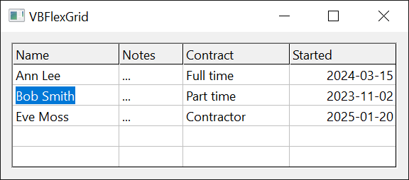

# Editing Cells
{: .no_toc }

Lets the user, or code, change the text of a cell in an edit box that the grid places over the cell, and reports each step of the edit in events.

The edit box is a standard Windows edit control. It takes the cell's font, text colour, background colour and alignment, covers the cell inside its grid lines, and is a child window of the grid ([**hWndEdit**](#hwndedit) is its handle). It exists only while a cell is being edited. A merged range is edited as one cell: the box covers the whole range, and the new text is stored in every cell of it.

{:width="384" height="169"}

```tb check_build
Private Sub Form_Load()
    VBFlexGrid1.AllowUserEditing = True
End Sub

Private Sub VBFlexGrid1_BeforeEdit(Row As Long, Col As Long, ByVal Reason As FlexEditReasonConstants, Cancel As Boolean)
    If Col = 0 Then Cancel = True   ' column 0 cannot be edited
End Sub

Private Sub VBFlexGrid1_AfterEdit(ByVal Row As Long, ByVal Col As Long, ByVal Changed As Boolean)
    If Changed Then Debug.Print "Cell " & Row & "," & Col & " is now " & VBFlexGrid1.TextMatrix(Row, Col)
End Sub
```

* TOC
{:toc}

## Starting an edit

The user starts an edit only when [**AllowUserEditing**](#allowuserediting) is **True** (the default is **False**). Code starts one with [**StartEdit**](#startedit), whatever **AllowUserEditing** says. Every start reports its cause in [**EditReason**](#editreason) and in the *Reason* argument of [**BeforeEdit**](#beforeedit), a [**FlexEditReasonConstants**](../Enumerations/EditingAndComboBoxes#flexeditreasonconstants) value:

| The user | *Reason* | What happens |
|:---------|:---------|:-------------|
| presses **F2** | **FlexEditReasonF2** | The box opens with all the text selected. |
| presses **Space** | **FlexEditReasonSpace** | The box opens with the caret at the end of the text. On a cell with a check box, **Space** toggles the [check box](CheckBoxes) instead. |
| presses **Backspace** | **FlexEditReasonBackSpace** | The box opens with the text removed. |
| presses **Return** | **FlexEditReasonReturn** | The box opens with the caret at the end of the text, only when [**DirectionAfterReturn**](Selection#directionafterreturn) is **FlexDirectionAfterReturnEdit**. |
| types a printable character | **FlexEditReasonKeyPress** | The box opens and receives the character. Not while [**AllowIncrementalSearch**](SortingAndSearching#allowincrementalsearch) is **True**: the character then starts a search. |
| double-clicks a cell with the left button | **FlexEditReasonDblClick** | Not on a fixed cell. |
| clicks a combo cue, or presses **F4** or **Alt+Up**, **Alt+Down** on a cell that has one | **FlexEditReasonComboCueClick**, **FlexEditReasonComboCueDblClick**, **FlexEditReasonComboCueF4**, **FlexEditReasonComboCueAltUpDown** | See [Drop-Down Lists, Buttons and Calendars](ComboEditing#combo-cues). |

**Space**, **Backspace** and **Return** start an edit only when no modifier key is held. Code starts an edit with the reason **FlexEditReasonCode**.

The edit is for the current cell. With [**SelectionMode**](Selection#selectionmode) by row or by column, a double-click or a click on a combo cue edits the cell where the clicked row or column meets the current column or row. [**StartEdit**](#startedit) takes the cell as arguments. The text in the box is the cell's text, with one exception: a column with a [**ColLookup**](Text#collookup) shows the looked-up description, and stores the key back.

Only one cell is edited at a time. When an edit does not start, because [**BeforeEdit**](#beforeedit) refused it, the grid is disabled or an edit is open, [**StartEdit**](#startedit) returns **False**.

## The life of an edit

These events occur, in this order, when an edit starts:

1. [**BeforeEdit**](#beforeedit): the edit can be refused, or moved to another cell.
2. [**EditSetupStyle**](#editsetupstyle): the window styles of the edit box can be changed.
3. The edit box is created.
4. [**EditSetupWindow**](#editsetupwindow): the colours of the box can be changed, and the box and its combo parts can be set up.
5. The box is shown. [**EnterEdit**](#enteredit) is the last event of the start.

While the box exists, [**EditKeyDown**](#editkeydown), [**EditKeyPress**](#editkeypress), [**EditKeyUp**](#editkeyup) and [**EditChange**](#editchange) report the typing, and [**EditContextMenu**](#editcontextmenu) a right click.

These occur, in this order, when the edit ends:

1. [**EditQueryClose**](#editqueryclose): the end can be refused. It does not occur when the end is caused by the box losing the focus.
2. [**ValidateEdit**](#validateedit): the new text can be refused. It occurs only when the text is to be kept and has changed.
3. The new text is written to the cell.
4. [**LeaveEdit**](#leaveedit), with the box still there.
5. The box is destroyed. [**AfterEdit**](#afteredit) is the last event.

The samples log these events with a small class, `EditWatcher`, that attaches to the grid. Its handlers do nothing else, apart from three switches that the later samples use.

```tb check_build projname=editing slot=file
Class EditWatcher
    Private WithEvents Grid As VBFLXGRD18.VBFlexGrid
    Private mLog As String

    Public RefuseCol As Long = -1   ' BeforeEdit refuses an edit in this column
    Public RejectText As String     ' ValidateEdit refuses this text
    Public KeepOpen As Boolean      ' EditQueryClose refuses to close the edit

    Public Sub Attach(ByVal G As VBFLXGRD18.VBFlexGrid)
        Set Grid = G
    End Sub

    ' Returns the events logged so far, and clears the log.
    Public Function Take() As String
        Take = Trim$(mLog)
        mLog = ""
    End Function

    Private Sub Grid_BeforeEdit(ByRef Row As Long, ByRef Col As Long, ByVal Reason As FlexEditReasonConstants, ByRef Cancel As Boolean)
        mLog &= " BeforeEdit"
        If Col = RefuseCol Then Cancel = True
    End Sub
    Private Sub Grid_EditSetupStyle(ByRef dwStyle As Long, ByRef dwExStyle As Long)
        mLog &= " EditSetupStyle"
    End Sub
    Private Sub Grid_EditSetupWindow(ByRef BackColor As OLE_COLOR, ByRef ForeColor As OLE_COLOR)
        mLog &= " EditSetupWindow"
    End Sub
    Private Sub Grid_EnterEdit()
        mLog &= " EnterEdit"
    End Sub
    Private Sub Grid_EditChange()
        mLog &= " EditChange"
    End Sub
    Private Sub Grid_EditQueryClose(ByVal CloseMode As FlexEditCloseModeConstants, ByRef Cancel As Boolean)
        mLog &= " EditQueryClose"
        If KeepOpen Then Cancel = True
    End Sub
    Private Sub Grid_ValidateEdit(ByRef Cancel As Boolean)
        mLog &= " ValidateEdit"
        If Grid.EditText = RejectText Then Cancel = True
    End Sub
    Private Sub Grid_LeaveEdit()
        mLog &= " LeaveEdit"
    End Sub
    Private Sub Grid_AfterEdit(ByVal Row As Long, ByVal Col As Long, ByVal Changed As Boolean)
        mLog &= " AfterEdit(" & Changed & ")"
    End Sub
End Class
```

A grid that is not shown has no window for the edit box, so the samples that run an edit show the form first.

```tb check_build check_run projname=editing
Form1.Show
DoEvents
Dim Watch As New EditWatcher
Watch.Attach VBFlexGrid1
With VBFlexGrid1
    .TextMatrix(1, 1) = "old"
    .Row = 1
    .Col = 1
    Debug.Print .StartEdit()        ' True
    Debug.Print Watch.Take()        ' BeforeEdit EditSetupStyle EditSetupWindow EnterEdit
    .EditText = "new"
    Debug.Print Watch.Take()        ' EditChange
    Debug.Print .CommitEdit()       ' True
    Debug.Print Watch.Take()        ' EditQueryClose ValidateEdit LeaveEdit AfterEdit(True)
    Debug.Print .TextMatrix(1, 1)   ' new
End With
```

### Ending the edit

The user ends an edit with these keys, and [**EditCloseMode**](#editclosemode) tells which one, a [**FlexEditCloseModeConstants**](../Enumerations/EditingAndComboBoxes#flexeditclosemodeconstants) value:

| Cause | *CloseMode* | The text |
|:------|:------------|:---------|
| **Esc** | **FlexEditCloseModeEscape** | Discarded. |
| **Return** | **FlexEditCloseModeReturn** | Kept. The key is then passed on to the grid, which moves the current cell as [**DirectionAfterReturn**](Selection#directionafterreturn) says. In a multi-line box, **Shift+Return** and **Ctrl+Return** put a carriage return and a line feed into the text instead. |
| **Tab**, **Shift+Tab** | **FlexEditCloseModeTab**, **FlexEditCloseModeShiftTab** | Kept, when [**TabBehavior**](Selection#tabbehavior) is not **FlexTabControls**. The key is passed on to the grid. |
| an arrow key, **Page Up**, **Page Down**, **Home** or **End** | **FlexEditCloseModeNavigationKey** | Kept, when no text is selected and the caret is already at the edge that the key points to (the first line for **Up**, the end of the text for **Right**). The key is passed on to the grid. |
| the box loses the focus | **FlexEditCloseModeLostFocus** | Kept. [**EditQueryClose**](#editqueryclose) is not raised, and the box stays open while [**ValidateEdit**](#validateedit) runs. |
| code | **FlexEditCloseModeCode** | [**CommitEdit**](#commitedit) keeps the text, [**CancelEdit**](#canceledit) discards it. |

A kept text is written to the cell only when it has changed: a box in which nothing was typed raises no [**ValidateEdit**](#validateedit) and leaves the cell as it was. The *Changed* argument of [**AfterEdit**](#afteredit) is **True** when the text was changed at any time during the edit, even if the final text equals the old one.

When [**UndoLimit**](ClipboardAndArrays#undolimit) is above 0, a kept change is put in the undo queue.

[**CommitEdit**](#commitedit) and [**CancelEdit**](#canceledit) return **True** when the edit ended. They return **False** when no edit is open, and when [**EditQueryClose**](#editqueryclose) or [**ValidateEdit**](#validateedit) refused the end: the edit then stays open. After **CancelEdit** the cell has its old text.

```tb check_build check_run projname=editing
Form1.Show
DoEvents
Dim Watch As New EditWatcher
Watch.Attach VBFlexGrid1
With VBFlexGrid1
    .TextMatrix(1, 1) = "old"
    .Row = 1
    .Col = 1
    .StartEdit
    Debug.Print .EditCloseMode      ' -1
    Debug.Print .CancelEdit()       ' True
    Debug.Print .EditCloseMode      ' 0
    Debug.Print .TextMatrix(1, 1)   ' old
    Debug.Print .CancelEdit()       ' False
    .StartEdit
    .EditText = "new"
    Watch.Take
    Watch.RejectText = "new"
    Debug.Print .CommitEdit()       ' False
    Debug.Print Watch.Take()        ' EditQueryClose ValidateEdit
    Debug.Print .EditRow            ' 1
    Watch.RejectText = ""
    Watch.KeepOpen = True
    Debug.Print .CommitEdit()       ' False
    Debug.Print .CancelEdit()       ' False
    Debug.Print Watch.Take()        ' EditQueryClose EditQueryClose
    Watch.KeepOpen = False
    Debug.Print .CommitEdit()       ' True
    Debug.Print Watch.Take()        ' EditQueryClose ValidateEdit LeaveEdit AfterEdit(True)
    Debug.Print .TextMatrix(1, 1)   ' new
End With
```

Setting [**EditText**](#edittext) from code also raises [**EditChange**](#editchange), when the text differs from the text in the box.

## Refusing, moving and changing an edit

[**BeforeEdit**](#beforeedit) takes *Row* and *Col* by reference. Setting *Cancel* refuses the edit: [**StartEdit**](#startedit) then returns **False**, and [**EditReason**](#editreason) is -1. Changing *Row* or *Col* edits another cell.

```tb check_build check_run projname=editing
Form1.Show
DoEvents
Dim Watch As New EditWatcher
Watch.Attach VBFlexGrid1
With VBFlexGrid1
    .Cols = 4
    .Row = 1
    .Col = 1
    Watch.RefuseCol = 1
    Debug.Print .StartEdit()                ' False
    Debug.Print .EditReason                 ' -1
    Debug.Print .EditRow                    ' -1
    Watch.RefuseCol = -1
    Debug.Print .StartEdit(1, 2)            ' True
    Debug.Print .EditRow & "," & .EditCol   ' 1,2
    .CancelEdit
End With
```

Code can edit a cell of a fixed row or column (**StartEdit 0, 0**). The user can start an edit in a fixed cell with the keys, but not with a double-click.

While the box exists, code can change it. These properties raise error 5 (*Invalid procedure call or argument*) when no edit is open: [**EditText**](#edittext), [**EditLocked**](#editlocked), [**EditMaxLength**](#editmaxlength), [**EditSelStart**](#editselstart), [**EditSelLength**](#editsellength) and [**EditSelText**](#editseltext). The [**EditSetupWindow**](#editsetupwindow) event is the place for setting them for every edit.

```tb check_build check_run projname=editing
Form1.Show
DoEvents
With VBFlexGrid1
    .TextMatrix(1, 1) = "two"
    .Row = 1
    .Col = 1
    .StartEdit
    Debug.Print .EditSelStart & " " & .EditSelLength & " " & .EditSelText   ' 0 3 two
    .EditSelStart = 1
    .EditSelLength = 1
    Debug.Print .EditSelText   ' w
    .EditSelText = "WW"
    Debug.Print .EditText      ' tWWo
    .EditMaxLength = 3
    .EditText = "abcdef"
    Debug.Print .EditText      ' abc
    .CancelEdit
    On Error Resume Next
    Debug.Print .EditText
    Debug.Print Err.Number     ' 5
End With
```

A column with a lookup shows the description in the box and stores the key:

```tb check_build check_run projname=editing
Form1.Show
DoEvents
With VBFlexGrid1
    .ColLookup(1) = "1;One|2;Two"
    .TextMatrix(1, 1) = "2"
    .Row = 1
    .Col = 1
    .StartEdit
    Debug.Print .EditText                          ' Two
    .EditText = "One"
    .CommitEdit
    Debug.Print .TextMatrix(1, 1)                  ' 1
    Debug.Print .Cell(FlexCellTextDisplay, 1, 1)   ' One
End With
```

The next two samples change how the box looks. The styles that [**EditSetupStyle**](#editsetupstyle) passes are the `ES_` styles of a Windows edit control. [**EditSetupWindow**](#editsetupwindow) sets the colours.

```tb check_build
Private Sub VBFlexGrid1_EditSetupStyle(dwStyle As Long, dwExStyle As Long)
    Const ES_NUMBER As Long = &H2000
    If VBFlexGrid1.Col = 2 Then dwStyle = dwStyle Or ES_NUMBER   ' digits only
End Sub

Private Sub VBFlexGrid1_EditSetupWindow(BackColor As OLE_COLOR, ForeColor As OLE_COLOR)
    BackColor = vbInfoBackground
    ForeColor = vbInfoText
End Sub
```

## Keys in the edit box

The grid passes the keys that reach the edit box to its own events. A handler of [**EditKeyDown**](#editkeydown) or [**EditKeyPress**](#editkeypress) can change the key, or discard it by setting it to 0.

```tb check_build
Private Sub VBFlexGrid1_EditKeyPress(KeyChar As Integer)
    If KeyChar >= 48 And KeyChar <= 57 Then Exit Sub   ' digits are accepted
    If KeyChar >= 32 Then KeyChar = 0                  ' other printable characters are discarded
End Sub
```

The window of the grid handles the keys that start an edit. The next sample calls `SendKey`, a procedure that sends a key-down message to that window, in place of the keyboard, so that the table of causes above can be checked: without **AllowUserEditing**, **F2** starts nothing.

```tb check_build hidden projname=editing slot=file
Module KeySender
    Private Declare PtrSafe Function SendMessageW Lib "user32" (ByVal hWnd As LongPtr, ByVal Msg As Long, ByVal wParam As LongPtr, ByVal lParam As LongPtr) As LongPtr

    Public Sub SendKey(ByVal Grid As VBFLXGRD18.VBFlexGrid, ByVal KeyCode As Long)
        Const WM_KEYDOWN As Long = &H100
        SendMessageW Grid.hWnd, WM_KEYDOWN, KeyCode, 0
    End Sub
End Module
```

```tb check_build check_run projname=editing
Form1.Show
DoEvents
With VBFlexGrid1
    .TextMatrix(1, 1) = "abc"
    .Row = 1
    .Col = 1
    .SetFocus
    SendKey VBFlexGrid1, vbKeyF2
    Debug.Print .EditRow                                              ' -1
    .AllowUserEditing = True
    SendKey VBFlexGrid1, vbKeyF2
    Debug.Print .EditRow & " " & .EditReason & " " & .EditSelLength   ' 1 1 3
    .CancelEdit
    SendKey VBFlexGrid1, vbKeySpace
    Debug.Print .EditReason & " " & .EditSelStart                     ' 2 3
    .CancelEdit
    SendKey VBFlexGrid1, vbKeyBack
    Debug.Print .EditReason & " [" & .EditText & "]"                  ' 5 []
    .CancelEdit
    SendKey VBFlexGrid1, vbKeyReturn
    Debug.Print .EditRow                                              ' -1
    .DirectionAfterReturn = FlexDirectionAfterReturnEdit
    SendKey VBFlexGrid1, vbKeyReturn
    Debug.Print .EditReason & " " & .EditSelStart                     ' 6 3
    .CancelEdit
End With
```

## Properties

### AllowUserEditing
{: .no_toc }

Whether the user can start an edit. **Boolean**. Default **False**.

Syntax: *object*.**AllowUserEditing** [ = *value* ]

**True** also lets a column or a cell show its [combo cue](ComboEditing#combo-cues). [**StartEdit**](#startedit) works whatever the value is.

### EditCloseMode
{: .no_toc }

How the last edit ended. A [**FlexEditCloseModeConstants**](../Enumerations/EditingAndComboBoxes#flexeditclosemodeconstants) value, read-only. It is -1 while an edit is open. After an edit it keeps the value of that edit until the next edit starts.

Syntax: *object*.**EditCloseMode**

### EditCol
{: .no_toc }

The column of the cell being edited. **Long**, read-only. -1 when no edit is open.

Syntax: *object*.**EditCol**

### EditLocked
{: .no_toc }

Whether the box rejects the typing of the user. **Boolean**. Code can still change the text with [**EditText**](#edittext) and the other properties. Raises error 5 when no edit is open. A column in the drop-down list [combo mode](ComboEditing) has the box locked from the start.

Syntax: *object*.**EditLocked** [ = *value* ]

### EditMaxLength
{: .no_toc }

The most characters that the box takes. **Long**. 0 restores the default limit of a Windows edit control. A negative value raises error 380, and any use with no edit open raises error 5. Assigning a longer text to [**EditText**](#edittext) cuts it to this length.

Syntax: *object*.**EditMaxLength** [ = *value* ]

### EditReason
{: .no_toc }

How the last edit started. A [**FlexEditReasonConstants**](../Enumerations/EditingAndComboBoxes#flexeditreasonconstants) value, read-only. It is -1 before the first edit, and after an edit that [**BeforeEdit**](#beforeedit) refused.

Syntax: *object*.**EditReason**

### EditRow
{: .no_toc }

The row of the cell being edited. **Long**, read-only. -1 when no edit is open.

Syntax: *object*.**EditRow**

### EditSelLength
{: .no_toc }

The number of selected characters in the box. **Long**. Assigning keeps the start of the selection and sets its length. Error 380 for a negative value, error 5 with no edit open.

Syntax: *object*.**EditSelLength** [ = *value* ]

### EditSelStart
{: .no_toc }

The position of the caret, or of the start of the selection, in the box, counted from 0. **Long**. Assigning a position removes the selection and puts the caret there. Error 380 for a negative value, error 5 with no edit open.

Syntax: *object*.**EditSelStart** [ = *value* ]

### EditSelText
{: .no_toc }

The selected text of the box. **String**. Assigning replaces the selection with the text, or inserts it at the caret when nothing is selected; an empty string deletes the selection. [**EditChange**](#editchange) is raised, as for typing. Error 5 with no edit open.

Syntax: *object*.**EditSelText** [ = *value* ]

### EditText
{: .no_toc }

The text in the box. **String**. Assigning replaces the whole text, and raises [**EditChange**](#editchange) when the new text differs from the old. A text longer than [**EditMaxLength**](#editmaxlength) is cut. Error 5 with no edit open.

Syntax: *object*.**EditText** [ = *value* ]

### hWndEdit
{: .no_toc }

The window handle of the edit box. **LongPtr**, read-only. 0 when no edit is open.

Syntax: *object*.**hWndEdit**

## Methods

### CancelEdit
{: .no_toc }

Ends the edit and discards the changes.

Syntax: *object*.**CancelEdit**( ) **As Boolean**

Raises [**EditQueryClose**](#editqueryclose) with **FlexEditCloseModeCode**, then [**LeaveEdit**](#leaveedit) and [**AfterEdit**](#afteredit); [**ValidateEdit**](#validateedit) is not raised. A drop-down list or calendar that is open is closed first. Returns **True** when the edit ended, **False** when no edit was open or [**EditQueryClose**](#editqueryclose) refused.

### CommitEdit
{: .no_toc }

Ends the edit and stores the text in the cell.

Syntax: *object*.**CommitEdit**( ) **As Boolean**

As [**CancelEdit**](#canceledit), but the text is kept: when it has changed, [**ValidateEdit**](#validateedit) is raised, and the cell then receives the text. Returns **False** when no edit was open, or when [**EditQueryClose**](#editqueryclose) or [**ValidateEdit**](#validateedit) refused: the edit then stays open.

### StartEdit
{: .no_toc }

Starts editing a cell.

Syntax: *object*.**StartEdit**( [ *Row* ], [ *Col* ] ) **As Boolean**

*Row*
: *optional* A **Long**. The row of the cell. -1, or omitted, is the current row ([**Row**](Selection#row)). Another value below -1 raises error 380, and a row that does not exist raises error 381 (*Subscript out of range*).

*Col*
: *optional* A **Long**. The column of the cell, with the same rules.

Raises [**BeforeEdit**](#beforeedit) with **FlexEditReasonCode**. Returns **True** when the box has been created. Returns **False** when an edit is already open, when the grid is disabled, or when [**BeforeEdit**](#beforeedit) set *Cancel*.

```tb check_build check_run arch=win32,win64
Form1.Show
DoEvents
On Error Resume Next
With VBFlexGrid1
    .StartEdit 9, 0
    Debug.Print Err.Number          ' 381
    Err.Clear
    .StartEdit -2, 0
    Debug.Print Err.Number          ' 380
    Err.Clear
    .Enabled = False
    Debug.Print .StartEdit()        ' False
    .Enabled = True
    Debug.Print .StartEdit(0, 0)    ' True
    Debug.Print .StartEdit()        ' False
    .CancelEdit
End With
```

## Events

### AfterEdit
{: .no_toc }

Occurs when an edit has ended.

Syntax: *object*\_**AfterEdit**( *Row* **As Long**, *Col* **As Long**, *Changed* **As Boolean** )

*Row*, *Col*
: The cell that was edited.

*Changed*
: **True** when the text was changed during the edit and kept, so that the cell received it. **False** otherwise, also after a discarded edit.

The edit box is gone, [**EditRow**](#editrow) and [**EditCol**](#editcol) are -1, and [**EditCloseMode**](#editclosemode) holds the cause. The handler can start another edit.

### BeforeEdit
{: .no_toc }

Occurs when an edit is about to start, whatever the cause.

Syntax: *object*\_**BeforeEdit**( *Row* **As Long**, *Col* **As Long**, *Reason* **As FlexEditReasonConstants**, *Cancel* **As Boolean** )

*Row*, *Col*
: The cell. Both are passed by reference, and a handler can set them to another cell.

*Reason*
: A [**FlexEditReasonConstants**](../Enumerations/EditingAndComboBoxes#flexeditreasonconstants) value that says what started the edit.

*Cancel*
: Set to **True** to refuse the edit.

### EditChange
{: .no_toc }

Occurs when the text in the box changes, by typing, pasting, or by code ([**EditText**](#edittext), [**EditSelText**](#editseltext)).

Syntax: *object*\_**EditChange**( )

### EditContextMenu
{: .no_toc }

Occurs when the user right-clicks the box, or presses **Shift+F10**.

Syntax: *object*\_**EditContextMenu**( *Handled* **As Boolean**, *X* **As Single**, *Y* **As Single** )

*Handled*
: Set to **True** to suppress the context menu of the box, for example to show another.

*X*, *Y*
: The position of the click, in the units of the container. -1 and -1 when the key was used.

### EditKeyDown
{: .no_toc }

Occurs when a key is pressed in the box.

Syntax: *object*\_**EditKeyDown**( *KeyCode* **As Integer**, *Shift* **As Integer** )

*KeyCode*
: A key code, such as **vbKeyF4**. It is passed by reference: another value replaces the key, and 0 discards it.

*Shift*
: A bit mask of **vbShiftMask**, **vbCtrlMask** and **vbAltMask**.

### EditKeyPress
{: .no_toc }

Occurs when a character key is pressed and released in the box.

Syntax: *object*\_**EditKeyPress**( *KeyChar* **As Integer** )

*KeyChar*
: The character code. It is passed by reference: another value replaces the character, and 0 discards it, without a beep.

### EditKeyUp
{: .no_toc }

Occurs when a key is released in the box.

Syntax: *object*\_**EditKeyUp**( *KeyCode* **As Integer**, *Shift* **As Integer** )

The arguments are those of [**EditKeyDown**](#editkeydown).

### EditQueryClose
{: .no_toc }

Occurs when the edit is about to end, except when the box lost the focus.

Syntax: *object*\_**EditQueryClose**( *CloseMode* **As FlexEditCloseModeConstants**, *Cancel* **As Boolean** )

*CloseMode*
: A [**FlexEditCloseModeConstants**](../Enumerations/EditingAndComboBoxes#flexeditclosemodeconstants) value, the cause of the end.

*Cancel*
: Set to **True** to keep the edit open. The text is neither stored nor discarded, and the key that caused the end (**Return**, **Tab**) is not passed on.

### EditSetupStyle
{: .no_toc }

Occurs before the edit box is created.

Syntax: *object*\_**EditSetupStyle**( *dwStyle* **As Long**, *dwExStyle* **As Long** )

*dwStyle*, *dwExStyle*
: The window style and the extended window style of the box, which a handler can change. They start with the alignment of the cell, **ES_MULTILINE** when [**WordWrap**](Text#wordwrap) is on or [**SingleLine**](Text#singleline) is off (else **ES_AUTOHSCROLL**), and the right-to-left styles. Afterwards the grid removes the border and edge styles, and sets **ES_READONLY** for a cell with a drop-down [combo mode](ComboEditing), or clears it for an editable one.

### EditSetupWindow
{: .no_toc }

Occurs after the edit box has been created and before it is shown.

Syntax: *object*\_**EditSetupWindow**( *BackColor* **As OLE_COLOR**, *ForeColor* **As OLE_COLOR** )

*BackColor*, *ForeColor*
: The colours of the box, taken from the cell. A handler can change them.

The box already holds the text of the cell, so that [**EditText**](#edittext), [**EditSelStart**](#editselstart), [**hWndEdit**](#hwndedit) and the combo properties can be used here.

### EnterEdit
{: .no_toc }

Occurs when the edit box has been shown.

Syntax: *object*\_**EnterEdit**( )

### LeaveEdit
{: .no_toc }

Occurs when the edit is ending, after the text was written to the cell and before the box is destroyed.

Syntax: *object*\_**LeaveEdit**( )

[**EditCloseMode**](#editclosemode) already holds the cause.

### ValidateEdit
{: .no_toc }

Occurs when an edit that changed the text is about to be kept, before the cell receives the text.

Syntax: *object*\_**ValidateEdit**( *Cancel* **As Boolean** )

*Cancel*
: Set to **True** to refuse the text. The edit stays open, and the user can correct the text, which is [**EditText**](#edittext).

## See Also

- [Drop-Down Lists, Buttons and Calendars](ComboEditing) -- the combo modes of the edit box
- [Check Boxes](CheckBoxes) -- check boxes in cells, which need no edit
- [Current Cell and Selection](Selection) -- **DirectionAfterReturn** and **TabBehavior**
- [FlexEditReasonConstants](../Enumerations/EditingAndComboBoxes#flexeditreasonconstants) enumeration
- [FlexEditCloseModeConstants](../Enumerations/EditingAndComboBoxes#flexeditclosemodeconstants) enumeration
