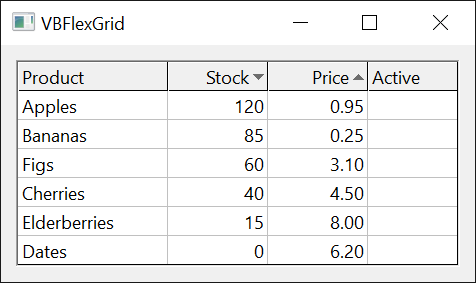

# Sorting and Searching
{: .no_toc }

Sorting the rows of a grid by code, drawing sort arrows in the column headers, comparing rows with a handler of your own, finding a cell by its text or its tag, and the search that the user starts by typing.

* TOC
{:toc}

## Sorting rows

The control sorts when the program asks it to, by setting [**Sort**](#sort). It never sorts because the user clicked a header: a program that wants that handles the click ([**CellClick**](MouseAndKeyboard#cellclick)), sorts the rows and sets the sort arrow of the column itself.

**Sort** works on the current selection:

- The **rows** to sort are those from [**Row**](Selection#row) to [**RowSel**](Selection#rowsel). When both are the same row, which is the case after any assignment to **Row**, the sort covers all rows that are not fixed rows.
- The **keys** are the columns from [**Col**](Selection#col) to [**ColSel**](Selection#colsel). The leftmost column is the primary key; rows that are equal in it are ordered by the next column, and so on.
- The sort is stable: rows that are equal in every key column keep their order, also in a descending sort.
- A row moves with everything it holds: its text, its cell formatting, its tags, its [**RowData**](Structure#rowdata) value, its height and whether it is hidden.

An assignment to **Row** also sets **RowSel**, and an assignment to **Col** also sets **ColSel**. To sort a range of rows, assign **Row** and **Col** first and **RowSel** and **ColSel** after them, or use [**SelectRange**](Selection#selectrange), which sets all four.

```tb check_build check_run slot=sub arch=win32,win64
With VBFlexGrid1
    .FixedRows = 1: .FixedCols = 0
    .Rows = 5: .Cols = 2
    .TextMatrix(0, 0) = "Name": .TextMatrix(0, 1) = "Qty"
    .TextMatrix(1, 0) = "bolt": .TextMatrix(1, 1) = "10"
    .TextMatrix(2, 0) = "washer": .TextMatrix(2, 1) = "9"
    .TextMatrix(3, 0) = "gear": .TextMatrix(3, 1) = "100"
    .TextMatrix(4, 0) = "nut": .TextMatrix(4, 1) = "2"

    .SelectRange 1, 1, 1, 1             ' one row, so all rows that are not fixed
    .Sort = FlexSortNumericAscending     ' the key is column 1

    Dim Row As Long
    For Row = 1 To 4
        Debug.Print .TextMatrix(Row, 0) & " " & .TextMatrix(Row, 1)
    Next
End With
' Output:
' nut 2
' washer 9
' bolt 10
' gear 100
```

The table lists the sort modes. **Ascending** and **Descending** modes are pairs of values of [**FlexSortConstants**](../Enumerations/SelectionAndInput#flexsortconstants).

| Mode | The cells are compared as |
|:-----|:--------------------------|
| **FlexSortGenericAscending**, **FlexSortGenericDescending** | Numbers when both cells of a pair are numeric, otherwise text by character code, so that uppercase letters come before lowercase ones. |
| **FlexSortNumericAscending**, **FlexSortNumericDescending** | Numbers. A cell that is not a number counts as 0. |
| **FlexSortStringAscending**, **FlexSortStringDescending** | Text, by the Windows rules for the language of the user, with case taken into account (so that **a** comes before **A**). |
| **FlexSortStringNoCaseAscending**, **FlexSortStringNoCaseDescending** | Text, by the same rules, with case ignored. |
| **FlexSortCurrencyAscending**, **FlexSortCurrencyDescending** | **Currency** values. A cell that is not a number counts as 0. |
| **FlexSortDateAscending**, **FlexSortDateDescending** | Dates. A cell that is not a date counts as 0, which is the earliest. |
| **FlexSortCustom** | The [**Compare**](#compare) event decides, for two rows. |
| **FlexSortCustomText** | The [**CompareText**](#comparetext) event decides, for the text of two cells. |
| **FlexSortUseColSort** | The mode that [**ColSort**](#colsort) gives each key column. |

Numbers are read with the decimal separator of the user, so a decimal number in a cell can be 0 on a computer with another language setting. The same applies to dates written in a form other than year-month-day.

```tb check_build check_run slot=sub arch=win32,win64
Dim Modes As Variant, Names As Variant, i As Long, Row As Long, Line As String
Modes = Array(FlexSortGenericAscending, FlexSortStringAscending, FlexSortNumericDescending, FlexSortDateAscending)
Names = Array("generic", "string", "numeric desc", "date")

With VBFlexGrid1
    .FixedRows = 0: .FixedCols = 0
    .Rows = 4: .Cols = 1
    For i = 0 To 3
        ' Numbers that look like dates: the text "2026-11-12" is a date, "100" a number
        If i < 3 Then
            .TextMatrix(0, 0) = "10": .TextMatrix(1, 0) = "9": .TextMatrix(2, 0) = "100": .TextMatrix(3, 0) = "2"
        Else
            .TextMatrix(0, 0) = "2026-11-12": .TextMatrix(1, 0) = "2025-03-01": .TextMatrix(2, 0) = "2026-01-30": .TextMatrix(3, 0) = "n/a"
        End If
        .SelectRange 0, 0, 0, 0
        .Sort = Modes(i)
        Line = ""
        For Row = 0 To 3: Line = Line & .TextMatrix(Row, 0) & " ": Next
        Debug.Print Names(i) & ": " & Line
    Next
End With
' Output:
' generic: 2 9 10 100 
' string: 10 100 2 9 
' numeric desc: 100 10 9 2 
' date: n/a 2025-03-01 2026-01-30 2026-11-12 
```

<!-- test: SortingTests.Sort_GenericAscending_ComparesDatesAsText, SortingTests.Sort_DateAscending_ComparesDates, SortingTests.Sort_GenericAscending_NumbersAreComparedAsNumbers -->
> [!NOTE] 1.8.69.0
> **FlexSortGenericAscending** and **FlexSortGenericDescending** compare strings and numbers only. Dates are compared as text, which MSFlexGrid does not do; use **FlexSortDateAscending** or **FlexSortDateDescending** for a column of dates. A column that mixes numbers and text has no reliable order in a generic sort, since a number is compared with a number as a number and with text as text.

### Sorting by several columns

With more than one key column, the leftmost is the primary key.

```tb check_build check_run slot=sub arch=win32,win64
With VBFlexGrid1
    .FixedRows = 0: .FixedCols = 0
    .Rows = 4: .Cols = 2
    .TextMatrix(0, 0) = "b": .TextMatrix(0, 1) = "1"
    .TextMatrix(1, 0) = "a": .TextMatrix(1, 1) = "2"
    .TextMatrix(2, 0) = "a": .TextMatrix(2, 1) = "1"
    .TextMatrix(3, 0) = "b": .TextMatrix(3, 1) = "2"

    .SelectRange 0, 0, 3, 1                  ' all rows, key columns 0 and 1
    .Sort = FlexSortStringAscending

    Dim Row As Long
    For Row = 0 To 3
        Debug.Print .TextMatrix(Row, 0) & .TextMatrix(Row, 1)
    Next
End With
' Output:
' a1
' a2
' b1
' b2
```

To sort only some rows, select them. The rows outside the selection stay where they are.

```tb check_build check_run slot=sub arch=win32,win64
With VBFlexGrid1
    .FixedRows = 0: .FixedCols = 0
    .Rows = 5: .Cols = 1
    .TextMatrix(0, 0) = "e": .TextMatrix(1, 0) = "d": .TextMatrix(2, 0) = "c": .TextMatrix(3, 0) = "b": .TextMatrix(4, 0) = "a"

    .SelectRange 1, 0, 3, 0                  ' rows 1 to 3
    .Sort = FlexSortStringAscending

    Dim Row As Long, Line As String
    For Row = 0 To 4: Line = Line & .TextMatrix(Row, 0): Next
    Debug.Print Line
End With
' Output:
' ebcda
```

### Sorting each column in its own way

A different mode for each key column is set with [**ColSort**](#colsort), and **FlexSortUseColSort** makes **Sort** use it.

```tb check_build check_run slot=sub arch=win32,win64
With VBFlexGrid1
    .FixedRows = 0: .FixedCols = 0
    .Rows = 4: .Cols = 2
    .TextMatrix(0, 0) = "b": .TextMatrix(0, 1) = "1"
    .TextMatrix(1, 0) = "a": .TextMatrix(1, 1) = "2"
    .TextMatrix(2, 0) = "a": .TextMatrix(2, 1) = "1"
    .TextMatrix(3, 0) = "b": .TextMatrix(3, 1) = "2"

    .ColSort(0) = FlexSortStringAscending     ' column 0 up
    .ColSort(1) = FlexSortNumericDescending   ' column 1 down

    .SelectRange 0, 0, 3, 1
    .Sort = FlexSortUseColSort

    Dim Row As Long
    For Row = 0 To 3
        Debug.Print .TextMatrix(Row, 0) & .TextMatrix(Row, 1)
    Next
End With
' Output:
' a2
' a1
' b2
' b1
```

### Sorting what the user sees

A column can hold values that its [**ColLookup**](Text#collookup) or [**ColFormat**](Text#colformat) shows as other text. The sort compares the stored text, unless the column's [**ColSortMode**](#colsortmode) is **FlexSortModeTextDisplay**, which compares the displayed text.

```tb check_build check_run slot=sub arch=win32,win64
With VBFlexGrid1
    .FixedRows = 0: .FixedCols = 0
    .Rows = 3: .Cols = 1
    .ColLookup(0) = "1;zebra|2;ant|3;mule"     ' the cells hold 1, 2 and 3
    .TextMatrix(0, 0) = "1": .TextMatrix(1, 0) = "2": .TextMatrix(2, 0) = "3"

    .SelectRange 0, 0, 0, 0
    .Sort = FlexSortStringAscending             ' by stored text: 1 2 3
    Debug.Print .TextMatrix(0, 0) & .TextMatrix(1, 0) & .TextMatrix(2, 0)

    .ColSortMode(0) = FlexSortModeTextDisplay
    .Sort = FlexSortStringAscending             ' by displayed text: ant, mule, zebra
    Debug.Print .TextMatrix(0, 0) & .TextMatrix(1, 0) & .TextMatrix(2, 0)
End With
' Output:
' 123
' 231
```

### Sorting with a handler of your own

**FlexSortCustom** raises [**Compare**](#compare) for pairs of rows, and **FlexSortCustomText** raises [**CompareText**](#comparetext) for the text of two cells. The handler sets *Cmp*: a negative number puts the first of the two before the second, a positive number puts it after, and 0 means they are equal. The sort is a merge sort that makes about *n* times log *n* comparisons, and it does not change the grid until it has finished, so a **Compare** handler can read the text of both rows with [**TextMatrix**](Text#textmatrix).

```tb check_build slot=file projname=sort-custom
Class LengthSorter
    Private WithEvents Grid As VBFLXGRD18.VBFlexGrid

    Public Sub Attach(ByVal G As VBFLXGRD18.VBFlexGrid)
        Set Grid = G
    End Sub

    ' Short text first; text of the same length in alphabetical order.
    Private Sub Grid_Compare(ByVal Row1 As Long, ByVal Row2 As Long, ByVal Col As Long, Cmp As Long)
        Dim A As String, B As String
        A = Grid.TextMatrix(Row1, Col)
        B = Grid.TextMatrix(Row2, Col)
        If Len(A) <> Len(B) Then
            Cmp = Len(A) - Len(B)
        Else
            Cmp = StrComp(A, B, vbTextCompare)
        End If
    End Sub

    ' Used by FlexSortCustomText: long text first.
    Private Sub Grid_CompareText(ByVal Text1 As String, ByVal Text2 As String, ByVal Col As Long, Cmp As Long)
        Cmp = Len(Text2) - Len(Text1)
    End Sub
End Class
```

```tb check_build check_run slot=sub projname=sort-custom
Dim Sorter As New LengthSorter
Sorter.Attach VBFlexGrid1

With VBFlexGrid1
    .FixedRows = 0: .FixedCols = 0
    .Rows = 5: .Cols = 1
    .TextMatrix(0, 0) = "ccc": .TextMatrix(1, 0) = "a": .TextMatrix(2, 0) = "bb": .TextMatrix(3, 0) = "dddd": .TextMatrix(4, 0) = "aa"
    .SelectRange 0, 0, 0, 0

    Dim Row As Long, Line As String
    .Sort = FlexSortCustom
    For Row = 0 To 4: Line = Line & .TextMatrix(Row, 0) & " ": Next
    Debug.Print Line

    Line = ""
    .Sort = FlexSortCustomText
    For Row = 0 To 4: Line = Line & .TextMatrix(Row, 0) & " ": Next
    Debug.Print Line
End With
' Output:
' a aa bb ccc dddd 
' dddd ccc aa bb a 
```

The second line shows that the sort is stable: after the first sort **aa** stood before **bb**, and the two have the same length, so **CompareText** leaves them in that order.

In the form of a program, the handler belongs to the grid on the form:

```tb check_build
Private Sub VBFlexGrid1_Compare(ByVal Row1 As Long, ByVal Row2 As Long, ByVal Col As Long, Cmp As Long)
    Cmp = StrComp(VBFlexGrid1.TextMatrix(Row1, Col), VBFlexGrid1.TextMatrix(Row2, Col), vbTextCompare)
End Sub
```

### Sort arrows

A sort arrow is a small triangle in a column header that shows the direction in which the column is sorted. The control draws it where the program asks and never sets it by itself: [**ColSortArrow**](#colsortarrow) chooses the arrow of a column and [**RowSortArrows**](#rowsortarrows) the fixed row that holds the arrows (row 0 unless it is changed). [**ColSortArrowAlignment**](#colsortarrowalignment) puts it at the right or at the left of the text, and [**SortArrowColor**](#sortarrowcolor) and [**ColSortArrowColor**](#colsortarrowcolor) set its color.

{:width="317" height="189"}

```tb check_build slot=sub
With VBFlexGrid1
    .FixedRows = 1: .FixedCols = 0
    .Rows = 5: .Cols = 3
    .TextMatrix(0, 0) = "Name": .TextMatrix(0, 1) = "Qty": .TextMatrix(0, 2) = "Price"

    .SelectRange 1, 1, 1, 1
    .Sort = FlexSortNumericDescending          ' sorts by column 1

    .ColSortArrow(-1) = FlexSortArrowNone      ' -1 is every column
    .ColSortArrow(1) = FlexSortArrowDescending
    .SortArrowColor = vbBlue
End With
```

### Sort errors

[**Sort**](#sort) raises error 380 for a value that is not in **FlexSortConstants**, and error 5 when the grid shows a [**FlexDataSource**](DataBinding#flexdatasource). It does nothing, and raises no error, when the grid has no cells.

## Finding cells

[**FindItem**](#finditem) finds a cell by its text and [**FindTag**](#findtag) by its tag. Each searches along one column (down or up, from a row) or along one row (right or left, from a column) and returns the row or column number of the first match, or -1. They do not move the selection or scroll the grid.

```tb check_build check_run slot=sub arch=win32,win64
With VBFlexGrid1
    .FixedRows = 1: .FixedCols = 0
    .Rows = 6: .Cols = 2
    .TextMatrix(1, 0) = "Apple": .TextMatrix(2, 0) = "pear": .TextMatrix(3, 0) = "APPLE": .TextMatrix(4, 0) = "plum": .TextMatrix(5, 0) = "apple"

    Debug.Print .FindItem("apple")                                  ' not case sensitive
    Debug.Print .FindItem("apple", , , , True)                      ' case sensitive
    Debug.Print .FindItem("pl", , , FlexFindMatchStartsWith)
    Debug.Print .FindItem("pear", 3)                                ' from row 3 down: not there
    Debug.Print .FindItem("pear", 3, , , , , True)                  ' with wrap, it starts again at the top
    Debug.Print .FindItem("apple", 5, , , , , , FlexFindDirectionUp) ' up from row 5
End With
' Output:
' 1
' 5
' 4
' -1
' 2
' 5
```

Tags are stored with [**CellTag**](Text#celltag). A tag of a number type is found by a number, so that **FindTag** can find the row of a record by its key.

```tb check_build check_run slot=sub arch=win32,win64
With VBFlexGrid1
    .FixedRows = 1: .FixedCols = 0
    .Rows = 4: .Cols = 1
    .Cell(FlexCellTag, 1, 0) = 1001
    .Cell(FlexCellTag, 2, 0) = 1002
    .Cell(FlexCellTag, 3, 0) = "invoice"

    Debug.Print .FindTag(1002)
    Debug.Print .FindTag("invoice")
    Debug.Print .FindTag(1002.5)
End With
' Output:
' 2
' 3
' -1
```

## Searching by typing

When [**AllowIncrementalSearch**](#allowincrementalsearch) is **True**, the characters that the user types in the grid search the column of the current cell. Each character is added to the search text, which can be read in [**IncrementalSearchString**](#incrementalsearchstring), and the current cell moves to the first cell, at or below the current one and wrapping at the end of the column, whose text starts with the search text. The matching start of the text is highlighted. Backspace removes the last character. Enter, Escape, a click, a movement key and the loss of the focus end the search, and so does a pause of [**IncrementalSearchTime**](#incrementalsearchtime). A space does not begin a search, but is part of the search text once the search has begun.

In a grid whose [**SelectionMode**](Selection#selectionmode) is by column, the search goes along the current row to the right. When **AllowIncrementalSearch** is **False** and [**AllowUserEditing**](Editing#allowuserediting) is **True**, a character typed in the grid starts the editing of the cell instead.

Three events follow a search. [**BeginIncrementalSearch**](#beginincrementalsearch) comes with the first character, and can set where the search starts and how it compares. [**IncrementalSearch**](#incrementalsearch) comes with each character, and [**EndIncrementalSearch**](#endincrementalsearch) when the search is over.

```tb check_build slot=file projname=search-typing
Class SearchLog
    Private WithEvents Grid As VBFLXGRD18.VBFlexGrid
    Public Log As String

    Public Sub Attach(ByVal G As VBFLXGRD18.VBFlexGrid)
        Set Grid = G
    End Sub

    Private Sub Grid_IncrementalSearch(ByVal Row As Long, ByVal Col As Long, ByVal CharCode As Long, ByVal CaseSensitive As Boolean, ByVal NoWrap As Boolean, ByVal Direction As FlexFindDirectionConstants, ByVal FoundIndex As Long)
        Log = Log & "[" & ChrW(CharCode) & " found " & FoundIndex & "] "
    End Sub

    Private Sub Grid_EndIncrementalSearch(ByVal Row As Long, ByVal Col As Long)
        Log = Log & "[end " & Row & "," & Col & "] "
    End Sub
End Class

Module SearchKeys
    Private Declare PtrSafe Function SendMessageW Lib "user32" (ByVal hWnd As LongPtr, ByVal Msg As Long, ByVal wParam As LongPtr, ByVal lParam As LongPtr) As LongPtr
    Private Declare PtrSafe Sub Sleep Lib "kernel32" (ByVal Milliseconds As Long)

    ' Sends the character to the control as if the user had typed it.
    Public Sub TypeChar(ByVal hWnd As LongPtr, ByVal Ch As String)
        Const WM_CHAR As Long = &H102
        SendMessageW hWnd, WM_CHAR, AscW(Ch), 0
    End Sub

    Public Sub WaitFor(ByVal Milliseconds As Long)
        Dim i As Long
        For i = 1 To Milliseconds \ 20
            DoEvents
            Sleep 20
        Next
    End Sub
End Module
```

```tb check_build check_run slot=sub projname=search-typing
Dim Watcher As New SearchLog
Watcher.Attach VBFlexGrid1

With VBFlexGrid1
    .FixedRows = 1: .FixedCols = 0
    .Rows = 6: .Cols = 1
    .TextMatrix(1, 0) = "apple": .TextMatrix(2, 0) = "apricot": .TextMatrix(3, 0) = "banana": .TextMatrix(4, 0) = "cherry": .TextMatrix(5, 0) = "cranberry"
    .AllowIncrementalSearch = True
    .IncrementalSearchTime = 400
    .SelectRange 1, 0, 1, 0

    TypeChar .hWnd, "c"
    Debug.Print .Row & " " & .IncrementalSearchString
    TypeChar .hWnd, "r"
    Debug.Print .Row & " " & .IncrementalSearchString
    TypeChar .hWnd, "x"                       ' nothing starts with "crx"
    Debug.Print .Row & " " & .IncrementalSearchString

    WaitFor 1200                              ' longer than IncrementalSearchTime
    Debug.Print .Row & " [" & .IncrementalSearchString & "] " & .IncrementalSearchRow
End With
Debug.Print Watcher.Log
' Output:
' 4 c
' 5 cr
' 5 cr
' 5 [] -1
' [c found 4] [r found 5] [x found -1] [end 5,0] 
```

```tb check_build
Private Sub VBFlexGrid1_BeginIncrementalSearch(Row As Long, Col As Long, CaseSensitive As Boolean, NoWrap As Boolean, Direction As FlexFindDirectionConstants, Cancel As Boolean)
    CaseSensitive = True        ' "A" no longer finds "apple"
    NoWrap = True               ' the search does not start again at the top
End Sub
```

## Properties

### AllowIncrementalSearch
{: .no_toc }

Whether typing searches the grid.

Syntax: *object*.**AllowIncrementalSearch** [ = *value* ]

A **Boolean**. Default: **False**. Setting it to **False** while a search is running ends the search. See [Searching by typing](#searching-by-typing).

### ColSort
{: .no_toc }

The sort mode of a column, used when [**Sort**](#sort) is **FlexSortUseColSort**.

Syntax: *object*.**ColSort** ( *Index* ) [ = *value* ]

*Index*
: *required* A **Long**, the column. When **-1** is used to set the property, every column is set. The property cannot be read with -1.

A value of [**FlexSortConstants**](../Enumerations/SelectionAndInput#flexsortconstants) other than **FlexSortUseColSort**, which is an error (380). Default: **FlexSortNone**, which leaves the order of the rows as it is for that key. An *Index* outside the columns raises error 30010.

### ColSortArrow
{: .no_toc }

The sort arrow in the header of a column.

Syntax: *object*.**ColSortArrow** ( *Index* ) [ = *value* ]

*Index*
: *required* A **Long**, the column. **-1** sets every column.

A value of [**FlexSortArrowConstants**](../Enumerations/SelectionAndInput#flexsortarrowconstants): **FlexSortArrowNone** (the default), **FlexSortArrowAscending** or **FlexSortArrowDescending**. The arrow is drawn in the row given by [**RowSortArrows**](#rowsortarrows), and only when that row is a fixed row. It does not change the order of the rows.

### ColSortArrowAlignment
{: .no_toc }

Whether the sort arrow of a column is drawn at the right or at the left of the header text.

Syntax: *object*.**ColSortArrowAlignment** ( *Index* ) [ = *value* ]

*Index*
: *required* A **Long**, the column. **-1** sets every column.

A value of [**FlexLeftRightAlignmentConstants**](../Enumerations/EditingAndComboBoxes#flexleftrightalignmentconstants). Default: **FlexLeftRightAlignmentRight**.

### ColSortArrowColor
{: .no_toc }

The color of the sort arrow of a column.

Syntax: *object*.**ColSortArrowColor** ( *Index* ) [ = *value* ]

*Index*
: *required* A **Long**, the column. **-1** sets every column.

A **Long** color. A column that has no color of its own, which is the case until a value is set, shows and returns the color of [**SortArrowColor**](#sortarrowcolor). Setting the value -1 gives a column back to **SortArrowColor**.

### ColSortMode
{: .no_toc }

Whether a sort of the column compares the text that is stored in the cells or the text that the column shows.

Syntax: *object*.**ColSortMode** ( *Index* ) [ = *value* ]

*Index*
: *required* A **Long**, the column. **-1** sets every column.

A value of [**FlexSortModeConstants**](../Enumerations/SelectionAndInput#flexsortmodeconstants). **FlexSortModeNormal** (the default) compares the stored text. **FlexSortModeTextDisplay** compares the text after [**ColLookup**](Text#collookup) and [**ColFormat**](Text#colformat) have been applied to it. The mode applies to every sort except **FlexSortCustom**, where the [**Compare**](#compare) event decides.

### IncrementalSearchCol
{: .no_toc }

The column of the cell that shows the highlight of a search.

Syntax: *object*.**IncrementalSearchCol**

A read-only **Long**: the column of the cell that holds the text found by the running search, or -1 when no search is running.

### IncrementalSearchRow
{: .no_toc }

The row of the cell that shows the highlight of a search.

Syntax: *object*.**IncrementalSearchRow**

A read-only **Long**: the row of the cell that holds the text found by the running search, or -1 when no search is running.

### IncrementalSearchString
{: .no_toc }

The text that the user has typed in the running search.

Syntax: *object*.**IncrementalSearchString**

A read-only **String**, empty when no search is running.

### IncrementalSearchTime
{: .no_toc }

The time in milliseconds that a search waits for the next character before it ends.

Syntax: *object*.**IncrementalSearchTime** [ = *value* ]

A **Long** from 0 to 65535, or **-1** (the default), which is twice the double-click time of the user, normally 1000 milliseconds. A value outside the range raises error 380.

### RowSortArrows
{: .no_toc }

The row that holds the sort arrows.

Syntax: *object*.**RowSortArrows** [ = *value* ]

A **Long**. Default: 0, the first row. The arrows are drawn only when this row is a fixed row. A negative value raises error 380.

### Sort
{: .no_toc }

Sorts the selected rows. The property can only be set.

Syntax: *object*.**Sort** = *value*

A value of [**FlexSortConstants**](../Enumerations/SelectionAndInput#flexsortconstants). **FlexSortNone** does nothing. Reading the property raises error 394, and a value that is not in the enumeration raises error 380. When a [**FlexDataSource**](DataBinding#flexdatasource) is set and its flags do not include **FlexDataSourceNoData**, the property raises error 5. See [Sorting rows](#sorting-rows).

Setting [**Cell**](Text#cell) with **FlexCellSort** does the same as setting this property.

A sort clears a selection of several separate rows (see [**AllowMultiSelection**](Selection#allowmultiselection)).

### SortArrowColor
{: .no_toc }

The color of the sort arrows.

Syntax: *object*.**SortArrowColor** [ = *value* ]

An **OLE_COLOR**. Default: **vbGrayText**. A column with a color of its own, set by [**ColSortArrowColor**](#colsortarrowcolor), uses that.

## Methods

### FindItem
{: .no_toc }

Finds a cell by its text, in one column or one row.

Syntax: *object*.**FindItem** ( *Text* [, *Row* [, *Col* [, *Match* [, *CaseSensitive* [, *ExcludeHidden* [, *Wrap* [, *Direction* [, *TextDisplay* ]]]]]]]] ) **As Long**

*Text*
: *required* A **String**, the text to find.

*Row*
: *optional* A **Long**, the row at which the search starts. Default: -1, which means the first row that is not fixed for a search down, and the last row for a search up. With a search to the right or the left, *Row* is the row that is searched.

*Col*
: *optional* A **Long**, the column at which the search starts. Default: -1, which means the first column that is not fixed for a search to the right, and the last column for a search to the left. With a search down or up, *Col* is the column that is searched.

*Match*
: *optional* A [**FlexFindMatchConstants**](../Enumerations/SelectionAndInput#flexfindmatchconstants) value: **FlexFindMatchExact** (the default), **FlexFindMatchPartial** (the text is anywhere in the cell), **FlexFindMatchStartsWith** or **FlexFindMatchEndsWith**. The value **True** is accepted as **FlexFindMatchPartial**.

*CaseSensitive*
: *optional* A **Boolean**. Default: **False**.

*ExcludeHidden*
: *optional* A **Boolean**. When **True**, hidden rows and columns are skipped. Default: **False**.

*Wrap*
: *optional* A **Boolean**. When **True**, a search that reaches the end continues at the other end and stops at the cell before the starting cell. Default: **False**.

*Direction*
: *optional* A [**FlexFindDirectionConstants**](../Enumerations/SelectionAndInput#flexfinddirectionconstants) value: **FlexFindDirectionDown** (the default), **FlexFindDirectionUp**, **FlexFindDirectionRight** or **FlexFindDirectionLeft**.

*TextDisplay*
: *optional* A **Boolean**. When **True**, the text that the cell shows, after [**ColLookup**](Text#collookup) and [**ColFormat**](Text#colformat), is compared, not the stored text. Default: **False**.

Returns the row of the first match for a search down or up, the column for a search to the right or left, and -1 when there is none. The search starts at *Row* and *Col* itself. Raises error 380 for a *Row* or *Col* below -1, or a value outside the enumerations, error 381 for a cell outside the grid, and error 30003 when the row at which a search down or up starts, or the column at which a search to the right or left starts, is fixed.

When the grid has a [**FlexDataSource**](DataBinding#flexdatasource), the text is asked for from the data source.

### FindTag
{: .no_toc }

Finds a cell by its tag, in one column or one row.

Syntax: *object*.**FindTag** ( *Value* [, *Row* [, *Col* [, *Match* [, *CaseSensitive* [, *ExcludeHidden* [, *Wrap* [, *Direction* [, *AllowCoercing* ]]]]]]]] ) **As Long**

*Value*
: *required* A **Variant**, the tag to find. It must not be an array.

*Row*, *Col*, *Match*, *CaseSensitive*, *ExcludeHidden*, *Wrap*, *Direction*
: *optional* As for [**FindItem**](#finditem).

*AllowCoercing*
: *optional* A **Boolean**. When **True**, a tag of another type than *Value* is compared by value, as a number and a string with the same value are. Default: **False**, when only a tag of the same type matches.

Returns the row (or column) of the first cell whose tag matches, or -1. A string is compared as text, an object by identity, and any other type by value. **FlexFindMatchPartial**, **FlexFindMatchStartsWith** and **FlexFindMatchEndsWith** need a string for *Value* (error 5 otherwise) and look only at tags that are strings. The errors are those of **FindItem**.

<!-- test: SortingTests.FindTag_StartsWith_Down, SortingTests.FindTag_StartsWith_Right, SortingTests.FindTag_StartsWith_Left, SortingTests.FindTag_StartsWith_Right_IgnoresTheTagOfTheControl, SortingTests.FindTag_Partial_Right -->
> [!WARNING] 1.8.69.0
> With **FlexFindMatchStartsWith** and a *Direction* of **FlexFindDirectionRight** or **FlexFindDirectionLeft**, **FindTag** compares the start of each tag with the **Tag** property of the control and not with *Value*. It returns -1 for a tag that does start with *Value*, and the column of a cell whose tag starts with the text of **Tag**. Search down or up, or use a *Match* other than **FlexFindMatchStartsWith**, until this is fixed.

```tb check_build check_run slot=sub
With VBFlexGrid1
    .FixedRows = 1: .FixedCols = 0
    .Rows = 2: .Cols = 3
    .Cell(FlexCellTag, 1, 1) = "t1"
    .Cell(FlexCellTag, 1, 2) = "t2"

    Debug.Print .FindTag("t", 1, 1, FlexFindMatchStartsWith)                                     ' down
    Debug.Print .FindTag("t", 1, 1, FlexFindMatchStartsWith, , , , FlexFindDirectionRight)       ' to the right
    .Tag = "t2"
    Debug.Print .FindTag("zzz", 1, 1, FlexFindMatchStartsWith, , , , FlexFindDirectionRight)
End With
' Output:
' 1
' -1
' 2
```

## Events

### BeginIncrementalSearch
{: .no_toc }

Raised when the first character of a search is typed.

Syntax: **Event** *object*\_**BeginIncrementalSearch** ( *Row* **As Long**, *Col* **As Long**, *CaseSensitive* **As Boolean**, *NoWrap* **As Boolean**, *Direction* **As** [**FlexFindDirectionConstants**](../Enumerations/SelectionAndInput#flexfinddirectionconstants), *Cancel* **As Boolean** )

*Row*, *Col*
: The cell at which the search starts. They hold the current cell, with *Row* moved to the first row that is not fixed when the current cell is in a fixed row. A handler can change them.

*CaseSensitive*
: **False**. A handler can set **True** to make the search case sensitive.

*NoWrap*
: **False**. A handler can set **True** so that the search does not start again at the other end.

*Direction*
: **FlexFindDirectionDown**, or **FlexFindDirectionRight** when the selection is by column. A handler can set another direction. A value that does not fit the selection mode is changed to one that does.

*Cancel*
: A handler sets **True** to start no search for this character. When [**AllowUserEditing**](Editing#allowuserediting) is **True**, the character then starts an edit.

### EndIncrementalSearch
{: .no_toc }

Raised when a search has ended.

Syntax: **Event** *object*\_**EndIncrementalSearch** ( *Row* **As Long**, *Col* **As Long** )

*Row*, *Col*
: The cell that was found last. Both are -1 when the first character of the search found nothing, which ends the search at once.

### IncrementalSearch
{: .no_toc }

Raised for each character of a search, after the control has looked for the new search text.

Syntax: **Event** *object*\_**IncrementalSearch** ( *Row* **As Long**, *Col* **As Long**, *CharCode* **As Long**, *CaseSensitive* **As Boolean**, *NoWrap* **As Boolean**, *Direction* **As** [**FlexFindDirectionConstants**](../Enumerations/SelectionAndInput#flexfinddirectionconstants), *FoundIndex* **As Long** )

*Row*, *Col*
: The cell found. For the direction down or up *Row* is -1 when nothing was found, and for the direction right or left *Col* is.

*CharCode*
: The code of the typed character, 8 for Backspace.

*CaseSensitive*, *NoWrap*, *Direction*
: The settings of the search, as the **BeginIncrementalSearch** handler left them.

*FoundIndex*
: The row (or column) of the match, or -1.

A character that finds no match does not change the search text of a search that is already running.

### Compare
{: .no_toc }

Raised during a sort with **FlexSortCustom**, to compare two rows.

Syntax: **Event** *object*\_**Compare** ( *Row1* **As Long**, *Row2* **As Long**, *Col* **As Long**, *Cmp* **As Long** )

*Row1*, *Row2*
: The two rows, numbered as they are before the sort. The sort does not change the grid until it has finished, so [**TextMatrix**](Text#textmatrix) and other members read the rows as they were.

*Col*
: The key column that is being sorted.

*Cmp*
: Set by the handler: a negative number if *Row1* comes before *Row2*, a positive number if it comes after, and 0 if they are equal. It is 0 when the handler is entered.

See [Sorting with a handler of your own](#sorting-with-a-handler-of-your-own).

### CompareText
{: .no_toc }

Raised during a sort with **FlexSortCustomText**, to compare the text of two cells.

Syntax: **Event** *object*\_**CompareText** ( *Text1* **As String**, *Text2* **As String**, *Col* **As Long**, *Cmp* **As Long** )

*Text1*, *Text2*
: The text of the two cells: the stored text, or the displayed text when the [**ColSortMode**](#colsortmode) of the column is **FlexSortModeTextDisplay**.

*Col*
: The key column that is being sorted.

*Cmp*
: As for [**Compare**](#compare), for *Text1* and *Text2*.

## See Also

- [Current Cell and Selection](Selection) -- **Row**, **RowSel**, **Col**, **ColSel** and **SelectRange**, which choose the rows and the keys of a sort
- [Cell Text](Text) -- **ColLookup**, **ColFormat** and **CellTag**
- [Mouse, Keyboard and Drag and Drop](MouseAndKeyboard) -- the click on a header that a program sorts by
- [Editing Cells](Editing) -- what a typed character does when no search is allowed
- [FlexSortConstants](../Enumerations/SelectionAndInput#flexsortconstants), [FlexSortModeConstants](../Enumerations/SelectionAndInput#flexsortmodeconstants), [FlexSortArrowConstants](../Enumerations/SelectionAndInput#flexsortarrowconstants), [FlexLeftRightAlignmentConstants](../Enumerations/EditingAndComboBoxes#flexleftrightalignmentconstants), [FlexFindMatchConstants](../Enumerations/SelectionAndInput#flexfindmatchconstants), [FlexFindDirectionConstants](../Enumerations/SelectionAndInput#flexfinddirectionconstants) enumerations
