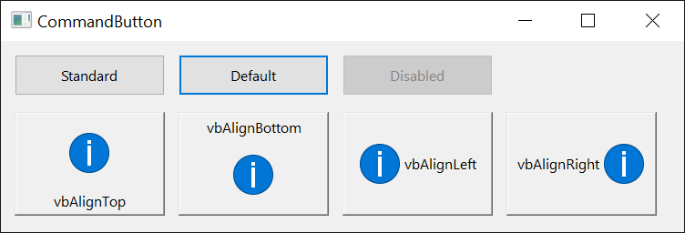

# ButtonConstants
{: .no_toc }

Style values for command buttons that support an optional graphical (image-based) appearance.

| Constant | Value | Description |
|----------|-------|-------------|
| **vbButtonStandard**{: #vbButtonStandard } | 0 | The button is drawn as a standard system push-button. |
| **vbButtonGraphical**{: #vbButtonGraphical } | 1 | The button is drawn as a graphical button able to display a picture. Available only when the **FEATURE_GRAPHICAL_BUTTONS** feature is enabled. |

{:width="501" height="171"}
