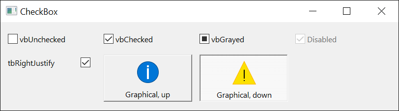

# CheckBoxConstants
{: .no_toc }

State values for the **Value** property of a check-box control.

| Constant | Value | Description |
|----------|-------|-------------|
| **vbUnchecked**{: #vbUnchecked } | 0 | The check box is cleared. |
| **vbChecked**{: #vbChecked } | 1 | The check box is selected. |
| **vbGrayed**{: #vbGrayed } | 2 | The check box is shown in an indeterminate (gray) state. |

{:width="541" height="151"}
