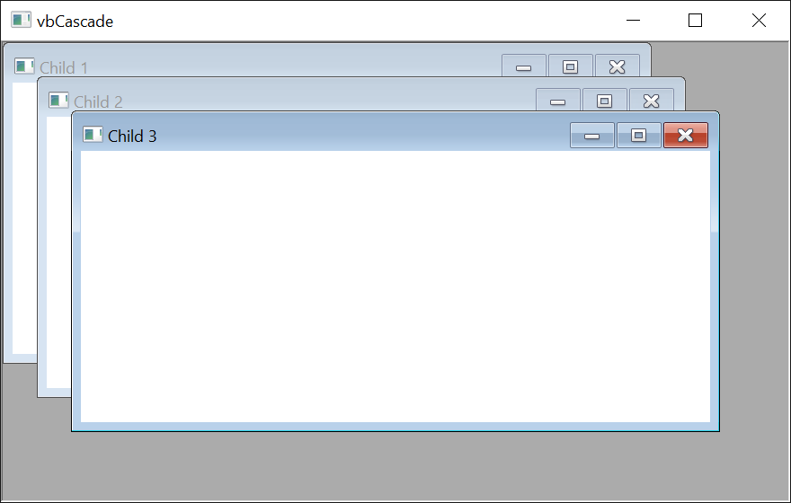
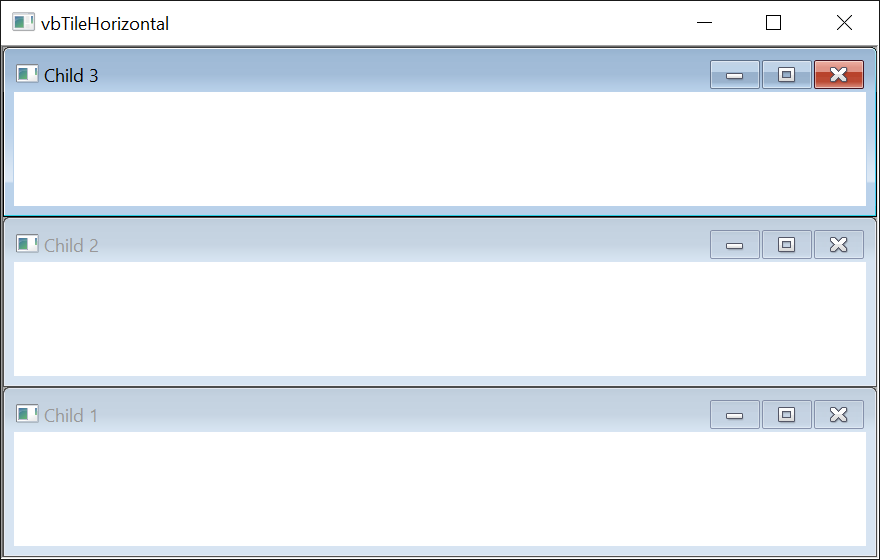
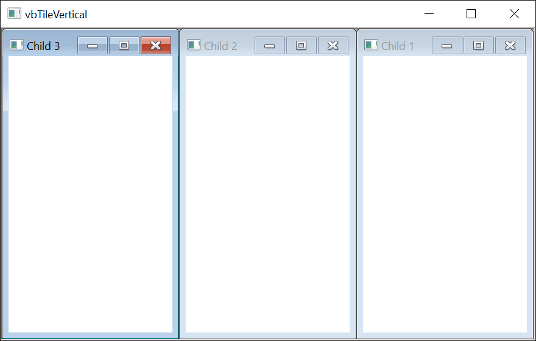

# FormArrangeConstants
{: .no_toc }

Arrangement modes for the **Arrange** method of an MDI parent form, controlling how its child windows are laid out.

| Constant | Value | Description |
|----------|-------|-------------|
| **vbCascade**{: #vbCascade } | 0 | Cascade the open child windows. |
| **vbTileHorizontal**{: #vbTileHorizontal } | 1 | Tile the child windows horizontally. |
| **vbTileVertical**{: #vbTileVertical } | 2 | Tile the child windows vertically. |
| **vbArrangeIcons**{: #vbArrangeIcons } | 3 | Arrange the icons of the minimised child windows along the bottom of the MDI parent. |

{:width="587" height="373"}

{:width="587" height="373"}

{:width="587" height="373"}
